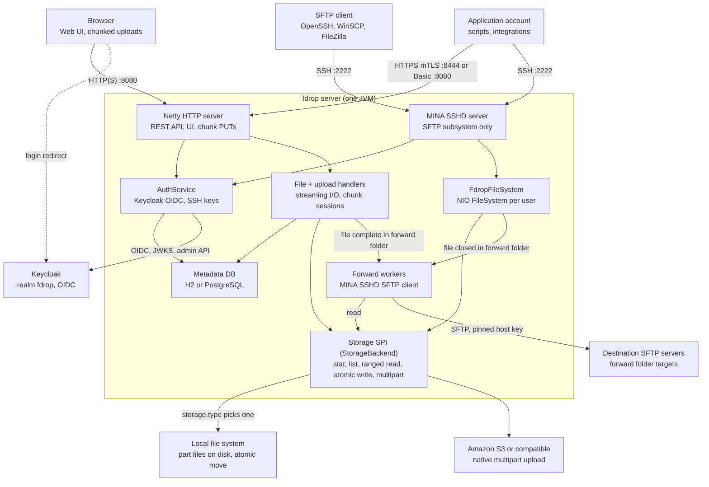
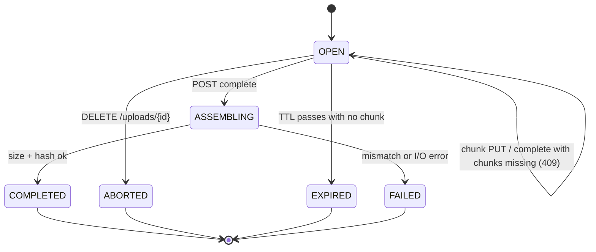
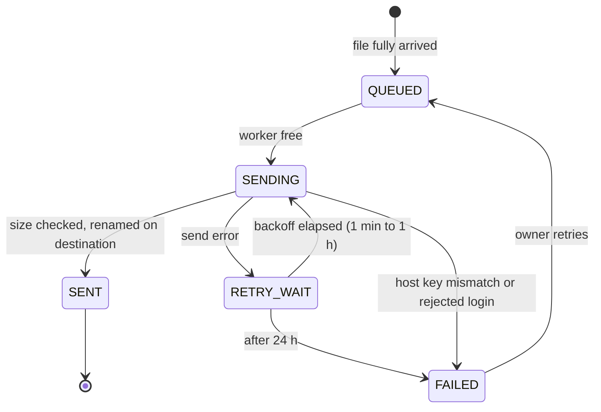

# fdrop — Technical Specification

Oct 22, 2026 · Living version: [fdrop — Technical Specification](https://claude.ai/artifact/Ghh6hqGnPMZmV8RmGQX1aN)

## Overview

fdrop is a single JVM service that lets users upload and download files through a browser (HTTP) or an SFTP client, with every file stored in a pluggable backend: the local file system or Amazon S3 (and S3-compatible stores). Browser uploads are split into chunks so a dropped connection resumes from the last acknowledged chunk instead of restarting. Users keep private files, collaborate in shared folders, and drop files into forward folders that fdrop relays to another SFTP server; admins create and delete users, create application accounts that let other systems exchange files over mTLS or a password (with `fdrop`, a Java command line client, for unattended uploads), and define the forwarding destinations each user may use.

### Goals

- One storage abstraction (the Storage SPI) shared by HTTP and SFTP, so a file uploaded one way is downloadable the other.
- Two backends at launch: `local` and `s3`, selected by configuration, no code change.
- Browser uploads of multi-GB files that survive network drops, tab reloads and server restarts.
- SFTP access via Apache MINA SSHD; HTTP via Netty, with streaming I/O and bounded memory regardless of file size.
- Per-user isolation: each user sees only their own files plus the shared and forward folders they belong to.

### Non-goals (v1)

- File versioning, sync clients, or desktop apps.
- Public anonymous upload links (candidate for v2).
- FTP/FTPS, WebDAV, or SCP (MINA supports SCP; left disabled in v1).
- Server-side encryption beyond what the backend provides (S3 SSE is passed through).
- Clustering with shared in-memory state; multiple nodes are supported only via shared storage and a shared metadata DB.

## Architecture

fdrop runs as one process with two protocol front ends, Netty for HTTP and Apache MINA SSHD for SFTP, sitting on shared services: AuthService, the metadata DB and the Storage SPI. Neither front end touches disk or S3 directly.



Browser uploads go through the upload handlers, which track chunk sessions in the metadata DB; SFTP goes through a per-user NIO file system. Both end at the same `StorageBackend`, so files are interchangeable between protocols. Forward workers pick up jobs queued in the metadata DB, read the file through the Storage SPI and send it to the folder's destination SFTP server. The browser signs in at Keycloak (dashed arrow), and AuthService talks to Keycloak for tokens, SFTP passwords and admin user management.

- **Threading:** Netty event loops and MINA NIO threads only parse protocol frames. All storage calls run on a virtual-thread executor, and results are handed back to the channel, so a slow S3 call never blocks a network thread.
- **Backpressure:** HTTP uploads pause `autoRead` while a write is pending; SFTP relies on MINA's window size (default 2 MiB) so a client cannot outrun the backend.
- **Lifecycle:** `fdrop-server` main loads config, runs DB migrations, initialises the chosen backend, starts HTTP and SFTP, and on SIGTERM stops accepting connections, waits up to 30 s for in-flight transfers, then closes.

## Storage backend SPI

All file bytes go through one Java interface, `StorageBackend`, discovered via `java.util.ServiceLoader` and selected by `storage.type` in config. Paths are logical keys (`users/<sub>/docs/report.pdf`), never OS paths; backends map them to their own layout.

```java
public interface StorageBackend extends AutoCloseable {
    String type();                                   // "local", "s3"
    void init(Config cfg);

    // Objects
    Optional<ObjectInfo> stat(StoragePath path);
    Stream<ObjectInfo> list(StoragePath dir, boolean recursive);
    ReadableByteChannel openRead(StoragePath path, long offset, long length);
    WriteHandle openWrite(StoragePath path, WriteOptions opts); // streaming, atomic on commit()
    void delete(StoragePath path);
    void move(StoragePath src, StoragePath dst);           // rename within backend
    void mkdirs(StoragePath dir);                         // no-op for S3 (prefixes)

    // Multipart (used by chunked uploads)
    MultipartUpload beginMultipart(StoragePath target, WriteOptions opts);
}

public interface MultipartUpload {
    String id();
    PartInfo putPart(int partNumber, ReadableByteChannel src, long length, Checksum sha256);
    List<PartInfo> listParts();
    ObjectInfo complete(List<PartInfo> parts);            // concatenates in part order
    void abort();
}
```

`ObjectInfo` carries path, size, last-modified, ETag/content hash, content type and an `isDirectory` flag. `WriteHandle.commit()` makes the object visible atomically; `abort()` discards it. Every method is blocking and is called from a dedicated I/O executor, never from a Netty event loop or an SSHD NIO thread.

### Backend behaviour

| Concern | `local` | `s3` |
| --- | --- | --- |
| Root | `storage.local.root` directory | `storage.s3.bucket` + optional `prefix` |
| Directories | Real directories | Zero-byte `dir/` marker objects plus prefix listing |
| Atomic write | Write to `.fdrop-tmp/<uuid>`, `fsync`, `Files.move(ATOMIC_MOVE)` | Single `PutObject` (< 16 MiB) or S3 multipart upload |
| Ranged read | `FileChannel.position(offset)` | `GetObject` with `Range: bytes=a-b` |
| Multipart parts | Files under `.fdrop-parts/<uploadId>/<n>.part` | Native S3 `UploadPart`; part number = chunk index + 1 |
| Concatenate | Stream parts in order into the target temp file, then atomic move | `CompleteMultipartUpload` (server-side, no bytes through fdrop) |
| Move/rename | `Files.move` | `CopyObject` + `DeleteObject` (multipart copy above 5 GiB) |
| Path safety | Normalise, reject `..`, resolve and verify still under root, refuse symlinks | Reject `..`, control chars and keys > 1024 bytes |

S3 uses the AWS SDK for Java v2 async client with the CRT HTTP client, credentials from the default provider chain, and optional `endpointOverride` + path-style access for MinIO, Ceph and other S3-compatible stores.

S3 requires every part except the last to be at least 5 MiB, so the chunk size floor is 5 MiB for all backends. The local backend has no such limit but uses the same chunk size so the client protocol is identical.

## HTTP API and browser UI

The HTTP side is a Netty 4.2 server on `http.port` (default 8080; 8443 with TLS) serving a JSON REST API under `/api/v1` and a static single-page UI at `/`. Request bodies are never aggregated: upload handlers consume `HttpContent` frames and write them straight to the storage `WriteHandle` with backpressure (auto-read off while a write is in flight).

### Pipeline

1. `SslHandler` (optional; ALPN for HTTP/2 later). The application mTLS listener on `http.mtls.port` always has one, with client authentication required
2. `HttpServerCodec` with max header size 16 KiB
3. `HttpServerKeepAliveHandler`
4. `IdleStateHandler` (read idle 60 s)
5. `AuthHandler` (session cookie, bearer token, or for application accounts a client certificate or HTTP Basic; rejects before the body is read)
6. `Router` → handler per route; upload and download handlers are streaming, all other routes use a `HttpObjectAggregator` limited to 1 MiB
7. `ChunkedWriteHandler` for downloads

### Endpoints

| Method | Path | Purpose |
| --- | --- | --- |
| GET | `/auth/login` | Redirect to Keycloak (authorization code + PKCE); `?action=configure-totp`, `register-security-key` or `recovery-codes` starts that Keycloak action and returns to the Account page |
| GET | `/auth/callback` | OIDC redirect target; creates the session cookie |
| POST | `/auth/logout` | End session and redirect to Keycloak end-session endpoint |
| POST | `/auth/backchannel-logout` | Keycloak back-channel logout (logout token) |
| GET | `/api/v1/me` | Current user: username, roles, quota, usage, two-factor status |
| DELETE | `/api/v1/me/two-factor/{credentialId}` | Remove one of the user's own second factors (needs a two-factor session; the last required factor cannot be removed) |
| GET/POST/DELETE | `/api/v1/me/ssh-keys` | Manage the user's SFTP public keys |
| GET | `/api/v1/me/uploads?wentTo=&q=&from=&to=&sort=&cursor=` | The My uploads list: the user's own upload records, filtered, sorted and paged, with count and total size for the filter |
| GET | `/api/v1/files?path=/home/docs` | List a directory in the virtual tree (name, size, mtime, type) |
| GET | `/api/v1/files/content?path=…` | Download; supports `Range`, `If-None-Match`, `Content-Disposition: attachment` |
| PUT | `/api/v1/files/content?path=…` | Simple single-request upload for files ≤ `http.simpleUploadMax` (default 64 MiB) |
| POST | `/api/v1/files/mkdir` | Create an ordinary sub-folder in `/home` or a shared folder |
| POST | `/api/v1/files/move` | Rename or move |
| DELETE | `/api/v1/files?path=…` | Delete file or empty directory |
| POST | `/api/v1/uploads` | Start a resumable upload |
| GET | `/api/v1/uploads/{id}` | Upload status and received chunks |
| PUT | `/api/v1/uploads/{id}/chunks/{index}` | Upload one chunk |
| POST | `/api/v1/uploads/{id}/complete` | Assemble chunks into the final file |
| DELETE | `/api/v1/uploads/{id}` | Abort and discard |
| GET | `/api/v1/folders` | Shared and forward folders the user owns or belongs to |
| POST | `/api/v1/folders` | Create a shared folder, or a forward folder with a `destinationId` from the user's assigned list |
| GET/PATCH/DELETE | `/api/v1/folders/{id}` | Read, rename, switch destination, change keep days, delete (owner) |
| PUT/DELETE | `/api/v1/folders/{id}/members/{username}` | Add or change a member's permission, remove a member (owner; a member may remove themselves) |
| POST | `/api/v1/folders/{id}/owner` | Transfer ownership to a member |
| GET | `/api/v1/folders/{id}/forward-jobs` | Forward job status for the folder |
| POST | `/api/v1/folders/{id}/forward-jobs/{jobId}/retry` | Retry a failed job (owner) |
| GET | `/api/v1/forward-destinations` | The caller's assigned, enabled destinations (id, name, description) for the drop-down |
| GET | `/api/v1/users?search=` | Find standard users and application accounts to add as members (username, display name and `kind` only) |
| GET/POST | `/api/v1/admin/users` | List or create users (admin) |
| DELETE | `/api/v1/admin/users/{id}` | Delete a user (admin) |
| POST | `/api/v1/admin/users/{id}/two-factor/reset` | Delete a user's second factors and end their sessions (admin) |
| GET/POST | `/api/v1/admin/app-accounts` | List or create application accounts (admin) |
| GET/PATCH/DELETE | `/api/v1/admin/app-accounts/{id}` | Read, change description, responsible person, allowed methods and source addresses, enable/disable, delete (admin) |
| POST | `/api/v1/admin/app-accounts/{id}/password` | Generate a new password, returned once (admin) |
| POST/DELETE | `/api/v1/admin/app-accounts/{id}/certificates[/{certId}]` | Add a pinned or by-subject client certificate, or retire one (admin) |
| POST/DELETE | `/api/v1/admin/app-accounts/{id}/ssh-keys[/{keyId}]` | Add or remove an SSH public key or user certificate (admin) |
| GET/POST | `/api/v1/admin/forward-destinations` | List or create destinations (admin) |
| GET/PATCH/DELETE | `/api/v1/admin/forward-destinations/{id}` | Read, change, enable/disable, delete when unused (admin) |
| POST | `/api/v1/admin/forward-destinations/{id}/test` | Connect with mutual authentication and report the host key or certificate seen and whether login succeeded (admin) |
| POST | `/api/v1/admin/forward-destinations/{id}/keys` | Generate a new client key, or upload a user certificate for one; activate and retire keys (admin) |
| PUT/DELETE | `/api/v1/admin/forward-destinations/{id}/assignments/{username}` | Assign a destination to a user or remove the assignment (admin) |
| GET | `/healthz`, `/readyz`, `/metrics` | Not on this port: served on the management port (8081); see Observability |

Errors use RFC 9457 problem JSON (`type`, `title`, `status`, `detail`). Downloads use `DefaultFileRegion` (zero-copy) for the local backend without TLS, and `ChunkedNioStream` over the backend channel otherwise; `Range` requests return 206 with one range (multi-range returns 200 with the full body).

### Browser UI

- Built with React 19 and TypeScript; no hand-written DOM JavaScript or other UI framework. Function components and hooks only.
- Built with npm: `package.json` and a committed `package-lock.json` in `fdrop-web`; `npm ci` installs, `npm run build` produces the bundle with Vite, `npm test` runs Vitest. The output is bundled into the jar as static resources; no server-side rendering.
- Libraries: React Router for navigation, TanStack Query for API calls and caching; no global state library unless a need appears.
- File browser: breadcrumb, list view, a drop zone for drag-and-drop upload (below), a file picker button, download, rename, delete, new folder.
- Upload queue panel showing each file's percentage, bytes sent, speed and time remaining, with pause/resume/cancel and a retry state when offline (below).
- Uploads run in a Web Worker using `Blob.slice()` and `XMLHttpRequest` (which, unlike `fetch`, reports upload progress events), up to 3 chunks in parallel per file; React components subscribe to worker progress through a small hook (`useUploadQueue`).
- In-progress uploads are recorded in IndexedDB (upload id, file name, size, `lastModified`, chunk size) so a reload offers to resume once the user re-selects the same file.
- CSRF: all state-changing requests send an `X-Fdrop-CSRF` header matching a token from the session.
- Local UI development: `npm run dev` starts the Vite dev server on https://localhost:5173 (with the dev certificate) and proxies `/api` and `/auth` to the fdrop server on https://localhost:8443.

### Drag-and-drop drop zone

- Every writable folder view (`/home` and its sub-folders, shared folders with write access, forward folders) shows a drop zone: a dashed area above the file list, with the fdrop logo mark as a faint background, reading "Drop files here or choose files", which also works as a button that opens the file picker.
- While files are dragged over the window, the whole file list becomes the drop target, highlighted, and names the folder the files will land in ("Drop to upload to /shared/Invoices"). Dropping on a sub-folder row uploads into that sub-folder.
- Dropping a folder uploads its contents with their sub-folder structure (via `DataTransferItem.webkitGetAsEntry()`), creating the sub-folders first. Forward folders accept files only; a dropped folder there is refused with a message.
- Many files can be dropped at once; each becomes its own entry in the upload queue. Files over `limits.maxFileSize` or beyond the user's remaining quota are rejected at drop time with the reason shown, before any bytes are sent.
- Where dropping is not allowed (`/`, `/shared`, `/forward`, read-only shared folders) the cursor shows not-allowed and nothing is uploaded.
- Drops outside the drop target never make the browser open the file in place.
- Keyboard and screen-reader users reach the same function through the drop zone's button; touch devices without drag show it as "Tap to choose files".

### Upload progress as a percentage

- Each queued file shows a progress bar with a whole-number percentage ("42%"), its bytes sent of its total ("1.7 GB of 4.0 GB"), current speed and estimated time remaining. The queue header shows the overall percentage across all active uploads, by bytes.
- Percentage = (bytes in chunks the server has acknowledged + bytes sent so far in chunks still in flight) ÷ file size, from the worker's `XMLHttpRequest` `upload.onprogress` events, updated at most 4 times a second.
- The percentage never goes down: if a chunk fails and is resent, the shown value holds until the resend catches up.
- It stops at 99% while the server assembles the file, shown as "Finishing…", and turns to 100% and "Done" only when `complete` succeeds. In a forward folder the row then shows the forward status (queued, sending, sent, failed).
- After a reload or a dropped connection, the bar resumes from the server's count of received chunks, not from 0%.
- Paused, offline and failed uploads keep their percentage and show the state beside it.
- Accessibility: the bar is a `progressbar` with `aria-valuenow` set to the percentage, and a polite live region announces each file every 25% and on completion.
- Files uploaded over SFTP do not appear in the browser queue; their progress is shown by the SFTP client.

### My uploads page

Every user has a **My uploads** page, reached from the main navigation, listing every file they have uploaded: its name, its size, and whether it went to a normal folder or a forward folder. It covers uploads over both the browser and SFTP, and keeps a row after the file has been forwarded, moved or deleted.

| Column | Shows |
| --- | --- |
| File | File name; a link to its folder while the file still exists and the user can still reach it |
| Size | Size at upload, in KB, MB or GB (exact bytes on hover) |
| Went to | **Folder** badge with the folder (`Home`, `Home / reports`, `Shared: Invoices`), or **Forward** badge with the forward folder and destination name (`Forward: Partner A`) |
| Uploaded | Date and time the upload completed, in the user's time zone |
| Via | Browser or SFTP |
| From IP | IP address of the machine that uploaded the file (IPv4, or IPv6 in compressed form). If a resumable upload was started from one address and finished from another, the finishing address is shown with "started from 203.0.113.7" beneath it |
| Status | Folder uploads: Stored, Moved or Deleted. Forward uploads: Queued, Sending, Sent, Failed or Paused, the same states as the forward job |

- Newest first by default; sortable by date, size and name.
- Filters: Went to (All, Folders, Forward), date range, and a search box that matches file names or an IP address (exact, or a prefix such as `10.20.`).
- Above the table: number of files and total size for the current filter ("1,284 files, 37.2 GB").
- 50 rows per page with "Load more", using a cursor so new uploads don't shift the pages.
- Row actions: download, while the file still exists and the user still has access; open the folder; and for a failed forward the folder owner sees Retry.
- On phones the table becomes cards showing name, size, the Folder or Forward badge, date and status; tapping a card shows the IP address and protocol. Filters move into a sheet.
- Badges follow the visual design: Folder in navy outline, Forward in deep navy fill with white text, Sent and Stored on mint.
- Only the user's own uploads appear. Admins see their own uploads here too, not other users'.
- Leaving a shared folder or losing a destination assignment keeps the rows but removes the links and download action.
- **Which IP is recorded.** For browser uploads, the address of the HTTP client. When fdrop sits behind a reverse proxy or load balancer, the client address is taken from the `Forwarded` or `X-Forwarded-For` header, but only when the connection comes from an address in `http.trustedProxies`; the rightmost address not in that list is used, so a client cannot fake its address by sending the header itself. For SFTP, the address of the SSH connection; behind a TCP load balancer, fdrop accepts the HAProxy PROXY protocol (v1 and v2) from `trustedProxies` when `sftp.proxyProtocol` is on. A resumable upload records the address that created the session and the address that completed it.
- **Privacy.** IP addresses are personal data. Users see only the addresses on their own uploads; the address is kept no longer than the row (`upload.historyRetention`), is deleted with a deleted user's rows, and never appears in metrics labels.
- Rows older than `upload.historyRetention` (default 365 days) are deleted by the nightly janitor. A deleted user's rows are deleted with them.

**Data.** When an upload completes (resumable `complete`, simple `PUT`, or an SFTP write handle closed), fdrop writes one `upload_record` row, including the client IP addresses. Moves, renames and deletes update its current path and status, and forward jobs link to it so its status follows the job. The page reads only from this table, so it stays fast regardless of storage backend.

### Responsive web app

The UI is one responsive web app that works on phones, tablets and desktops from the same code and URL; there is no separate mobile site or native app.

| Width | Layout |
| --- | --- |
| Under 640 px (phone) | Single column; navigation in a menu button; files as list rows (name, size, date) with actions in an overflow menu; upload queue as a bottom sheet |
| 640–1024 px (tablet) | Navigation as a collapsible drawer; files as a compact table; dialogs as side panels |
| Over 1024 px (desktop) | Fixed sidebar (Home, Shared, Forward, My uploads, Admin); full file table with sortable columns; upload queue as a docked panel |

- Mobile-first CSS with breakpoints at 640 px and 1024 px, and container queries for components such as the file table and upload queue; usable down to 320 px wide with no horizontal page scrolling.
- Styling with CSS Modules and CSS custom properties for theme tokens (light and dark follow the system setting; see Visual design); Radix UI primitives for accessible menus, dialogs and drop-downs, including the forward destination drop-down.
- Touch: tap targets at least 44 × 44 px; the drop zone accepts drag-and-drop wherever the device supports it (desktop, and tablets with drag such as iPad), and is always also a button that opens the file picker, including the phone's photo library and camera. On phones the upload percentage stays visible in the collapsed bottom sheet.
- Admin screens (users, forward destinations, assignments) work on tablets and phones too; long forms become a single column.
- Mobile browsers suspend background tabs, so an upload pauses when the user switches away and resumes through the resumable upload protocol when they come back; the queue shows this as paused, not failed.
- Accessibility target: WCAG 2.2 AA, full keyboard use, and correct behaviour at 200% browser zoom.

### Visual design

The UI uses the same fonts, colours and component styles as [lme.com](https://www.lme.com/): Nunito Sans, LME navy text, deep navy bars and buttons, coral accents and pill-shaped buttons. Values were read from lme.com's live styles on 2026-10-22. fdrop keeps its own name and wordmark; showing the LME logo or name needs approval from LME's brand owners.

All values live as CSS custom properties in `fdrop-web/src/theme/tokens.css`; components never hard-code colours or sizes.

**Logo**


- The fdrop logo is a large capital F inside a circle: a deep navy disc, a thin coral ring, and a white geometric F drawn as a path, so it needs no font and renders the same everywhere.
- Two files live in `fdrop-web/src/assets/logo/`: `fdrop-logo.svg` (full colour) and `fdrop-mark-mono.svg` (the ring and F in one colour, for watermarks).
- Uses: the top bar (32 px, beside the name "fdrop"), the favicon (the SVG plus a 32 px PNG fallback), and the drop zone background.
- Minimum size 16 px; at that size the coral ring may vanish, which is acceptable. Keep clear space of a quarter of the logo's width around it.
- **Drop zone background:** the mono mark is centred behind the drop zone text, at 70% of the drop zone's height up to 160 px. It is applied as a CSS mask, so its colour comes from the tokens: `--color-ink` at 8% opacity normally, `--color-coral` at 15% while files are dragged over, and white at 8% in the dark theme. It is decorative (`aria-hidden`) and faint enough not to affect text contrast. On phones, where the drop zone is a short "Tap to choose files" bar, the mark shrinks with it.

**Colours**

| Token | Value | Used for |
| --- | --- | --- |
| `--color-ink` | `#13426B` (LME navy) | Body text, headings, icons, progress bar fill, links |
| `--color-navy-deep` | `#171739` | Top bar, primary buttons, dark-theme background |
| `--color-coral` | `#F4364C` | Accents: active navigation underline, keyboard focus ring, drop-zone highlight border, error and destructive icons and borders |
| `--color-mint` | `#B5E3D8` | Success backgrounds such as "Done" and "Sent" badges, always with navy text |
| `--color-surface` | `#FFFFFF` | Page background |
| `--color-surface-alt` | `#F9F9F9` | Panels, alternate table rows, drop zone background |
| `--color-border` | `#C0CDD8` | Input and secondary-button borders, dashed drop-zone border, progress track |
| `--color-divider` | `rgba(19, 66, 107, 0.2)` | Table and list dividers |
| `--color-muted` | `#696969` | Secondary text such as sizes, dates and speeds |
| `--color-link` | `#3860BE` | Inline text links |

**Typography**

| Role | Style |
| --- | --- |
| Font | Nunito Sans (weights 200, 400, 600, 700), self-hosted from the `@fontsource/nunito-sans` npm package (SIL Open Font License), no font CDN, so the `default-src 'self'` CSP holds |
| Body | 16 px / 24 px, regular, navy |
| Small body, table cells, navigation | 14 px / 21–24 px, regular |
| Page title | 40 px / 48 px, regular (32 px on phones) |
| Section label | 12 px / 16 px, bold, uppercase, 1 px letter spacing |
| Buttons | 14 px, semibold (600) |

**Components**

- **Buttons:** pill shape (24 px radius), 12 px × 32 px padding (shortened to 10 px × 20 px on phones). Primary: deep navy fill, white text. Secondary: transparent, 1 px `#C0CDD8` border, navy text. On dark backgrounds, the secondary button uses a white border and white text.
- **Top bar:** deep navy, with the fdrop logo (32 px) and name at the left and white 14 px navigation; the active item has a 2 px coral underline.
- **Inputs, drop-downs, cards, dialogs:** 4 px radius, 1 px `--color-border` border; raised panels and dialogs use LME's soft navy shadow (`0 20px 28px rgba(19, 66, 107, 0.2)`).
- **Keyboard focus:** a 2 px coral outline, shown only when the user is tabbing, as on lme.com.
- **Drop zone:** 2 px dashed `--color-border` on `--color-surface-alt`, with the fdrop mark as a faint centred watermark behind the text (see Logo). While files are dragged over, the border and the watermark turn coral.
- **Progress bars:** navy fill on a `--color-border` track; the percentage in navy, semibold; finished rows get a mint "Done" badge.
- **Errors and destructive actions:** navy text with a coral icon and coral left border or outline. Coral is never used for text or as a fill behind white text: coral on white, and white on coral, measure about 3.8:1, under the 4.5:1 that WCAG AA requires for text.
- **Dark theme:** lme.com has none, so fdrop derives one. Deep navy background, `#13426B` panels, white text, white-outline secondary buttons, and the same coral accents.

## Resumable chunked uploads

A browser upload is a server-side upload session: the client cuts the file into fixed-size chunks, sends each with its own `PUT`, and the server records every acknowledged chunk durably. After a drop, the client asks which chunks the server holds and sends only the missing ones; `complete` then concatenates them in order into the final file.

### Protocol

1. **Create.** `POST /api/v1/uploads` with `{ "path": "/docs/big.iso", "size": 4294967296, "lastModified": 1761130000000, "sha256": "<optional whole-file hash>", "overwrite": false }`. Server checks quota, permissions and that the target does not exist (unless `overwrite`), then returns `201 { "id": "upl_01J…", "chunkSize": 8388608, "chunkCount": 512, "expiresAt": "…" }`. Chunk size is chosen by the server: 8 MiB default, raised so `chunkCount` ≤ 10,000 (S3's part limit), never below 5 MiB.
2. **Upload chunks.** `PUT /api/v1/uploads/{id}/chunks/{index}` with `Content-Length` = chunk length (exactly `chunkSize`, except the last chunk) and `X-Chunk-SHA256`. The server streams the body to `MultipartUpload.putPart`, verifying length and hash as it goes. On success it commits the chunk record and returns `204` with `ETag`. Re-sending an already-stored chunk with the same hash is a no-op `204` (idempotent); a different hash returns `409`.
3. **Resume.** After any network error the client calls `GET /api/v1/uploads/{id}` → `{ "state": "OPEN", "received": [[0, 211], [214, 214]], "bytesReceived": … }` (ranges of chunk indexes) and re-queues the gaps. A chunk interrupted mid-body is discarded by the server and simply sent again.
4. **Complete.** `POST /api/v1/uploads/{id}/complete`. The server verifies every index `0..chunkCount-1` is present, calls `MultipartUpload.complete` (local: stream-concatenate into a temp file then atomic move; S3: `CompleteMultipartUpload`), verifies total size and the optional whole-file SHA-256, writes file metadata, and returns `200` with the `ObjectInfo`. Large local assemblies return `202` and the client polls status until `COMPLETED`.
5. **Abort.** `DELETE /api/v1/uploads/{id}` deletes parts and the session.

### Session states



Only `COMPLETED` writes the target file; every other end state deletes the stored parts, so partial uploads are never visible to downloads or SFTP listings.

### Server-side storage of sessions

- Session and chunk records live in the metadata DB (embedded H2 by default, PostgreSQL for multi-node): `upload_session(id, user_id, target_path, size, chunk_size, chunk_count, sha256, state, backend_upload_id, created_at, updated_at, expires_at)` and `upload_chunk(session_id, idx, size, sha256, etag, received_at)`.
- A chunk row is inserted only after its bytes are durable in the backend (local: `fsync`; S3: `UploadPart` returned), so the DB never claims a chunk that is not stored. A restart loses at most in-flight chunks.
- Chunk data never touches the JVM heap beyond Netty's pooled buffers; the handler pauses `autoRead` while the backend write catches up.
- Two concurrent `PUT`s of the same index: a per-session, per-index lock admits one; the other gets `409` and the client re-checks status.

### Expiry and cleanup

- Sessions expire `upload.ttl` (default 24 h) after their last chunk; any successful chunk extends `expiresAt`.
- A janitor runs every 15 min: marks expired `OPEN` sessions `EXPIRED`, calls `abort()` (deletes local part files or issues `AbortMultipartUpload`), and removes their rows.
- On S3, operators should also set a bucket lifecycle rule `AbortIncompleteMultipartUpload` after 7 days as a backstop.
- Bytes held in open sessions count toward the user's quota so abandoned uploads cannot exhaust disk.

### Client behaviour

- Retry each chunk with exponential backoff (1 s doubling to 60 s, jitter); go to a paused-offline state on `navigator.onLine === false` and resume on the `online` event.
- After a reload, match a re-selected file to its IndexedDB record by name, size and `lastModified`, then resume via status; if the session is gone (`404`), start a new one.
- Hash each chunk with `crypto.subtle.digest('SHA-256')` in the worker; the optional whole-file hash is computed incrementally only when the file is under `upload.clientHashMax` (default 2 GiB) to bound CPU time.

## SFTP server

SFTP runs on Apache MINA SSHD 2.x (`sshd-core` + `sshd-sftp`) on `sftp.port` (default 2222), exposing each user's namespace through a custom NIO `FileSystem` backed by the same `StorageBackend`. Only the SFTP subsystem is enabled: no shell, exec, port forwarding or SCP.

### Server setup

- `SshServer.setUpDefaultServer()` with the NIO2 I/O factory (MINA's default; Netty I/O factory is an option to share the event loop group).
- Host key from `sftp.hostKeyPath` (Ed25519 generated on first start if missing, then persisted so clients don't see key changes).
- `PasswordAuthenticator` and `PublickeyAuthenticator` delegate to the shared `AuthService`; keyboard-interactive disabled.
- Modern algorithms only: `curve25519-sha256`, `chacha20-poly1305`, `aes256-gcm`, `ssh-ed25519`, `rsa-sha2-512`.
- `SftpSubsystemFactory` with an `SftpEventListener` for audit logging, metrics, and queueing a forward job when a file written into a forward folder is closed.
- `FileSystemFactory` returns a per-session `FdropFileSystem` presenting the user's virtual tree (`/home`, `/shared`, `/forward`; see Folders), so nothing outside it is reachable by construction. Membership is re-checked on each operation, so a removed member loses access mid-session.
- Limits: `MAX_CONCURRENT_SESSIONS` per user (default 10), idle timeout 10 min, auth timeout 60 s, max 3 auth attempts.

### FdropFileSystem

A `java.nio.file.spi.FileSystemProvider` + `FileSystem` + `Path` implementation translating NIO calls to the Storage SPI:

| NIO call | Storage SPI |
| --- | --- |
| `readAttributes` | `stat` (synthesised POSIX perms: dirs 0755, files 0644, owner = user) |
| `newDirectoryStream` | `list(dir, false)` |
| `newByteChannel(READ)` | `openRead(path, offset, …)`; seekable via re-open at new offset on S3 |
| `newByteChannel(WRITE, CREATE, TRUNCATE_EXISTING)` | `openWrite`; commit on close |
| `createDirectory` | `mkdirs` |
| `delete` | `delete` |
| `move` | `move` |
| `setAttribute` (mtime, perms) | Accepted and ignored (or stored as metadata for mtime) |

### Writes and resume over SFTP

- Sequential writes stream directly into `openWrite`; S3 uses an internal multipart upload with 8 MiB buffered parts, so memory per open file is bounded at roughly one part.
- Random-offset writes (rare; some clients use them for parallel transfer) fall back to a local spool file under `sftp.spoolDir` and are uploaded on close.
- If the session drops before close, the partial object is discarded (never visible). SFTP resume (`reput` in OpenSSH, resume in WinSCP) opens with `APPEND`: the local backend appends in place; the S3 backend implements append as a server-side `UploadPartCopy` of the existing object followed by new parts.
- Downloads support arbitrary offsets via ranged reads, so client-side resume of downloads works on both backends.

## Folders

Besides their private area, standard users create two kinds of managed folder: **shared folders**, where logged-on members exchange files, and **forward folders**, where every file that lands is relayed by fdrop to another SFTP server. Both are created in the web UI or API, never by `mkdir` over SFTP, because they carry settings.

### What a user sees

The same virtual tree appears in the browser and as the SFTP root:

| Path | Contents | Who sees it |
| --- | --- | --- |
| `/home/…` | Private files and ordinary sub-folders | The user only |
| `/shared/<name>/…` | A shared folder's files and sub-folders | Owner and members |
| `/forward/<name>/` | Files waiting for or recently forwarded | Owner and members |

- `/`, `/shared` and `/forward` are read-only listings; creating files or folders directly in them is refused.
- Folder names are unique across fdrop (case-insensitive, 1–100 characters, no `/`), so every member sees the same path.
- In storage, homes live at `users/<sub>/` and managed folders at `folders/<folderId>/`; renaming a folder changes only its metadata row, never the stored keys.
- Authorisation is checked on every request against this tree: own `/home`, plus the folders where the user is owner or member. Nothing else is reachable, admins included.

### Shared folders

- Shared folders are members-only (decided): users who are not the owner or a member cannot see, list or open them. The creator becomes the **owner** and adds members by username (`GET /api/v1/users?search=` lists matching users with the standard role and application accounts). Application accounts are members on the same terms as people; see Application accounts.
- Each member is **read-write** (upload, create sub-folders, rename, delete) or **read-only** (list and download).
- The owner can rename the folder, change members, transfer ownership to a member, and delete the folder with its contents.
- A member can leave a folder; the owner cannot leave without transferring ownership first.
- Removing a member takes effect on their next request, including open SFTP sessions.
- Uploads into a shared folder count against the **owner's** quota.

### Forward folders

A forward folder pairs a drop location in fdrop with one destination SFTP server. When a file finishes arriving — a resumable upload reaches `COMPLETED`, a simple `PUT` completes, or an SFTP write handle is closed — fdrop queues a forward job for it.

Users never type a host, path or credential. **Admins define forward destinations** (a server plus a directory) in the admin UI and **assign** each one to users; a user creating a forward folder picks one of their assigned destinations from a drop-down.

**Forward destinations** (admin only):

| Setting | Notes |
| --- | --- |
| Name, description | What users see in the drop-down, e.g. "Partner A – inbound invoices" |
| Host, port | Must also match `forward.allowedHosts`, a server-wide guard against probing internal hosts |
| Remote directory | Fixed per destination; created on first send if missing. Two directories on one server are two destinations |
| Username | The account fdrop logs in as on the destination |
| Server authentication | Pinned host key (SHA-256 fingerprint confirmed from a test connection), or a trusted host CA public key, so any host certificate that CA signs for this hostname is accepted |
| Client authentication | fdrop's own key pair for this destination (Ed25519 by default, generated by fdrop, public key shown for installation on the destination), optionally with an SSH user certificate the destination's CA has signed for it. Passwords are not supported |
| Overwrite existing files | Off by default; when off, a name clash fails the job with a conflict |
| Enabled | Disabling pauses every job to this destination without deleting anything |
| Assigned users | The users who see this destination in their drop-down |

### Mutual authentication

Every forward connection is authenticated in both directions, the SSH equivalent of mutual TLS:

- **fdrop checks the server:** the presented host key must match the pinned fingerprint, or be a valid OpenSSH host certificate signed by the configured CA, unexpired and issued for this hostname. Anything else fails the job immediately, without retry, and never re-pins silently.
- **The server checks fdrop:** fdrop authenticates with the destination's private key (plus its user certificate when one is set). Password and keyboard-interactive authentication are disabled on forward connections.
- MINA SSHD supports OpenSSH certificates on both sides, so no extra library is needed.
- Rotating a client key: the admin generates a new key while the old one stays active, installs the new public key on the destination, runs a test connection, then retires the old key.

### Assignments and the drop-down

- `GET /api/v1/forward-destinations` returns only the enabled destinations assigned to the caller, with name and description; hosts, directories and keys are never shown to standard users.
- A user with no assigned destinations sees the forward folder option disabled, with a hint to ask an admin.
- A forward folder records the chosen destination. The owner can switch it to another of their assigned destinations; pending jobs keep their original destination.
- Ownership of a forward folder can only be transferred to a member who is also assigned its destination. Application accounts can be members of forward folders but never owners, and are never assigned destinations.
- If an admin removes an assignment, that user's forward folders using the destination stop accepting uploads and their queued jobs pause, until the destination is reassigned or the owner switches to another one.
- A destination used by any forward folder cannot be deleted, only disabled; the admin UI lists the folders using it.

### Per-folder settings

The forward folder's owner chooses:

| Setting | Notes |
| --- | --- |
| Destination | Drop-down of destinations assigned to the owner |
| After sending | Delete from fdrop (default) or keep for N days (default 7) |

### Sending

- A forward worker pool (default 4 threads, `forward.workers`) uses the MINA SSHD SFTP client, streaming from `StorageBackend.openRead` without a local copy.
- Each file is written as `.<name>.fdrop-part` on the destination, its size checked, then renamed to `<name>`, so the receiver never sees a partial file. An existing destination file is overwritten only if the destination allows it (off by default; otherwise the job fails with a conflict).
- Jobs run in arrival order per folder, up to 2 at a time per destination.
- Failures retry with backoff (1 min doubling to 1 h) for up to 24 h, then the job is `FAILED` and the owner sees it in the UI with the error; a manual retry puts it back in the queue.
- Members can upload and see each file's forward status; only the owner can change settings or retry.
- Forwarding is recorded in the audit log (file, size, destination, outcome) and in metrics (jobs by state, bytes forwarded, send latency).



A job only reaches `SENT` after the destination holds the complete file under its final name; until then the file stays in fdrop.

### Forwarding security

- Destination private keys are encrypted at rest with AES-256-GCM using a key from `forward.encryptionKey` (env var or secret file). The API returns only the public key and certificate details, never the private key.
- Only admins can create or change destinations, so standard users cannot point fdrop at arbitrary hosts. `forward.allowedHosts` is a second, server-wide limit that also binds admins; an empty list disables forwarding.
- Every destination change, assignment change and key rotation is written to the audit log with the acting admin.

### Metadata

- `folder(id, type SHARED|FORWARD, name, owner_sub, created_at)`
- `folder_member(folder_id, user_sub, permission READ|WRITE)`
- `folder_forward(folder_id, destination_id, keep_days)`
- `forward_destination(id, name, description, host, port, remote_dir, username, server_auth HOST_KEY|HOST_CA, host_key_sha256, host_ca_pubkey, overwrite, enabled, created_by, updated_at)`
- `forward_client_key(id, destination_id, public_key, private_key_enc, user_cert, state ACTIVE|PENDING|RETIRED, created_at)`
- `destination_assignment(destination_id, user_sub)`
- `forward_job(id, folder_id, destination_id, upload_record_id, path, size, state, attempts, last_error, next_attempt_at, created_at, sent_at)`
- `upload_record(id, user_sub, file_name, size, went_to HOME|SHARED|FORWARD, folder_id, path_at_upload, current_path, status STORED|MOVED|DELETED|FORWARDED, via HTTP|SFTP, client_ip, start_ip, completed_at)`, indexed on `(user_sub, completed_at)` and `(user_sub, client_ip)`

## Authentication and authorisation

One `AuthService` serves both protocols and delegates identity to Keycloak over OpenID Connect, so a user has the same identity, roles, home and quota over HTTP and SFTP. fdrop stores no passwords.

- **Identity provider:** a Keycloak 26 realm named `fdrop`. Users, passwords, password policy, brute-force detection, second factors and any federation (LDAP, social login) are configured in Keycloak, not in fdrop. fdrop decides who must use two-factor authentication and checks that they did (see Two-factor authentication).
- **Roles:** three realm roles, `fdrop-user` (standard), `fdrop-admin` (admin) and `fdrop-app` (application account), read from the token's `realm_access.roles`. `fdrop-app` is granted through the `fdrop-applications` group rather than assigned directly. What each allows is defined in Users and roles and Application accounts below.
- **User id:** the token's `sub` is the stable user id; `preferred_username` is for display and for picking folder members. On first login fdrop creates a `user` row (sub, username, quota) in the metadata DB for quota, SSH keys and folder membership.
- **Library:** Nimbus OAuth 2.0 SDK with OpenID Connect plus `nimbus-jose-jwt`. No Keycloak-specific adapter (those are deprecated), so fdrop stays a plain OIDC client.

### Production Keycloak

Production uses an existing Keycloak server; fdrop does not ship, deploy or operate Keycloak. The bundled Keycloak exists only in the dev container, tests and the local demo compose file.

- The Keycloak administrators create the `fdrop-web`, `fdrop-sftp` and `fdrop-api` clients, the `fdrop-user`, `fdrop-admin` and `fdrop-app` roles, and the `fdrop-applications` group with `fdrop-app` as its role mapping, in a realm of their choice. The dev `fdrop-realm.json` serves as the reference for client settings, minus its users and secrets.
- Admin user management needs the `fdrop-sftp` service account to hold `manage-users` and `query-groups` in that realm (the latter to find `fdrop-applications` and add application accounts to it). Where users come from a read-only source (LDAP federation, another team's policy), set `auth.userManagement.enabled: false`; the admin screens then show users read-only and creation and deletion happen in Keycloak.
- Realm and role names are not hard-coded: fdrop reads the issuer URL, client ids and role names from config (`auth.oidc.*`), so it can join an existing realm whose roles are named differently.
- For two-factor authentication the realm needs: a browser flow with level of authentication 2 (OTP form and WebAuthn as alternatives), the `fdrop-web` ACR mapping `2fa` → 2, Keycloak's conditional OTP step in the direct grant flow used by `fdrop-sftp` (the built-in `direct grant` flow has it), and an OTP policy of TOTP, 6 digits, 30 s. Recovery authentication codes are optional. The dev realm is the reference.
- Client secrets come from environment variables or a mounted secret file, never from `fdrop.yaml` in the image.
- Production redirect and back-channel logout URLs use the public fdrop hostname over HTTPS, and the issuer must be the Keycloak URL as browsers see it.
- fdrop needs outbound HTTPS to Keycloak for discovery, JWKS, token exchange, password grants (SFTP) and the Admin REST API; `/readyz` reports Keycloak unreachable as degraded, not down, so logged-in sessions keep working.

### Keycloak clients

| Client | Type | Used for |
| --- | --- | --- |
| `fdrop-web` | Confidential, standard flow (authorization code + PKCE S256) | Browser login through the fdrop server |
| `fdrop-sftp` | Confidential, direct access grants + service account (`view-users`, `manage-users`, `query-users`, `query-groups`) | Checking SFTP and application passwords and user status; creating and deleting users and application accounts for admins |
| `fdrop-api` | Audience only (no login); scripts use their own client-credentials clients with an `fdrop-api` audience mapper | Scripts and automation |

### Browser login (backend-for-frontend)

1. The React app calls `GET /api/v1/me`; a `401` makes it navigate to `GET /auth/login`.
2. fdrop redirects to Keycloak's authorize endpoint with `state`, `nonce` and a PKCE challenge.
3. Keycloak redirects back to `/auth/callback`. fdrop exchanges the code with its client secret, validates the ID token, stores the access and refresh tokens in a server-side session, and sets an opaque session cookie (`HttpOnly`, `Secure`, `SameSite=Lax` so the redirect back carries it).
4. Tokens never reach the browser. fdrop refreshes the access token before expiry; a failed refresh ends the session.
5. `POST /auth/logout` clears the session and redirects to Keycloak's end-session endpoint. Keycloak calls `POST /auth/backchannel-logout` to end fdrop sessions when a user is logged out or disabled centrally.

### API access

Scripts send `Authorization: Bearer <JWT>`. fdrop validates the signature against the realm's JWKS (cached, refetched on an unknown `kid`), plus `iss`, `exp`, and that `aud` contains `fdrop-api`. No introspection call per request.

### SFTP

- **Password:** MINA's `PasswordAuthenticator` performs a password grant against `fdrop-sftp`; a token holding `fdrop-user`, or `fdrop-app` for an application account allowed to use a password, means success. Results are not cached, so Keycloak's brute-force lockout applies. Users who need two factors log in with `keyboard-interactive` (password and code) or with keys; see Two-factor authentication.
- **Public key:** keys are stored in fdrop's metadata DB, not in Keycloak (decided for v1), keyed by `sub` and managed in the web UI after login. On key login fdrop checks via the Keycloak Admin REST API (the `fdrop-sftp` service account) that the user is still enabled and holds `fdrop-user` (or `fdrop-app` for an application account); the answer is cached for 5 min. Application accounts' keys are managed by admins, since they have no web UI.

### Two-factor authentication

Keycloak asks for and checks the second factor; fdrop decides who must have one and refuses any session where Keycloak does not confirm it. fdrop never sees or stores a factor's secret.

- **Factors.** Time-based one-time codes from an authenticator app (TOTP, RFC 6238: 6 digits, 30 s period, SHA-1 so every common app works), and WebAuthn security keys or passkeys. When the realm enables Keycloak's recovery authentication codes, a user can print a set of one-use codes for a lost device. SMS and email codes are not supported.
- **Who needs it.** `auth.twoFactor.require` is `none`, `admins` (the default) or `all`. With `admins`, every holder of `fdrop-admin` must sign in with two factors, and standard users may turn it on for themselves from the Account page. With `all`, every user must. A user who has set up a factor is always asked for it, whatever the policy. Application accounts are never covered and never asked for a second factor, whatever the policy; see Application accounts.
- **How fdrop knows.** The realm's browser flow uses Keycloak's levels of authentication: level 1 is the password, level 2 is the password plus a code or security key. The `fdrop-web` client maps the ACR value `2fa` (`auth.twoFactor.acr`) to level 2, so Keycloak puts `acr: "2fa"` in the ID token only when a second factor was used.
- **Step-up at login.** After the callback fdrop works out whether this user needs two factors: the policy and the user's roles, or a factor the user has set up (read through the Admin REST API and cached with the user's status for 5 min). If they do and the ID token's `acr` is not `2fa`, fdrop sends the browser straight back to Keycloak with `acr_values=2fa`. Keycloak's SSO session means only the second factor is asked for. A user who must have two factors but has none set up is first sent to Keycloak's `CONFIGURE_TOTP` action to set up an authenticator app, then back through the step-up, before any fdrop session exists. Cancelling the setup ends on a "Sign-in refused" page.
- **Refusal.** If the token still lacks `acr: "2fa"` after the step-up, for example because a production realm is missing the level 2 flow, fdrop creates no session and redirects to `/sign-in-problem`, a page outside the signed-in app that says "Two-factor sign-in is required, but Keycloak did not confirm it. Ask your administrator." The refusal is audited and counted in `fdrop_two_factor_total{result="refused"}`. This check is fdrop's own, so a misconfigured realm cannot quietly turn two-factor off.
- **The session remembers.** The server-side session records that it was signed in with two factors. `GET /api/v1/me` reports `twoFactor: { required, thisSession, otp, securityKeys, recoveryCodesLeft }` so the UI can show the status.
- **Account page.** A Two-factor card lists the user's factors with when each was added, and offers "Set up authenticator app", "Add security key or passkey" and "Generate recovery codes". Each button goes through `GET /auth/login?action=…`, which starts a Keycloak application-initiated action (`kc_action=CONFIGURE_TOTP`, `webauthn-register`, `CONFIGURE_RECOVERY_AUTHN_CODES`) and returns to the Account page. Removing a factor goes through fdrop (`DELETE /api/v1/me/two-factor/{credentialId}`, which calls the Admin REST API) and needs a two-factor session; fdrop refuses to remove the last factor of a user who must have one.
- **Admin reset.** An admin can choose "Reset two-factor" for a user who has lost their device. fdrop deletes that user's OTP, WebAuthn and recovery-code credentials through the Admin REST API, then ends their browser and SFTP sessions. If the user must have two factors, they enrol again at their next sign-in. Admins cannot reset their own factors, and every reset is audited with the acting admin.
- **Admin actions need it.** Under `admins` or `all`, the admin API refuses any session that did not sign in with two factors (`403`, problem type `two-factor-required`), even if Keycloak's own policy changed after the session started.
- **SFTP with keys.** An SSH key is something the user has, so key login counts as two-factor and needs no code. Users who must have two factors can only add keys from a two-factor browser session.
- **SFTP with a password.** For users who need two factors, fdrop turns off the plain `password` method and offers `keyboard-interactive` instead: it prompts `Password:` and then `Verification code:` and sends both to Keycloak's direct grant (`password` plus the `totp` parameter). The realm's direct grant flow must include Keycloak's conditional OTP step so the code is actually checked; Keycloak's built-in `direct grant` flow does. Security keys and recovery codes cannot be used over SFTP, so users with only a security key use SSH keys. `auth.twoFactor.sftpPasswordWithCode: false` turns this off and leaves keys as the only SFTP login for those users.
- **Scripts.** Bearer tokens from client-credentials clients belong to service accounts, not people, and are not affected. Systems that need their own files, quota and folder memberships use application accounts instead. A bearer token issued to a person who needs two factors must carry `acr: "2fa"`.
- **Brute force.** Keycloak's brute-force detection counts wrong codes the same as wrong passwords, over the browser and SFTP. fdrop does not retry a failed code.

## Users and roles

fdrop has three roles: **standard** (`fdrop-user`) works with files and creates folders; **admin** (`fdrop-admin`) creates and deletes users and application accounts; **application** (`fdrop-app`, through the `fdrop-applications` group) is for other systems, not people. Standard and admin are additive, so an admin who also uploads files holds both; the dev `admin` user does. Application never combines with the other two.

| Action | Standard | Admin only | Application |
| --- | --- | --- | --- |
| Log in over HTTP and SFTP | Yes | Needs `fdrop-user` too | HTTP API (mTLS or Basic) and SFTP; not the web UI |
| Second factor required | Per `auth.twoFactor.require` | Per `auth.twoFactor.require` | Never |
| Upload, download, rename, delete in own private area (`/home`) | Yes | — | Yes |
| Create ordinary sub-folders in `/home` and inside shared folders | Yes | — | Yes, with write permission |
| Be added as a member of shared and forward folders | Yes | — | Yes |
| Create shared folders, manage their members | Yes (owner) | — | No |
| Create forward folders from a drop-down of assigned destinations | Yes (owner) | — | No |
| Manage own SSH keys | Yes | — | No (admin manages them) |
| Set up and remove own second factors | Yes | — | No |
| List users, create users, delete users | No | Yes | No |
| Create and manage application accounts and their credentials | No | Yes | No |
| Reset another user's two-factor | No | Yes | No |
| Define forward destinations (server, directory, keys) and assign them to users | No | Yes | No |

The admin role grants no access to other users' files: an admin sees only their own home and the folders they own or belong to.

### Creating a user

- Admin screen form: username, email, first and last name, role (standard, or standard + admin). Application accounts are created on their own screen; see Application accounts.
- fdrop calls the Keycloak Admin REST API: create the user, assign the realm roles, and set a temporary password shown once to the admin (Keycloak forces a change at first login). When the realm has SMTP configured, fdrop instead triggers Keycloak's execute-actions email (`UPDATE_PASSWORD`) and no password is shown.
- Usernames follow Keycloak's rules; a duplicate returns `409`.
- If the two-factor policy covers the new user, Keycloak takes them through setting up a factor at their first sign-in.
- The new user's fdrop row and empty `/home` are created at their first login, so users created directly in Keycloak work the same way.

### Deleting a user

- The admin confirms by typing the username. An admin cannot delete themselves, and fdrop refuses to delete the last user holding `fdrop-admin`.
- In order: Keycloak logout of all the user's sessions (which also ends fdrop sessions through back-channel logout), drop live SFTP sessions, delete the Keycloak user, then in fdrop delete their SSH keys, folder memberships, destination assignments, open upload sessions and `/home` contents.
- Folders the user owned are not deleted: ownership passes to the admin who performed the delete, who can then reassign or delete them. Pending forward jobs in those folders keep running.
- Every create and delete is written to the audit log with the acting admin.

## Application accounts

An **application account** is a non-person account for another system (a batch job, an ERP export, a partner integration) that sends or collects files without anyone signing in. Admins create them; they authenticate with a **client certificate (mTLS)** or a **username and password**, never need a second factor, and are added to shared and forward folders exactly like standard users.

### Identity and Keycloak group

- An application account is a Keycloak user in the realm group **`fdrop-applications`** (`auth.applications.group`). The group carries the realm role **`fdrop-app`** (`auth.oidc.appRole`), so fdrop reads it from `realm_access.roles` like the other two roles, and Keycloak administrators manage application accounts by group membership.
- `fdrop-app` cannot be combined with `fdrop-user` or `fdrop-admin`. fdrop refuses to sign in an account that holds `fdrop-app` together with either, and audits the refusal, so a person's account cannot be turned into an unattended one by accident or the reverse.
- The account's `sub` is its fdrop id, as for people. Its fdrop `user` row has `kind = APPLICATION` and is created by fdrop when an admin creates the account in fdrop, or at the first password login of an account added to the group directly in Keycloak.
- Each account has a name (the Keycloak username, e.g. `erp-export`), a description, and a **responsible person**: a standard user who is named in the warnings fdrop raises when the account's password or certificates are about to expire, and who is shown on the admin screen.

### Authentication

Application accounts use the HTTP API and SFTP. They cannot use the browser UI: fdrop ends `/auth/callback` for an `fdrop-app` token on the "Sign-in refused" page with "Application accounts cannot sign in to the web app", and creates no session.

| Protocol | mTLS (certificate) | Username and password |
| --- | --- | --- |
| HTTP API | TLS client certificate on the mTLS listener (`http.mtls.port`, default 8444) | HTTP Basic over TLS on the normal HTTP port |
| SFTP | Not applicable: SSH uses public keys, the SSH equivalent of mTLS (below) | SSH `password` method |

**mTLS over HTTP.**

- A separate listener on `http.mtls.port` requires a client certificate (`ClientAuth.REQUIRE`) and serves only `/api/v1`. Browsers never meet a certificate prompt on the main port, and the mTLS port can sit behind a TCP load balancer with TLS passthrough. The handshake sends no list of acceptable CAs, since some clients (Java's among them) then refuse to offer a pinned self-signed certificate; the decision is made per request instead.
- The certificate must chain to a CA in `auth.applications.mtls.trustedCas` (PEM bundle, hot-reloaded) and be within its validity period. Revocation is checked against CRLs from `auth.applications.mtls.crls` when set; OCSP is not used.
- The certificate is matched to an account in one of two ways, chosen per certificate: **pinned**, where the certificate's SHA-256 fingerprint is registered on the account (a self-signed certificate is allowed in this mode and needs no trusted CA), or **by subject**, where a SAN (DNS, URI or email) or the full subject DN registered on the account must match, so a CA can reissue the certificate without an admin change. Subject DNs are compared in canonical form with their parts in any order, so `CN=erp,O=Example` as Java prints it, `O=Example, CN=erp` and OpenSSL's `/CN=erp/O=Example` are the same subject.
- A certificate that matches no account, or matches a disabled one, gets `401` with no hint which check failed.
- Behind a TLS-terminating proxy, fdrop can instead read the client certificate from a header (`auth.applications.mtls.proxyHeader`, e.g. `X-Forwarded-Client-Cert`), believed only from `http.trustedProxies` and ignored from anyone else.
- An account may hold several certificates at once, so a new one can be added before the old one expires and then retired, with no downtime.

**Username and password.**

- HTTP Basic is accepted only for application accounts and only over TLS (or from a trusted proxy that terminated TLS and says so with `X-Forwarded-Proto: https` or `Forwarded: proto=https`); a standard user's Basic credentials are refused with `401`, since people use the browser or bearer tokens. `auth.applications.basicWithoutTls` allows plain HTTP for development only.
- fdrop checks the password with a direct grant against `fdrop-sftp`, the same as SFTP passwords. To avoid a Keycloak call per chunk of a large upload, a successful check is cached for 5 minutes under an HMAC of username and password with a per-process random key; failures are never cached, so Keycloak's brute-force lockout still applies.
- Over SFTP, application accounts use the plain `password` method; `keyboard-interactive` is never offered to them.
- Passwords are generated by fdrop (32 random characters) and shown once to the admin; admins cannot type one in. A password expires after `auth.applications.passwordMaxAge` (default 365 days, `0` = never); expiry is enforced by fdrop, since Keycloak's password policy applies to people too.

**SSH keys.** Over SFTP an account may also log in with public keys or OpenSSH user certificates registered by an admin, checked the same way as for standard users. This is the SFTP counterpart of mTLS.

Each account has its own set of **allowed methods** (any of mTLS, password, SSH key); a method not enabled for the account is refused even with valid credentials. On every certificate or key login fdrop checks through the Admin REST API that the Keycloak user is enabled, still in `fdrop-applications` and holds `fdrop-app`, cached for 5 minutes as for standard users.

**Source addresses.** An account can carry an optional list of allowed client addresses (CIDRs). When set, logins from anywhere else are refused for every method, using the real client IP (`X-Forwarded-For` or PROXY protocol from trusted proxies).

### No two-factor authentication

- Application accounts are outside `auth.twoFactor.require`, whatever its value, and fdrop never steps them up or asks for a code.
- They cannot set up second factors, since they have no Account page, and fdrop removes any OTP or WebAuthn credential it finds on an `fdrop-app` user (audited), so Keycloak's conditional OTP step in the direct grant never applies to them.
- What replaces the second factor: the strongest method allowed for each account, generated passwords, optional source address limits, expiry of passwords and certificates, and an audit trail.

### Folders and files

- Each application account has its own `/home` and quota (`limits.defaultAppQuota`, default 10 GiB), with the same virtual tree over HTTP and SFTP as a standard user.
- Owners add application accounts to **shared and forward folders** as members, read-only or read-write, exactly as they add people. `GET /api/v1/users?search=` returns both kinds, each marked `kind: user | application` and shown with an "App" badge in the member picker.
- Application accounts are members only (decided): they cannot create shared or forward folders, folder ownership cannot be transferred to them, and they are never assigned forward destinations, so every managed folder has a person accountable for it.
- As members they upload, download, create sub-folders, rename and delete with the permission they were given. Removing an application account from a folder takes effect on its next request, including open SFTP sessions.
- Files an application account writes into a forward folder are forwarded like anyone else's, and appear in its My uploads records (`GET /api/v1/me/uploads`).

### Managing application accounts

An **Application accounts** admin screen, separate from Users, lists each account with its responsible person, allowed methods, last login, and the nearest password or certificate expiry.

- **Create:** name, description, responsible person, allowed methods and optional source addresses. fdrop creates the Keycloak user with no required actions, a placeholder first and last name and a placeholder address that can never receive mail (`<name>@applications.invalid`, marked verified), since Keycloak's default user profile otherwise marks the user "not fully set up" and refuses its password grants; it then adds it to `fdrop-applications`, creates the fdrop row and `/home`, and, if password login is allowed, generates and shows the password once.
- **Credentials:** regenerate the password (the old one stops working at once); add a certificate by uploading the PEM (pinned) or entering the expected subject or SAN (by subject); add SSH public keys; retire any of them. Expiry dates are shown, and 30 and 7 days (`auth.applications.expiryWarnings`) before a password or certificate expires fdrop logs a warning and writes an `app.credential.expiring` audit entry naming the account and its responsible person, `fdrop_app_credentials_expiring` counts it, and the `FdropAppCredentialExpiring` alert fires. fdrop sends no email itself; route the alert to the responsible people.
- **Disable / enable:** disabling sets the Keycloak user disabled and drops the account's live SFTP sessions, keeping its files, memberships and credentials.
- **Delete:** as for users (typed confirmation), removing the Keycloak user, credentials, memberships, open upload sessions and `/home` contents. It owns no folders, so nothing passes to the admin.
- Accounts can also be created in Keycloak by adding a user to `fdrop-applications`, which is the only way when `auth.userManagement.enabled` is `false`. Such an account appears on the admin screen after its first password login, with all methods allowed and no source limits; until an admin opens it there it has no certificates or SSH keys, so password is the only method that can succeed. Admins manage certificates, SSH keys, allowed methods and source addresses in fdrop either way, since these hold no Keycloak data.
- Every change is audited with the acting admin. Application logins are audited with the account, method (`mtls`, `password`, `publickey`), certificate or key fingerprint, client IP and client (`User-Agent`, or the SSH client version). An HTTP client authenticates on every request, chunks included, so the checks run every time but the login is recorded (audit line, last sign-in, `fdrop_app_auth_total`) once per five minutes for the same account, method, address and credential. Every refusal is recorded.

### Metadata

- `user(sub, username, kind USER|APPLICATION, quota, …)`
- `app_account(sub, description, responsible_sub, allowed_methods, allowed_sources, password_set_at, created_by, created_at, last_login_at)`
- `app_client_cert(id, sub, match PINNED|SUBJECT, sha256, subject, san, not_after, state ACTIVE|RETIRED, created_at)`
- Application SSH keys use the existing SSH key table, keyed by `sub`.

## Command line client (fdrop-cli)

`fdrop-cli` is a Maven module that builds `fdrop`, a Java command line client that lets a system upload files to fdrop unattended. It signs in as an application account with a client certificate on the mTLS listener and uploads over HTTPS with the resumable upload protocol, so a large upload survives network drops and even a restart of the CLI.

### Usage

```text
fdrop upload <local-file> <remote-path> [options]
fdrop whoami [options]
```

- `upload` sends one file. `<remote-path>` is a path in the account's virtual tree: a directory ending in `/` (the local file name is kept, e.g. `/forward/partner-a/`) or a full file path (`/shared/finance/2026-10.csv`).
- `whoami` calls `GET /api/v1/me` and prints the account name and kind, to check certificate and connectivity before a job is scheduled.

| Option | Env var | Notes |
| --- | --- | --- |
| `--url` | `FDROP_URL` | Base URL of the mTLS listener, e.g. `https://fdrop.example.com:8444`. Must be `https` |
| `--cert`, `--key` | `FDROP_CERT`, `FDROP_KEY` | PEM client certificate chain and PKCS#8 private key (RSA, EC or Ed25519) |
| `--key-password-file` | `FDROP_KEY_PASSWORD_FILE` | Password for an encrypted private key, read from a file |
| `--keystore` | `FDROP_KEYSTORE` | PKCS#12 file holding certificate and key, instead of `--cert` and `--key` |
| `--keystore-password-file` | `FDROP_KEYSTORE_PASSWORD_FILE` | Password for the PKCS#12 file |
| `--ca` | `FDROP_CA` | Extra PEM CA bundle to trust for the server certificate, added to the JDK's default trust store |
| `--overwrite` | — | Replace an existing file at the target; without it an existing file fails with exit code 3 |
| `--parallel` | — | Chunks sent at once (default 3, maximum 8) |
| `--retry-for` | — | How long to keep retrying network errors before giving up (default 1h) |
| `--no-resume` | — | Do not resume a previous run's upload session; start a new one |
| `--quiet`, `--json` | — | No progress output; or print the result as one line of JSON on stdout |
| `--config` | `FDROP_CONFIG_FILE` | Properties file with any of the above (default `~/.config/fdrop/cli.properties`); options override env vars, which override the file |

- Secrets never go on the command line: key and keystore passwords come only from files (or the config file, which must not be readable by others; the CLI refuses it otherwise), so they don't show in process lists or shell history.
- There is no option to skip server certificate or hostname verification.
- Password login (HTTP Basic) is not offered; the CLI uses the certificate only.

### Upload flow

1. Load the client certificate and key into a `KeyManager`, and the JDK trust store plus `--ca` into a `TrustManager`; build one `SSLContext` (TLS 1.2+) for a `java.net.http.HttpClient` using HTTP/1.1.
2. Read the file once to compute its SHA-256, so the server can verify the assembled file.
3. Look for a saved session for this upload in `~/.local/state/fdrop/uploads/`, keyed by a hash of URL, account certificate fingerprint, remote path, size, last-modified time and file hash. If one exists, `GET /api/v1/uploads/{id}` gives the chunks already received; a `404` or a non-`OPEN` state means start again.
4. Otherwise `POST /api/v1/uploads` with path, size, last-modified, SHA-256 and `overwrite`, and save the returned id, chunk size and chunk count (file mode `0600`).
5. Send each missing chunk with `PUT /api/v1/uploads/{id}/chunks/{index}` and `X-Chunk-SHA256`, up to `--parallel` at once. Each chunk body streams from a `FileChannel` region, so memory stays at a few buffers whatever the file size.
6. On a network error, a timeout, a connection dropped during the TLS handshake, `429` or `5xx`, wait with exponential backoff (1 s doubling to 60 s, with jitter) and resume from the server's status; a `409` on a chunk also triggers a status check (three times at most for the same chunk). Stop when nothing has got through for `--retry-for`. A server whose session has expired (`404`) gets a new one.
7. `POST /api/v1/uploads/{id}/complete`; on `202`, poll status until `COMPLETED` or `FAILED`. Then delete the saved session and print the result (path, size, SHA-256, whether it resumed, and for a forward folder that the file is queued for forwarding).
8. On Ctrl-C, keep the session on the server and the state file, so the next run resumes. A failed upload (wrong hash, `FAILED`) is aborted with `DELETE /api/v1/uploads/{id}`.

Progress goes to stderr as a percentage of bytes acknowledged by the server, only when stderr is a terminal. Requests carry `User-Agent: fdrop-cli/<version>`, which fdrop records in the audit log.

### Exit codes

| Code | Meaning |
| --- | --- |
| 0 | Uploaded (or `whoami` succeeded) |
| 1 | Usage error: bad option, missing file, unreadable certificate or key, or a remote path the server rejects (`400` on create) |
| 2 | Authentication failed: TLS handshake refused, untrusted server certificate, or `401` |
| 3 | Target exists and `--overwrite` was not given (`409` on create) |
| 4 | Not allowed: `403` (no write permission), quota exceeded (`413`), or `404` (no such folder, or not a member) |
| 5 | Gave up after `--retry-for` without reaching the server; the session is kept for a later run. `whoami` does not retry and exits 5 when the server cannot be reached |
| 6 | Server-side failure: assembly `FAILED`, hash mismatch or an unexpected response |

Error messages print the server's problem JSON `title` and `detail`, never certificate or key contents.

### Module and packaging

- `fdrop-cli` depends only on the JDK, picocli (argument parsing and help) and Jackson (JSON). It does not depend on `fdrop-core` or any server module at compile or run time, so the jar stays small and has no server code on the client; `fdrop-http` and `fdrop-storage-local` are test-scope dependencies only, for the integration tests, which start fdrop's HTTP server in the test JVM. `fdrop-cli` is the last module in the reactor. Its request and response types are its own records; the integration tests keep them in step with the server.
- Private keys load with the JDK only: PKCS#8 PEM through `KeyFactory`, encrypted PKCS#8 through `EncryptedPrivateKeyInfo`, and PKCS#12 through `KeyStore`. Traditional OpenSSL (`BEGIN RSA PRIVATE KEY`) keys are refused with a hint to convert them with `openssl pkcs8 -topk8`.
- `maven-shade-plugin` builds `fdrop-cli/target/fdrop-cli.jar`, run with `java -jar` on Java 21. The module also packages a `fdrop` launcher script and a `.tar.gz` with jar, script and README, attached to each release.
- The version printed by `fdrop --version` is the project version and commit, matching the server's `fdrop_build_info`.

### Tests

- **Unit tests** (JUnit 5, Surefire): option precedence of options, environment variables and config file, and `--config` over `$FDROP_CONFIG_FILE`; refusal of a config file readable by others; PEM loading for RSA, EC and Ed25519 keys, encrypted PKCS#8 with its password file, PKCS#12, a clear error for a traditional OpenSSL key and for a key that is not the certificate's; remote path handling (directory versus file); session keys; backoff timing with a fake clock.
- **Fake server tests:** a JDK `HttpsServer` in the test, requiring a client certificate, with certificates made per run by a test-only CA (BouncyCastle in test scope). It scripts responses to check: every chunk sent with its hash and every request with a client certificate and the `fdrop-cli` User-Agent; a connection dropped mid-chunk, a `503` and a `409` retried after a status check; a run that gives up keeps its session, and the next run resumes and sends only the missing chunks; `--no-resume`; a saved session the server forgot starts again; `202` polling on complete, and a failed assembly aborted with exit code 6; exit codes for `409`, `403`, `413`, `404`, `401` and a rejected chunk; an untrusted server certificate failing with exit code 2; giving up after `--retry-for`; usage errors.
- **Integration tests** (Failsafe, `*IT.java`): fdrop's HTTP server with the mTLS listener in the test JVM, using the test identity provider of the server's own tests (no Keycloak), and an application account with a pinned certificate. The CLI uploads into `/home`, a shared folder where it is a read-write member, and a forward folder, whose forward job is then queued; it is refused (exit code 4) in a read-only folder and one it is not a member of; an existing file gives exit code 3 without `--overwrite`; an unregistered certificate and a disabled account give exit code 2. A 40 MiB file goes through a test TCP proxy that cuts the connection three times mid-transfer and arrives with the right SHA-256; and a run whose server becomes unreachable mid-upload gives up, then the next run resumes without re-sending the chunks that arrived.
- **End-to-end test:** the shaded jar is run as a separate process with `java -jar` against the same kind of server, checking `--version`, `whoami --json`, `upload --json`, an existing file's exit code 3 with its message on stderr, and a usage error.

## Security

- TLS 1.2+ on HTTP when `http.tls.enabled` (PEM cert + key, hot reload on file change); HSTS when on.
- The application mTLS listener uses the same server certificate, accepts TLS 1.2+ only, requires a client certificate, and serves nothing but `/api/v1`. HTTP Basic is refused on plain HTTP unless a trusted proxy terminated TLS.
- Path traversal: every path is normalised and checked in one place (`StoragePath.of`) before reaching any backend; names with NUL, `/` inside a segment, or longer than 255 bytes are rejected.
- Downloads always send `Content-Disposition: attachment` and `X-Content-Type-Options: nosniff` so uploaded HTML cannot execute in the app's origin.
- Content-Security-Policy `default-src 'self'` on the UI.
- Max file size `limits.maxFileSize` (default 100 GiB) enforced at upload create and on stream length.
- Audit log (JSON lines) of logins, uploads, downloads, deletes, moves with user, IP, protocol, path and bytes.

## Configuration

One YAML file (`fdrop.yaml`), every key overridable by env var (`FDROP_STORAGE_TYPE`, `FDROP_STORAGE_S3_BUCKET`, …).

```yaml
http:
  port: 8080
  tls: { enabled: false, cert: /etc/fdrop/tls.crt, key: /etc/fdrop/tls.key }
  simpleUploadMax: 64MiB
  trustedProxies: []    # CIDRs of reverse proxies / load balancers whose Forwarded, X-Forwarded-For and PROXY headers are believed
  mtls:
    enabled: false      # listener for application accounts with client certificates
    port: 8444
management:
  port: 8081
  bind: 0.0.0.0
  metricsToken: ${FDROP_MANAGEMENT_METRICSTOKEN:-}   # empty = /metrics needs no token
  histogramBuckets: [0.005, 0.025, 0.1, 0.5, 1, 5, 30, 120, 600]
sftp:
  enabled: true
  port: 2222
  hostKeyPath: /var/lib/fdrop/ssh_host_ed25519_key
  spoolDir: /var/lib/fdrop/spool
  proxyProtocol: false  # accept HAProxy PROXY v1/v2 from http.trustedProxies, to record real client IPs behind a TCP load balancer
auth:
  oidc:
    issuer: http://localhost:8180/realms/fdrop
    webClientId: fdrop-web
    webClientSecret: ${FDROP_AUTH_OIDC_WEBCLIENTSECRET}
    redirectUri: http://localhost:8080/auth/callback
    sftpClientId: fdrop-sftp
    sftpClientSecret: ${FDROP_AUTH_OIDC_SFTPCLIENTSECRET}
    apiAudience: fdrop-api
    userRole: fdrop-user
    adminRole: fdrop-admin
    appRole: fdrop-app
  userManagement:
    enabled: true        # false = admins see users read-only
  twoFactor:
    require: admins      # none | admins | all
    acr: 2fa             # ACR value Keycloak returns for a two-factor sign-in
    sftpPasswordWithCode: true   # false = users who need two factors use SSH keys only over SFTP
  session: { idle: 24h, absolute: 7d }
  applications:
    group: fdrop-applications   # Keycloak group whose members are application accounts (role mapping: appRole)
    passwordMaxAge: 365d        # 0 = passwords never expire
    expiryWarnings: [30d, 7d]   # log, audit and fdrop_app_credentials_expiring before a password or certificate expires
    basicWithoutTls: false      # development only: accept HTTP Basic on plain HTTP
    mtls:
      trustedCas: /etc/fdrop/app-client-ca.pem   # PEM bundle; pinned certificates need no CA
      crls: []                  # optional CRL files or URLs
      proxyHeader: null         # e.g. X-Forwarded-Client-Cert, believed only from http.trustedProxies
forward:
  allowedHosts: []       # e.g. ["sftp.partner.example", "10.20.0.0/16"]; empty disables forward folders
  encryptionKey: ${FDROP_FORWARD_ENCRYPTIONKEY}   # 32-byte base64
  workers: 4
  perDestinationConcurrency: 2
  retryFor: 24h
  connectTimeout: 30s
storage:
  type: s3            # local | s3
  local: { root: /var/lib/fdrop/data }
  s3:
    bucket: my-fdrop
    prefix: prod/
    region: eu-west-1
    endpointOverride: null   # e.g. http://minio:9000
    pathStyle: false
    sse: AES256
upload:
  chunkSize: 8MiB
  ttl: 24h
  maxParallelChunks: 3
  historyRetention: 365d   # My uploads rows
db:
  url: jdbc:h2:file:/var/lib/fdrop/meta   # or jdbc:postgresql://…
limits:
  maxFileSize: 100GiB
  defaultQuota: 50GiB
  defaultAppQuota: 10GiB
```

## Tech stack and packaging

| Area | Choice |
| --- | --- |
| Language / runtime | Java 21 (virtual threads for the storage I/O executor) |
| Build | Apache Maven 3.9 multi-module reactor: `fdrop-core` (SPI, auth, metadata), `fdrop-storage-local`, `fdrop-storage-s3`, `fdrop-http`, `fdrop-sftp`, `fdrop-web` (UI), `fdrop-server` (main), `fdrop-cli` (command line client) |
| Web UI | React 19 + TypeScript responsive web app styled after lme.com, built with npm (Vite bundler, Vitest tests, CSS Modules, Radix UI, Nunito Sans) |
| Identity | Keycloak 26 over OpenID Connect; Nimbus OAuth 2.0 SDK + `nimbus-jose-jwt` in fdrop |
| HTTP | Netty 4.2 |
| SFTP | Apache MINA SSHD 2.x |
| S3 | AWS SDK for Java v2 (async, CRT client) |
| Metadata | JDBC + Flyway migrations; H2 embedded or PostgreSQL |
| Config | Jackson YAML + env overlay |
| Command line client | Java 21, picocli, `java.net.http.HttpClient`, Jackson; shaded jar |
| Logging / metrics | SLF4J + Logback (JSON); Micrometer with the Prometheus registry, served on management port 8081 |
| Distribution | Fat jar; OCI container image (distroless Java 21) run with Podman, rootless by default; an example Compose file with MinIO and Keycloak for local demos only (`podman-compose up`); and an example Quadlet unit (`deploy/quadlet/fdrop.container`) that runs fdrop under systemd on Linux hosts |

### Maven build

Maven is the top-level build for the whole project; npm builds the React UI and is run by Maven, so one command still builds everything. `mvn verify` from the repo root must build every module, the UI and the fat jar, and run all tests.

- Root `pom.xml` is the parent (`packaging=pom`) listing the eight modules and pinning versions in `<dependencyManagement>` via the Netty, AWS SDK v2 and Testcontainers BOMs.
- Maven Wrapper (`mvnw`, `.mvn/wrapper/`) is committed so builds don't depend on a locally installed Maven.
- `maven-enforcer-plugin` requires Java 21 and Maven 3.9+, and bans duplicate classes and dependency convergence errors.
- `fdrop-web` uses `frontend-maven-plugin` to install pinned Node and npm versions, then run `npm ci`, `npm test` and `npm run build`; output lands in `target/classes/static` and is packaged as a jar the server depends on.
- `fdrop-server` builds the runnable fat jar with `maven-shade-plugin` (merging `META-INF/services` so `ServiceLoader` finds both storage backends). `fdrop-cli` builds its own shaded jar and release `.tar.gz`; it is not part of the server jar or image.
- Unit tests run under Surefire; Testcontainers and SFTP integration tests run under Failsafe (`*IT.java`) in the `verify` phase.
- The container image is built with Jib (`jib-maven-plugin`) as a standard OCI image, with no Containerfile and no container daemon: `jib:buildTar` writes an archive for `podman load`, and `jib:build` pushes straight to a registry. Jib's Docker-daemon goal (`jib:dockerBuild`) is not used.

### Dev container

The repo ships `.devcontainer/devcontainer.json` so the project builds and tests identically in VS Code or any Dev Containers client, with nothing installed on the host but Podman 5 and `podman-compose`. Docker is not required or used anywhere.

The dev container is Compose based and runs under Podman, so Keycloak runs beside the workspace container. Files live in `.devcontainer/`: `devcontainer.json`, `compose.yaml`, `fdrop.dev.yaml`, `keycloak/fdrop-realm.json` and the development certificates in `mtls/`. (`dockerComposeFile` below is the Dev Containers spec's own property name; Podman reads the same file.)

```json
{
  "name": "fdrop",
  "dockerComposeFile": "compose.yaml",
  "service": "dev",
  "runServices": ["certs", "localhost", "dev", "keycloak", "sftp-target", "prometheus"],
  "workspaceFolder": "/workspaces/fdrop",
  "features": {
    "ghcr.io/devcontainers/features/java:1": { "version": "none", "installMaven": "true", "mavenVersion": "3.9" },
    "ghcr.io/devcontainers/features/node:1": { "version": "22" },
    "ghcr.io/devcontainers/features/aws-cli:1": {}
  },
  "forwardPorts": [8443, 8081, 8444, 2222, 5173, 8180, 9090, 9000, 9001],
  "portsAttributes": {
    "8443": { "label": "fdrop HTTPS", "protocol": "https" },
    "8081": { "label": "fdrop management (metrics)" },
    "8444": { "label": "fdrop application mTLS" },
    "2222": { "label": "fdrop SFTP" },
    "5173": { "label": "Vite dev server", "protocol": "https" },
    "8180": { "label": "Keycloak" },
    "9090": { "label": "Prometheus" },
    "9000": { "label": "MinIO API" },
    "9001": { "label": "MinIO console" }
  },
  "remoteEnv": {
    "FDROP_CONFIG": "/workspaces/fdrop/.devcontainer/fdrop.dev.yaml",
    "FDROP_AUTH_OIDC_ISSUER": "http://localhost:8180/realms/fdrop",
    "FDROP_AUTH_OIDC_WEBCLIENTSECRET": "fdrop-web-dev-secret",
    "FDROP_AUTH_OIDC_SFTPCLIENTSECRET": "fdrop-sftp-dev-secret",
    "FDROP_LOG_FORMAT": "PLAIN"
  },
  "updateRemoteUserUID": false,
  "postCreateCommand": "sudo chown vscode:vscode /home/vscode/.m2 && ./mvnw -B -ntp dependency:go-offline && (cd fdrop-web && npm ci)",
  "customizations": {
    "vscode": {
      "extensions": [
        "vscjava.vscode-java-pack",
        "redhat.vscode-yaml",
        "ms-azuretools.vscode-containers",
        "dbaeumer.vscode-eslint",
        "esbenp.prettier-vscode"
      ]
    }
  }
}
```

```yaml
# .devcontainer/compose.yaml (run by podman-compose)
x-podman:
  in_pod: false                      # podman-compose's default pod rejects dev's userns_mode ("--userns and --pod cannot be set together")
services:
  certs:                             # one-shot: creates the dev CA and certificates in .devcontainer/certs/
    image: docker.io/library/alpine:3.22
    command: ["sh", "-c", "apk add -q --no-cache openssl && sh /repo/scripts/dev-certs.sh /repo/.devcontainer/certs"]
    volumes:
      - ..:/repo:z
  localhost:                         # owns the shared network so dev can be recreated without the services joined to it
    image: registry.k8s.io/pause:3.10
  dev:
    image: mcr.microsoft.com/devcontainers/java:21
    command: sleep infinity
    network_mode: service:localhost
    userns_mode: keep-id             # rootless Podman: workspace files keep the host user's ownership
    environment:
      JAVA_HOME: /usr/lib/jvm/msopenjdk-current                # the image's JDK; the java feature (version none, for Maven) points it at an SDKMAN JDK that isn't there
      DOCKER_HOST: unix:///var/run/docker.sock                  # Testcontainers uses Podman's Docker-compatible API
      TESTCONTAINERS_DOCKER_SOCKET_OVERRIDE: ${PODMAN_SOCKET:-/run/podman/podman.sock}
      TESTCONTAINERS_RYUK_CONTAINER_PRIVILEGED: "true"
    volumes:
      - ..:/workspaces/fdrop:z
      - fdrop-m2:/home/vscode/.m2
      - ${PODMAN_SOCKET:-/run/podman/podman.sock}:/var/run/docker.sock
      - /sys:/sys:ro                 # keep-id can't mount sysfs in localhost's network namespace (another user namespace)
    depends_on:
      certs: { condition: service_completed_successfully }
  keycloak:
    image: quay.io/keycloak/keycloak:26.4
    command: ["start-dev", "--import-realm", "--http-port=8180"]
    network_mode: service:localhost  # shares localhost with the dev container
    environment:
      KC_BOOTSTRAP_ADMIN_USERNAME: admin
      KC_BOOTSTRAP_ADMIN_PASSWORD: admin
      KC_HOSTNAME: http://localhost:8180
      KC_HEALTH_ENABLED: "true"
      KC_TRUSTSTORE_PATHS: /etc/fdrop/certs/ca.crt   # for back-channel logout calls to fdrop's HTTPS port
    volumes:
      - ./keycloak/fdrop-realm.json:/opt/keycloak/data/import/fdrop-realm.json:ro,z
      - ./certs:/etc/fdrop/certs:ro,z
    depends_on:
      certs: { condition: service_completed_successfully }
  prometheus:                        # scrapes fdrop's /metrics and evaluates the alert rules
    image: quay.io/prometheus/prometheus:v3.5.0
    network_mode: service:localhost  # reaches fdrop at localhost:8081
    volumes:
      - ./prometheus/prometheus.yml:/etc/prometheus/prometheus.yml:ro,z
      - ../deploy/prometheus/alerts.yml:/etc/prometheus/alerts.yml:ro,z
  sftp-target:                       # destination for trying forward folders
    image: docker.io/atmoz/sftp:alpine
    command: "target::1001::inbox"   # no password: public-key login only
    volumes:
      - ./sftp-target:/home/target/.ssh/keys:ro,z   # every file is a key; README.pub keeps the folder non-empty
volumes:
  fdrop-m2:
```

### Dev realm

`.devcontainer/keycloak/fdrop-realm.json` is imported on start and defines the realm, the three roles, the `fdrop-applications` group, both clients, the three dev users, the `app-demo` application account and the two-factor browser flow. The key parts (the `fdrop browser` flow, its level 1 and level 2 sub-flows and their level-of-authentication conditions are in the file but left out here; SFTP codes use Keycloak's built-in `direct grant` flow):

```json
{
  "realm": "fdrop",
  "enabled": true,
  "bruteForceProtected": true,
  "otpPolicyType": "totp",
  "otpPolicyAlgorithm": "HmacSHA1",
  "otpPolicyDigits": 6,
  "otpPolicyPeriod": 30,
  "browserFlow": "fdrop browser",
  "roles": { "realm": [ { "name": "fdrop-user" }, { "name": "fdrop-admin" }, { "name": "fdrop-app" } ] },
  "groups": [ { "name": "fdrop-applications", "realmRoles": ["fdrop-app"] } ],
  "clients": [
    {
      "clientId": "fdrop-web",
      "secret": "fdrop-web-dev-secret",
      "publicClient": false,
      "standardFlowEnabled": true,
      "directAccessGrantsEnabled": false,
      "redirectUris": ["https://localhost:8443/auth/callback", "https://localhost:5173/auth/callback"],
      "attributes": {
        "pkce.code.challenge.method": "S256",
        "acr.loa.map": "{\"2fa\":\"2\"}",
        "backchannel.logout.url": "https://localhost:8443/auth/backchannel-logout"
      }
    },
    {
      "clientId": "fdrop-sftp",
      "secret": "fdrop-sftp-dev-secret",
      "publicClient": false,
      "standardFlowEnabled": false,
      "directAccessGrantsEnabled": true,
      "serviceAccountsEnabled": true
    }
  ],
  "users": [
    {
      "username": "admin",
      "enabled": true,
      "email": "admin@fdrop.local",
      "emailVerified": true,
      "firstName": "fdrop",
      "lastName": "Admin",
      "credentials": [ { "type": "password", "value": "admin", "temporary": false } ],
      "realmRoles": ["fdrop-user", "fdrop-admin"]
    },
    {
      "username": "jugash",
      "enabled": true,
      "email": "jugash@fdrop.local",
      "emailVerified": true,
      "firstName": "Jugash",
      "lastName": "Test",
      "credentials": [ { "type": "password", "value": "jugash", "temporary": false } ],
      "realmRoles": ["fdrop-user"]
    },
    {
      "username": "chris",
      "enabled": true,
      "email": "chris@fdrop.local",
      "emailVerified": true,
      "firstName": "Chris",
      "lastName": "Test",
      "credentials": [ { "type": "password", "value": "chris", "temporary": false } ],
      "realmRoles": ["fdrop-user"]
    },
    {
      "username": "app-demo",
      "enabled": true,
      "email": "app-demo@applications.invalid",
      "emailVerified": true,
      "firstName": "app-demo",
      "lastName": "Application account",
      "credentials": [ { "type": "password", "value": "app-demo", "temporary": false } ],
      "groups": ["/fdrop-applications"]
    },
    {
      "username": "service-account-fdrop-sftp",
      "enabled": true,
      "serviceAccountClientId": "fdrop-sftp",
      "clientRoles": { "realm-management": ["view-users", "query-users", "manage-users", "query-groups"] }
    }
  ]
}
```

- **Host setup.** Install Podman 5 and `podman-compose`. On macOS and Windows, create a rootful Podman machine (`podman machine init --rootful`, then `podman machine start`); on Linux, enable the API socket with `systemctl --user enable --now podman.socket`. For IntelliJ, also install Docker Compose v2 (Ubuntu: `docker-compose-v2`, without `docker.io`), which `podman compose` then prefers: IntelliJ adds its own long-syntax bind mount at the workspace folder, and only Docker Compose merges it with the compose file's mount (podman-compose passes both, and Podman rejects the duplicate mount destination). On rootless Linux, set `PODMAN_SOCKET` where the IDE will see it, such as `~/.config/environment.d/` (then log in again), and keep it out of `podman.service` with a drop-in containing `UnsetEnvironment=PODMAN_SOCKET`: Podman reads that variable as its API endpoint and won't start with a plain path.
- **VS Code.** Set `dev.containers.dockerPath` to `podman` and `dev.containers.dockerComposePath` to `podman-compose` in user settings, so Dev Containers drives Podman. These are user settings, not committed to the repo.
- **Testcontainers.** The integration tests start MinIO, LocalStack, OpenSSH and Keycloak through the host's Podman API socket, mounted into the dev container as `/var/run/docker.sock`; Podman serves the Docker-compatible API there, so Testcontainers needs no Docker. `PODMAN_SOCKET` defaults to `/run/podman/podman.sock` (right for a rootful Podman machine); on rootless Linux set it to `$XDG_RUNTIME_DIR/podman/podman.sock`. Ryuk, Testcontainers' clean-up container, runs privileged so it can reach the socket.
- **Rootless and SELinux.** `userns_mode: keep-id` keeps workspace files owned by the host user, so `updateRemoteUserUID` is off; bind mounts carry `:z` so they work on SELinux hosts such as Fedora and RHEL, and the label is ignored elsewhere.
- **Image names** are fully qualified (`docker.io/atmoz/sftp`, `quay.io/keycloak/keycloak`), because Podman does not assume Docker Hub for short names.
- Prometheus runs beside the dev container at `http://localhost:9090`, scraping `localhost:8081/metrics` every 15 s with the same alert rules as production (`deploy/prometheus/alerts.yml`), so new metrics and alerts can be tried locally. The dev config sets no metrics token.
- The named `.m2` volume keeps the Maven cache across container rebuilds.
- Node 22 and npm are installed so developers can run `npm run dev` and `npm test` in `fdrop-web` directly; the Maven build still pins its own Node and npm through `frontend-maven-plugin`, and both must use the same major version.
- The dev container, Keycloak and Prometheus share one network namespace, owned by the `localhost` service (a pause container), so `http://localhost:8180/realms/fdrop` is the same issuer for the browser (through the forwarded port) and for the fdrop server. Without this, tokens issued to the browser would fail the server's `iss` check. The namespace belongs to `localhost` rather than `dev` because Podman refuses to remove a container others share: with it, the dev container can be recreated (IntelliJ IDEA does so each time it opens the project) without touching the services beside it.
- **IntelliJ IDEA** opens the same `devcontainer.json`. Set its Docker connection to Podman, with the Podman machine's rootful connection (`podman-machine-default-root`) on macOS and Windows so the images it builds and the containers `docker-compose` starts share one store, and Docker Compose to a `docker-compose` v2 binary.
- Default user: **admin / admin** in the `fdrop` realm, with `fdrop-user` and `fdrop-admin`. The Keycloak admin console (master realm, `http://localhost:8180/admin`) also uses admin / admin. Two standard (non-admin) users, **jugash / jugash** and **chris / chris**, hold only `fdrop-user`, so sharing, destination assignments and permission checks can be tried with more than one account. Further users are created from fdrop's admin screen.
- **app-demo / app-demo** is an application account in `fdrop-applications`, for trying password login (`curl --cacert .devcontainer/certs/ca.crt -u app-demo:app-demo https://localhost:8443/api/v1/me`, `sftp -P 2222 app-demo@localhost`) and for adding an application to shared and forward folders. The dev config enables the mTLS listener on 8444 with the dev CA, so `curl --cert` or the CLI can try certificate login with the generated `app-demo` certificate once an admin registers its subject or SAN on `app-demo`:
  ```bash
  java -jar fdrop-cli/target/fdrop-cli.jar upload README.md /home/ --url https://localhost:8444 --cert .devcontainer/certs/app-demo.crt --key .devcontainer/certs/app-demo.key --ca .devcontainer/certs/ca.crt
  ``` fdrop creates the `app-demo` row at its first password login.
- Two-factor in dev: the dev config sets `auth.twoFactor.require: none`, so the dev users keep signing in with just a password and the acceptance checks below need no authenticator app. Any dev user can still turn it on from the Account page. To try the production behaviour, start fdrop with `FDROP_AUTH_TWOFACTOR_REQUIRE=admins` and admin is asked to set up an authenticator app at the next sign-in. Deleting the credential in the Keycloak admin console, or recreating the Keycloak container, undoes it.
- `sftp-target` is a throwaway SFTP server that accepts public-key login only (user `target`, directory `inbox`), reachable from the dev container as `sftp-target:22`. After creating a destination for it in the admin UI, the developer pastes fdrop's public key into the git-ignored `.devcontainer/sftp-target/authorized_keys` and recreates `sftp-target`. The whole `.devcontainer/sftp-target/` folder is mounted as the image's keys folder, where every file is a key; a committed comment-only `README.pub` keeps it non-empty, since a missing single-file mount becomes an empty directory under Docker-compatible engines and the image cannot start with one. The dev config sets `forward.allowedHosts: [sftp-target]` and a fixed dev `forward.encryptionKey`.
- These credentials and client secrets are for development only. The realm file stays under `.devcontainer/` and is never packaged into the jar or image; fdrop logs a startup warning if a client secret ends in `-dev-secret`.
- Keycloak runs in `start-dev` mode with its own throwaway database, so changes made in its console are lost when the container is recreated; durable changes go into `fdrop-realm.json`.
- **HTTPS only.** The dev config serves the web app and API on https://localhost:8443 and nothing on plain HTTP. A one-shot `certs` service, which Keycloak and the dev container wait for, runs `scripts/dev-certs.sh` (OpenSSL in an Alpine container) to create, in the git-ignored `.devcontainer/certs/`, a dev CA, a `localhost` server certificate for fdrop's HTTPS and mTLS ports and the Vite dev server, and an `app-demo` client certificate. Existing files are kept until a week before they expire. Keycloak stays on plain HTTP at `localhost:8180` and trusts the dev CA (`KC_TRUSTSTORE_PATHS`) for its back-channel logout calls to fdrop. The demo stack in `deploy/compose/` does the same into `deploy/compose/certs/`. These keys are for development only.
- Acceptance: in a fresh container, `./mvnw verify` passes with no extra setup; after starting the server, logging in at `https://localhost:8443` as admin / admin works, `sftp -P 2222 admin@localhost` accepts password admin, and after the admin creates and assigns an `sftp-target` destination, a file dropped into a forward folder using it arrives in `inbox`.
- CI runs the same container with the Dev Containers CLI on an Ubuntu GitHub runner, which ships Podman: `devcontainer up --docker-path podman --docker-compose-path podman-compose`, then `./mvnw verify` inside it, so local and CI builds match.

## Observability

fdrop exposes a Prometheus metrics endpoint, `GET /metrics`, on a separate management port (default 8081), together with health and readiness checks. User traffic on the HTTP(S) and SFTP ports never reaches it, and the main HTTP port does not serve `/metrics`.

- Structured logs with a request/session id shared across the Netty handler, storage calls and audit entries.

### Management endpoints

| Path (port 8081) | Purpose |
| --- | --- |
| `GET /metrics` | Prometheus scrape endpoint: Prometheus text format, or OpenMetrics when the scraper asks for it (`Accept: application/openmetrics-text`), so exemplars and created timestamps are available |
| `GET /healthz` | Liveness: the process is up and its event loops respond. Used for container restarts |
| `GET /readyz` | Readiness: the metadata DB answers and a `stat` of the storage root succeeds. Keycloak being unreachable reports `degraded` with HTTP 200, so logged-in sessions keep working; DB or storage failure returns 503 |

- Built with Micrometer's `PrometheusMeterRegistry` (`micrometer-registry-prometheus`), served by a small Netty listener of its own so a busy main port cannot starve scrapes.
- Access: `management.bind` (default `0.0.0.0` in the container) and an optional bearer token, `management.metricsToken`. When the token is set, `/metrics` requires `Authorization: Bearer <token>`; `/healthz` and `/readyz` stay open for the container runtime. The management port must not be published to the internet.
- Scrapes are cheap: gauges for counts (folders, users, jobs by state) are refreshed from the metadata DB every 30 s in the background, never computed during a scrape.

### Metrics

All fdrop metrics are prefixed `fdrop_`. Durations are histograms in seconds, sizes in bytes, and counters end in `_total`.

| Metric | Type | Labels | Meaning |
| --- | --- | --- | --- |
| `fdrop_build_info` | gauge (1) | `version`, `commit`, `java_version` | Which build is running |
| `fdrop_http_requests_seconds` | histogram | `method`, `route`, `status` | HTTP request duration; `route` is the route template (`/api/v1/files/content`), never the raw URL |
| `fdrop_http_connections_active` | gauge | — | Open HTTP connections |
| `fdrop_sftp_sessions_active` | gauge | — | Open SFTP sessions |
| `fdrop_sftp_auth_total` | counter | `method` (password, keyboard_interactive, publickey), `result` (success, failure) | SFTP login attempts |
| `fdrop_app_auth_total` | counter | `protocol` (http, sftp), `method` (mtls, password, publickey), `result` (success, failure, method_not_allowed, source_refused) | Application account logins |
| `fdrop_app_credentials_expiring` | gauge | `type` (password, certificate), `within` (30d, 7d) | Application passwords and certificates expiring soon |
| `fdrop_two_factor_total` | counter | `result` (satisfied, step_up, refused) | Sign-ins needing two factors: already done, sent back for a second factor, or refused because Keycloak did not confirm it |
| `fdrop_logins_total` | counter | `result` (success, failure, refresh_failed) | Browser logins through Keycloak |
| `fdrop_transfer_bytes_total` | counter | `protocol` (http, sftp), `direction` (upload, download) | Bytes moved by users |
| `fdrop_upload_sessions` | gauge | `state` | Resumable upload sessions by state |
| `fdrop_upload_chunks_total` | counter | `result` (stored, duplicate, rejected) | Chunk PUTs and their outcome |
| `fdrop_upload_assembly_seconds` | histogram | `backend` | Time to concatenate chunks into the final file |
| `fdrop_uploads_completed_total` | counter | `protocol`, `went_to` (home, shared, forward) | Finished uploads, matching My uploads rows |
| `fdrop_storage_operation_seconds` | histogram | `backend` (local, s3), `operation`, `outcome` (ok, error) | Storage SPI calls: stat, list, read, write, multipart_part, multipart_complete, delete, move |
| `fdrop_storage_used_bytes` | gauge | — | Total bytes stored across all users |
| `fdrop_forward_jobs` | gauge | `state`, `destination` | Forward jobs by state; `destination` is the destination id |
| `fdrop_forward_send_seconds` | histogram | `destination`, `outcome` | Time to send one file |
| `fdrop_forward_bytes_total` | counter | `destination` | Bytes forwarded |
| `fdrop_forward_failures_total` | counter | `destination`, `reason` (host_key_mismatch, auth_rejected, connect, io, conflict) | Failed send attempts, including ones that will be retried |
| `fdrop_keycloak_request_seconds` | histogram | `operation` (token, jwks, password_grant, admin_api), `outcome` | Calls to Keycloak |
| `fdrop_users` | gauge | `kind` (user, application) | Users and application accounts known to fdrop |
| `fdrop_folders` | gauge | `type` (shared, forward) | Managed folders |

Micrometer's standard JVM and process metrics (`jvm_memory_*`, `jvm_gc_*`, `jvm_threads_*`, `process_*`), Netty's pooled buffer memory, and the DB connection pool (`hikaricp_*`) are included too.

**Label rules.** Labels never contain usernames, `sub` values, file names, paths, folder names, IP addresses or destination hostnames. That keeps personal data out of the monitoring system and keeps the number of time series bounded. Destinations are labelled by id, which admins can map to a name in the admin UI. A unit test fails the build if any `fdrop_` metric gains a label outside an allow-list.

**Histograms** use fixed buckets (5 ms, 25 ms, 100 ms, 500 ms, 1 s, 5 s, 30 s, 2 min, 10 min), overridable with `management.histogramBuckets`; no client-side percentiles, so quantiles are computed in Prometheus and aggregate correctly across instances.

### Scraping, alerts and dashboard

`deploy/prometheus/` ships an example scrape job and alert rules; `deploy/grafana/fdrop-dashboard.json` is a ready-made dashboard (traffic, uploads, storage latency, forwarding by destination, Keycloak, JVM).

```yaml
# deploy/prometheus/prometheus.yml (excerpt)
scrape_configs:
  - job_name: fdrop
    scrape_interval: 15s
    metrics_path: /metrics
    authorization:
      credentials_file: /etc/prometheus/fdrop-metrics-token
    static_configs:
      - targets: ["fdrop.internal:8081"]
```

| Alert | Fires when | Severity |
| --- | --- | --- |
| `FdropDown` | `up{job="fdrop"} == 0` for 2 min | critical |
| `FdropNotReady` | `/readyz` returns 503 (via the blackbox exporter) for 5 min | critical |
| `FdropStorageErrors` | storage `outcome="error"` above 1% of operations for 10 min | critical |
| `FdropForwardFailing` | any destination with failures and no successful send for 30 min | warning |
| `FdropForwardHostKeyMismatch` | any increase in `reason="host_key_mismatch"` | critical |
| `FdropKeycloakErrors` | Keycloak `outcome="error"` above 5% for 10 min | warning |
| `FdropSftpAuthFailureSpike` | more than 50 SFTP login failures in 5 min | warning |
| `FdropAppAuthFailures` | more than 20 application login failures in 5 min | warning |
| `FdropAppCredentialExpiring` | any application password or certificate expiring within 7 days | warning |
| `FdropUploadAssemblySlow` | 95th percentile assembly time over 5 min for 30 min | warning |
| `FdropHeapHigh` | JVM heap above 90% of max for 15 min | warning |

## Testing

- Storage SPI contract test suite run against both backends (S3 via Testcontainers MinIO, plus LocalStack for multipart edge cases).
- Auth tests against a Keycloak Testcontainer (`testcontainers-keycloak`) importing the same `fdrop-realm.json`: browser login and callback, token refresh, back-channel logout, bearer JWT validation, role checks, SFTP password grant and disabled-user rejection.
- Two-factor tests against the Keycloak Testcontainer: with `require: admins`, admin's first sign-in enrols an authenticator app (Playwright reads the secret from Keycloak's page and generates codes) and later sign-ins ask for a code; jugash signs in with a password only until they opt in; with `all`, everyone enrols; a WebAuthn sign-in with Playwright's virtual authenticator; step-up after a password-only SSO session; a realm without the level 2 flow is refused and no session is created; the admin API refuses a password-only session; SFTP `keyboard-interactive` accepts the right code and rejects a wrong or missing one, and plain `password` is refused for users who need two factors; keys can be added only from a two-factor session; removing the last required factor is refused; admin reset deletes the factors and ends the user's sessions.
- Application account tests, with the fake identity provider of the other HTTP and SFTP tests: an admin creates an account with a generated password, and it signs in with HTTP Basic through a trusted TLS proxy but not on plain HTTP, and not with a wrong password; a new password replaces the cached old one at once; Basic and bearer tokens are refused for people's accounts, application bearer tokens and an account holding both kinds of role; mTLS works with a pinned certificate and with a by-subject SAN from the trusted CA (also after the CA reissues it), and fails with an unknown, expired or untrusted certificate, a retired one, a disabled account, no certificate, and on routes outside `/api/v1`; a certificate forwarded by a trusted proxy in a header is accepted; a method not allowed for the account, a login from outside its source addresses and an expired password are refused and counted; a second factor set up in Keycloak is removed and never asked for; the web login is refused; deleting an account ends its access. Over SFTP: password login without a code even under `require: all`, never keyboard-interactive, an account added in Keycloak taken on at its first login, admin-added SSH keys, a disabled account refused, and methods and sources enforced. Unit tests cover subject and SAN normalisation, the proxy header formats (nginx, Envoy, folded PEM) and chain validation.
- Application folder tests: an owner finds an application account in the member search, adds it to a shared folder, and read-only and read-write permissions are enforced; it cannot create managed folders, receive ownership or add its own SSH keys; through the CLI integration tests it uploads into a forward folder and the forward job is queued.
- Command line client tests: unit, fake-server, integration and end-to-end tests as listed under Command line client (fdrop-cli).
- User management tests: admin creates and deletes users, standard users get `403`, self-deletion and last-admin deletion are refused, and a deleted user's folders pass to the deleting admin.
- Folder access tests over both HTTP and SFTP: members see only their folders, read-only members cannot write, removed members lose access in an open SFTP session, and admins cannot read other users' files.
- Destination and assignment tests: only admins manage destinations; a user's drop-down lists only assigned, enabled destinations and never shows hosts or keys; creating a folder with an unassigned destination is refused; removing an assignment pauses that user's folders; a destination in use cannot be deleted.
- Forward tests against OpenSSH Testcontainers: file arrives complete under its final name; pinned host key and host-CA modes accept the right server and fail fast on a wrong key, an unsigned key or an expired certificate; the destination rejects fdrop without the right client key or user certificate; password auth is never attempted; key rotation works without downtime; destination down then up is retried; hosts outside `forward.allowedHosts` are refused; private keys never appear in API responses or logs.
- My uploads tests: uploads over the browser and SFTP both appear with the right size and Folder or Forward badge; forward status follows the job; rows survive move, delete and forwarding; users never see other users' rows; filters, totals and paging are correct; retention removes old rows; the recorded IP is the real client's behind a trusted proxy, both for HTTP (`X-Forwarded-For`) and SFTP (PROXY protocol), and a forged `X-Forwarded-For` from an untrusted address is ignored.
- Metrics tests: `/metrics` is served only on the management port and returns valid Prometheus and OpenMetrics output; the bearer token is enforced when set; every documented metric appears with its labels; no label value contains a test username, file name, path or hostname; `/readyz` reports degraded when Keycloak is stopped and 503 when the DB is; `promtool check rules` passes on `deploy/prometheus/alerts.yml`.
- Resumable upload tests: kill the connection mid-chunk, restart the server between chunks, duplicate and out-of-order chunks, wrong hash, expiry.
- SFTP integration tests with MINA's client and OpenSSH `sftp` in a container (put, get, reput, rename, large files).
- Vitest + React Testing Library component tests, and Playwright tests of the UI upload queue with network throttling and offline toggling; Playwright logs in through Keycloak as admin / admin, and as jugash and chris for multi-user sharing and permission checks. Playwright runs each UI test at phone (390 × 844), tablet (820 × 1180) and desktop (1440 × 900) viewports, with screenshot comparisons per layout and an axe accessibility check. Playwright also drops single files, many files and a folder onto the drop zone, checks refused drops in read-only and forward folders, and checks that the percentage rises without going back, survives a dropped connection and a reload, and ends at 100% only after completion.
- Load test: 50 concurrent 5 GiB uploads must keep heap below 512 MiB.

## Milestones

1. **M1 Core:** Maven reactor and devcontainer with Keycloak, Storage SPI, local backend, metadata DB, Keycloak-backed AuthService and dev realm, config.
2. **M2 HTTP:** Netty server, file API over `/home`, simple upload/download, minimal UI.
3. **M3 Resumable:** Upload sessions, chunk endpoints, assembly, janitor, UI upload queue with resume.
4. **M4 S3:** S3 backend including native multipart, MinIO compatibility.
5. **M5 SFTP:** MINA SSHD server, FdropFileSystem, key management in UI.
6. **M6 Users and shared folders:** admin user screens backed by Keycloak, two-factor authentication (policy, step-up, Account page, admin reset, SFTP keyboard-interactive), virtual tree, shared folders and membership over HTTP and SFTP.
7. **M7 Forward folders:** admin-managed destinations with SSH mutual authentication (pinned host key or host CA, fdrop client keys and certificates), user assignments and the destination drop-down, encrypted keys, forward workers and retries, status UI, the My uploads page, `sftp-target` in the devcontainer.
8. **M8 Application accounts:** `fdrop-applications` group and `fdrop-app` role, admin screens, password login over HTTP Basic and SFTP, the mTLS listener with pinned and by-subject certificates, SSH keys, source address limits, folder membership, expiry warnings, `app-demo` in the dev realm.
9. **M9 Command line client:** `fdrop-cli` module with `upload` and `whoami`, certificate loading, resumable uploads that survive drops and restarts, exit codes, shaded jar and release archive, and its unit, fake-server, integration and end-to-end tests.
10. **M10 Hardening:** TLS, rate limits, audit log, management port with Prometheus metrics, alert rules and Grafana dashboard, container image and Quadlet example, load tests.

## Open questions

- Should two-factor authentication be required for all users from launch (`require: all`) rather than only admins?
- Should users be able to share files with people outside fdrop via public links in a later version?
- Is a single node enough, or must v1 run several nodes behind a load balancer (forces PostgreSQL and S3)?
- Should the client-supplied whole-file SHA-256 be mandatory for integrity, at the cost of hashing time on large files?
- Should a forward folder ever forward to more than one destination, or pull files back from a remote server?
- Should password login for application accounts be allowed in production at all, or only mTLS and SSH keys, with passwords kept for dev and migration?
