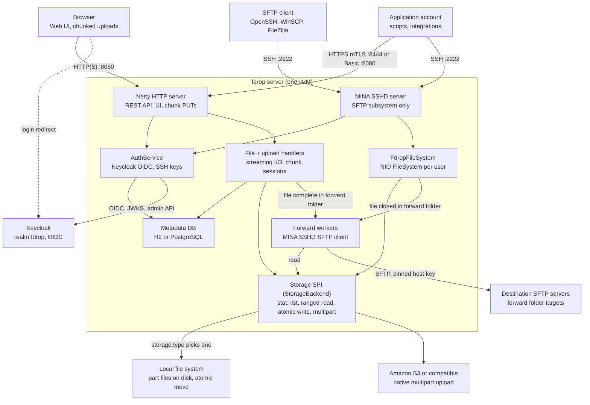
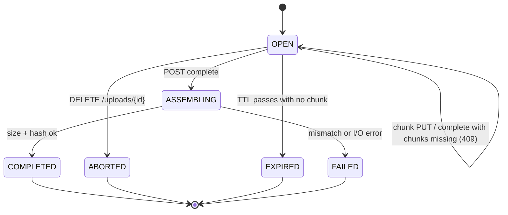
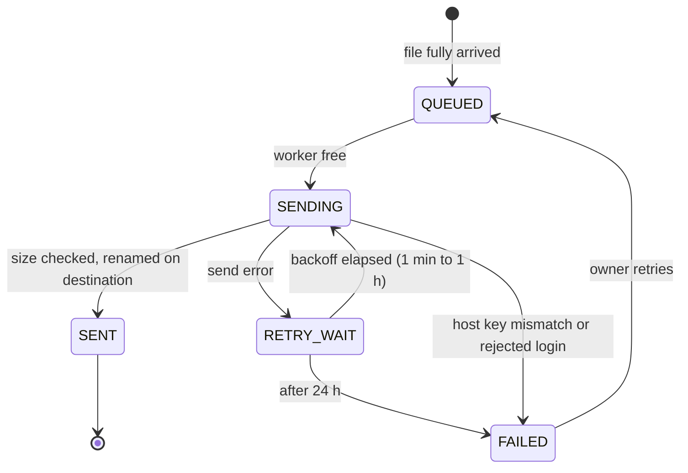

# fdrop — Technical Specification

Oct 22, 2026 · Living version: [fdrop — Technical Specification](https://claude.ai/artifact/Ghh6hqGnPMZmV8RmGQX1aN)

## Overview

fdrop is a single JVM service that lets users upload and download files through a browser (HTTP) or an SFTP client, with every file stored in a pluggable backend: the local file system or Amazon S3 (and S3-compatible stores). Browser uploads are split into chunks so a dropped connection resumes from the last acknowledged chunk instead of restarting. Any file can be given an expiry (`6 days`, `2weeks`), after which fdrop deletes it, and users can search the names and contents of every file they can see. Users keep private files, collaborate in shared folders, and drop files into forward folders that fdrop relays to another SFTP server; admins create and delete users, create application accounts that let other systems exchange files over mTLS or a password (with `fdrop`, a Java command line client, for unattended uploads), and define the forwarding destinations each user may use.

### Goals

- One storage abstraction (the Storage SPI) shared by HTTP and SFTP, so a file uploaded one way is downloadable the other.
- Two backends at launch: `local` and `s3`, selected by configuration, no code change.
- Browser uploads of multi-GB files that survive network drops, tab reloads and server restarts.
- SFTP access via Apache MINA SSHD; HTTP via Netty, with streaming I/O and bounded memory regardless of file size.
- Per-user isolation: each user sees only their own files plus the shared and forward folders they belong to.
- Every stored file encrypted at rest with streaming, per-file envelope encryption, on both backends.
- Full-text search over names and contents with Lucene, never returning anything from a file the user cannot open.
- A complete, tamper-evident audit log that admins can read and search in the web app, with its own Lucene index.

### Non-goals (v1)

- File versioning, sync clients, or desktop apps.
- Public anonymous upload links (candidate for v2).
- FTP/FTPS, WebDAV, or SCP (MINA supports SCP; left disabled in v1).
- Hiding file and folder names in storage (contents are encrypted at rest; see Encryption at rest).
- Clustering with shared in-memory state; multiple nodes are supported only via shared storage and a shared metadata DB.

## Architecture

fdrop runs as one process with two protocol front ends, Netty for HTTP and Apache MINA SSHD for SFTP, sitting on shared services: AuthService, the metadata DB and the Storage SPI. Neither front end touches disk or S3 directly.



Browser uploads go through the upload handlers, which track chunk sessions in the metadata DB; SFTP goes through a per-user NIO file system. Both end at the same `StorageBackend`, so files are interchangeable between protocols. Forward workers pick up jobs queued in the metadata DB, read the file through the Storage SPI and send it to the folder's destination SFTP server. The browser signs in at Keycloak (dashed arrow), and AuthService talks to Keycloak for tokens, SFTP passwords and admin user management.

- **Threading:** Netty event loops and MINA NIO threads only parse protocol frames. All storage calls run on a virtual-thread executor, and results are handed back to the channel, so a slow S3 call never blocks a network thread.
- **Backpressure:** HTTP uploads pause `autoRead` while a write is pending; SFTP relies on MINA's window size (default 2 MiB) so a client cannot outrun the backend.
- **Audit log:** every audit event goes to the log file as before and, in batches, to an append-only, hash-chained `audit_event` table; each node also keeps a separate Lucene audit index built from that table, used only by the admin Audit log page (see Audit log).
- **Search:** an embedded Lucene index on each node, fed from a change feed in the metadata DB, with text extracted once per file by Tika in a separate short-lived JVM (see Search). It lives in the `fdrop-search` module behind a `SearchService` interface in `fdrop-core`, so a build without it simply has no search.
- **Encryption:** the backend is always wrapped in `EncryptingStorage`, so every byte written through the Storage SPI is encrypted and every byte read is decrypted and authenticated, whichever front end or worker made the call (see Encryption at rest).
- **Lifecycle:** `fdrop-server` main loads config, runs DB migrations, initialises the chosen backend and its encryption keys, starts HTTP and SFTP, and on SIGTERM stops accepting connections, waits up to 30 s for in-flight transfers, then closes.

## Storage backend SPI

All file bytes go through one Java interface, `StorageBackend`, discovered via `java.util.ServiceLoader` and selected by `storage.type` in config. Paths are logical keys (`users/<sub>/docs/report.pdf`), never OS paths; backends map them to their own layout.

```java
public interface StorageBackend extends AutoCloseable {
    String type();                                   // "local", "s3"
    void init(Config cfg);

    // Objects
    Optional<ObjectInfo> stat(StoragePath path);
    Stream<ObjectInfo> list(StoragePath dir, boolean recursive);
    ReadableByteChannel openRead(StoragePath path, long offset, long length);
    WriteHandle openWrite(StoragePath path, WriteOptions opts); // streaming, atomic on commit()
    void delete(StoragePath path);
    void move(StoragePath src, StoragePath dst);           // rename within backend
    void mkdirs(StoragePath dir);                         // no-op for S3 (prefixes)

    // Multipart (used by chunked uploads)
    MultipartUpload beginMultipart(StoragePath target, WriteOptions opts);
}

public interface MultipartUpload {
    String id();
    PartInfo putPart(int partNumber, ReadableByteChannel src, long length, Checksum sha256);
    List<PartInfo> listParts();
    ObjectInfo complete(List<PartInfo> parts);            // concatenates in part order
    void abort();
}
```

`ObjectInfo` carries path, size, last-modified, ETag/content hash, content type and an `isDirectory` flag. `WriteHandle.commit()` makes the object visible atomically; `abort()` discards it. Every method is blocking and is called from a dedicated I/O executor, never from a Netty event loop or an SSHD NIO thread.

### Backend behaviour

| Concern | `local` | `s3` |
| --- | --- | --- |
| Root | `storage.local.root` directory | `storage.s3.bucket` + optional `prefix` |
| Directories | Real directories | Zero-byte `dir/` marker objects plus prefix listing |
| Atomic write | Write to `.fdrop-tmp/<uuid>`, `fsync`, `Files.move(ATOMIC_MOVE)` | Single `PutObject` (< 16 MiB) or S3 multipart upload |
| Ranged read | `FileChannel.position(offset)` | `GetObject` with `Range: bytes=a-b` |
| Multipart parts | Files under `.fdrop-parts/<uploadId>/<n>.part` | Native S3 `UploadPart`; part number = chunk index + 1 |
| Concatenate | Stream parts in order into the target temp file, then atomic move | `CompleteMultipartUpload` (server-side, no bytes through fdrop) |
| Move/rename | `Files.move` | `CopyObject` + `DeleteObject` (multipart copy above 5 GiB) |
| Path safety | Normalise, reject `..`, resolve and verify still under root, refuse symlinks | Reject `..`, control chars and keys > 1024 bytes |

S3 uses the AWS SDK for Java v2 async client with the CRT HTTP client, credentials from the default provider chain, and optional `endpointOverride` + path-style access for MinIO, Ceph and other S3-compatible stores.

S3 requires every part except the last to be at least 5 MiB, so the chunk size floor is 5 MiB for all backends. The local backend has no such limit but uses the same chunk size so the client protocol is identical.

## Encryption at rest

Every file fdrop stores is encrypted before its bytes reach the backend, and decrypted as it is read back. Encryption is a streaming layer, `EncryptingStorage`, that wraps whichever `StorageBackend` is configured, the way `InstrumentedStorage` does, so the local file system and S3 are covered alike and neither the protocol front ends nor the backends change. Nothing above the layer sees ciphertext; nothing below it sees plaintext.

- **What is covered:** stored files, resumable upload parts (local `.fdrop-parts/` files and S3 parts), the local backend's `.fdrop-tmp/` write files, SFTP spool files under `sftp.spoolDir`, the text extracted for search (`system/search-text/`) and, through `EncryptedDirectory`, each node's search index (see Search). Folder markers (`dir/` objects on S3, real directories locally) carry no content and are not encrypted.
- **What is not hidden:** storage keys are paths (`users/<sub>/docs/report.pdf`), so folder and file names, the number of files and their approximate sizes stay visible to anyone who can list the storage. Hiding names is an open question.
- **Streaming throughout:** a file is cut into fixed-size segments (64 KiB), and each is encrypted and authenticated on its own. Uploads encrypt as bytes arrive and downloads decrypt as they leave, so memory per transfer stays at about one segment, a multi-GB file is never buffered, and a ranged read decrypts only the segments it touches.
- **Default on:** `storage.encryption.enabled` is `true` for new installations; fdrop refuses to start with it on and no usable key-encryption key. Turning it off later stops encrypting new files but still decrypts existing ones.

### Threat model

| Protects against | Does not protect against |
| --- | --- |
| A stolen or discarded disk, a copied volume or snapshot, leaked backups | Anyone who controls the running fdrop process or its host's memory |
| Read access to the S3 bucket or the storage root (operators, other tenants, a misconfigured bucket policy) | Anyone who holds the key-encryption key (KEK) and a copy of the storage |
| Silent corruption and tampering with stored bytes: any change, truncation, reordering or splicing of segments fails decryption | Swapping whole objects between paths by someone with write access to the storage (each file still decrypts, at the wrong path) |
| Files left behind by an abandoned upload or a crash, which are ciphertext like everything else | Names, sizes and timestamps visible in listings (above) |

S3 server-side encryption (`storage.s3.sse`) still applies on top and can stay on; it protects against a different party (the storage provider's media), not against bucket readers.

### Keys

Envelope encryption with two levels:

- **Data encryption key (DEK):** 32 random bytes from `SecureRandom`, new for every object. Never stored in clear: the object's header holds it wrapped (encrypted) under a KEK.
- **Key-encryption key (KEK):** held outside the storage, by one of three providers (`storage.encryption.keyProvider`):

| Provider | KEK lives in | Wrap / unwrap |
| --- | --- | --- |
| `local` | A keyring of 32-byte keys from an environment variable or secret file (`storage.encryption.local.keys`), never from `fdrop.yaml` in the image | AES-256-GCM in process, a fresh 12-byte nonce per wrap |
| `aws-kms` | An AWS KMS key (`storage.encryption.awsKms.keyId`) | KMS `GenerateDataKey` for new objects, `Decrypt` to read, via the AWS SDK and the default credential chain |
| `vault` | A HashiCorp Vault transit key (`storage.encryption.vault.*`) | Transit `datakey/plaintext` and `decrypt` |

- **Key ids:** each KEK has an id (`k2026a`, or the KMS key ARN with version, or `vault:<name>:<version>`) written into the header, so several KEKs can be in use at once. The `local` keyring is `id:base64key` pairs, comma-separated; the first is the primary that wraps new DEKs, and the others only unwrap.
- **DEK cache:** unwrapped DEKs are kept in a bounded in-memory cache keyed by object and header hash (`storage.encryption.dekCache`, default 10,000 entries, 10 min), so a ranged read or an SFTP client reading in many small requests does not call KMS each time. Evicted keys are overwritten with zeros, as far as Java allows. A resumable upload's DEK stays cached while its session is open.
- **No KEK, no service:** at startup fdrop wraps and unwraps a test DEK with the primary KEK; failure stops startup. While running, a KEK provider failure fails the affected request with `503`, `/readyz` returns 503, and `FdropKmsErrors` fires.

### Object format (`fdrop-stream-v1`)

Each stored object is a header followed by the encrypted segments. All integers are big-endian.

| Field | Bytes | Value |
| --- | --- | --- |
| Magic | 8 | `FDRP` `ENC` `\x01`: `46 44 52 50 45 4E 43 01` |
| Header length | 4 | Total header bytes, magic to MAC inclusive: always 1,024 in v1 |
| Algorithm | 1 | `1` = AES-256-GCM segments, keys from HKDF-SHA-256 |
| Segment size | 4 | Plaintext bytes per segment, `S`: always 65,536 in v1, so every chunk size the server picks (whole MiB) is a multiple |
| Key provider | 1 | `1` local, `2` aws-kms, `3` vault |
| Key id | 2 + n | Length, then the KEK id in UTF-8 |
| Wrapped DEK | 2 + n | Length, then the provider's ciphertext of the DEK |
| Padding | to byte 992 | Zero bytes |
| Header MAC | 32 | HMAC-SHA-256 over every header byte before it (bytes 0–991), with the header key below |

The header length and segment size are fixed so that a stored object's plaintext size follows from its stored size alone, and listings never read headers. They are still written into every header, so a later format version can change them.

Keys and segments:

- `headerHash = SHA-256(header bytes before the MAC)`
- `segmentKey = HKDF-SHA-256(ikm = DEK, salt = empty, info = "fdrop-stream-v1 segment" ‖ headerHash, 32 bytes)`
- `headerKey = HKDF-SHA-256(ikm = DEK, salt = empty, info = "fdrop-stream-v1 header", 32 bytes)`
- Segment `i` (0-based) of plaintext `p_i` is stored as `nonce_i ‖ AES-256-GCM-Encrypt(segmentKey, nonce_i, p_i, aad_i)`, where `nonce_i` is 12 random bytes and `aad_i = i (8 bytes) ‖ final (1 byte: 1 for the last segment, else 0)`. The GCM tag is 16 bytes, so each segment adds 28 bytes.
- Every segment but the last holds exactly `S` plaintext bytes; the last holds 0 to `S`. An empty file is one empty final segment.

Why it is built this way:

- **Random access:** segments sit at fixed offsets (segment `i` starts at `H + i × (S + 28)`, `H` being the header length), so a `Range` request, an SFTP read at any offset, or a resumed download reads and decrypts only the segments it needs.
- **Integrity of the whole file:** the index in each segment's AAD stops reordering and splicing, the final flag stops truncation (a file that ends on a non-final segment, or has data after a final one, fails), and `headerHash` in the segment key ties every segment to its own header. The header MAC stops changes to the segment size or key id. Any failure is an error, never partial plaintext: the read fails with an I/O error, the HTTP download is cut off (status already sent) or refused with `500` before the first byte, and the event is audited and counted.
- **Random nonces, one key per object:** no counter has to be coordinated between the parallel chunk uploads of one file, between nodes, or across a re-sent chunk. With a fresh DEK per object and at most 2³² segments, random 96-bit nonces stay far inside GCM's safety margin.
- **Standard parts only:** AES-GCM, HKDF and HMAC from the JDK (`javax.crypto`), which use the CPU's AES instructions. No new crypto library. The design follows Tink's streaming AEAD and age's STREAM construction; it is fdrop's own only so that independent parts can be encrypted in parallel.

**Sizes.** With `n = max(1, ⌈P / S⌉)` segments and `H` = 1,024, a `P`-byte file stores `H + P + 28n` bytes. Going back from a stored size `C`: `n = ⌈(C − H) / (S + 28)⌉` and `P = C − H − 28n`; a stored size that gives a final segment shorter than 28 bytes belongs to no valid object. The overhead is 0.04% plus the 1 KiB header (the fields use 120 bytes with `local` keys, up to about 400 with KMS). `ObjectInfo.size`, listings, quotas, `Content-Length` and My uploads all report the plaintext size, computed from the stored size without reading the object; only a read fetches the header (one small ranged read, then cached per object version with its derived key).

### How each path works

| Path | With encryption |
| --- | --- |
| Simple upload, SFTP sequential write | `openWrite` generates the DEK, writes the header, then encrypts each segment as it fills and passes ciphertext to the backend's `WriteHandle`; `commit()` encrypts the final segment. Atomic visibility is unchanged |
| Resumable upload | At `beginMultipart` the DEK and header are made. The upload's multipart id, kept in `upload_session.backend_upload_id`, becomes `fdrop-enc1|<total>|<part size>|<provider>|<key id>|<wrapped DEK>|<backend id>` (base64url fields), so any node, after any restart, can rebuild the header and encrypt any chunk; the id holds only the wrapped DEK. Chunk size must be a multiple of `S` (8 MiB = 128 segments), so chunk `k` is segments `128k` to `128k + 127` and is encrypted on its own, in any order and in parallel. Part 1 is the header plus chunk 0; the last chunk ends with the final segment. `X-Chunk-SHA256` is checked against the plaintext as before. Re-sending a chunk encrypts it again with new nonces, which is safe |
| Assembly | Local: concatenating the encrypted parts gives a valid object, since the segment layout already continues across parts. S3: `CompleteMultipartUpload` still runs server-side, with no bytes through fdrop. The whole-file SHA-256 check reads back through the layer, so it hashes the plaintext |
| Download, `Range` | The layer maps the plaintext range to whole segments, reads only that ciphertext range (one ranged `GetObject` on S3), decrypts and trims. Zero-copy `DefaultFileRegion` downloads are no longer possible for encrypted files; they use `ChunkedNioStream`, like TLS already does |
| SFTP read at offsets | As a ranged download; a seek opens at the containing segment |
| SFTP resume / `APPEND` | The existing file is decrypted into a new upload and the new bytes follow (fdrop already resumes this way), then the new object replaces the old one atomically. The final segment of the old file therefore never needs rewriting in place |
| SFTP random-offset writes | The spool file is encrypted with a per-process key that exists only in memory; spool files cannot be recovered after a restart, as today |
| Move, rename | Local `Files.move`; S3 `CopyObject`. The bytes are copied unchanged: nothing in the format depends on the path |
| Forwarding | Forward workers read through the layer and send plaintext over the mutually authenticated SSH connection; the destination receives the original file |
| File expiry, delete | Unchanged. The DEK lives only in the object's header, so it goes with the object; a backup copy stays readable for as long as its KEK can still be unwrapped (see Key rotation) |

### Key rotation and re-encryption

- **Rotating the KEK:** add the new key at the front of the keyring (or point `awsKms.keyId` at the new key), restart, and new objects use it at once; objects wrapped under older keys still decrypt as long as those keys remain in the keyring or KMS. KMS-side automatic rotation needs nothing from fdrop, since KMS keeps old key material for `Decrypt`.
- **Retiring a KEK:** the **re-encryption job** rewrites every object whose header names a given key id: it reads through the layer, writes a new object with a new DEK under the primary KEK to a temporary key, and replaces the original atomically (local `ATOMIC_MOVE`; S3 `CopyObject` within the bucket, then delete). Started by an admin with `POST /api/v1/admin/storage/encryption/reencrypt` `{ "fromKeyId": "k2025b" }`; progress is in `GET /api/v1/admin/storage/encryption`, it runs at `storage.encryption.reencrypt.bytesPerSecond` (default 50 MiB/s) per node, it claims objects through the metadata DB like the expiry sweeper so several nodes can share it, and it resumes after a restart. When `fdrop_encryption_objects{key_id="k2025b"}` reaches 0, the key can be removed from the keyring.
- **A compromised KEK** is handled the same way: rotate, re-encrypt everything from the old id, then delete the old key. Backups made before that are still readable with the old key, so retire it from backups too.
- **Inventory:** a daily job reads every object's header (one small ranged read each) and counts objects per key id and objects still in plaintext, for the gauges and the admin screen; admins can also run it on demand.
- The header cannot be re-wrapped in place (it sits at the start of the object and S3 objects are immutable), which is why retiring a key rewrites the objects. Rewrapping only the DEK would be cheaper; it is not done in v1, so that the header stays the single, self-contained record needed to decrypt a file, also from a backup without the metadata DB.

### Migrating existing plaintext files

- With `storage.encryption.enabled: true` on a store that already holds plaintext files, set `storage.encryption.allowPlaintextReads: true` for the migration. Reads then check the first 8 bytes: an object without the magic is served as plaintext and counted in `fdrop_encryption_plaintext_reads_total`. Only objects that start with the magic and whose header MAC verifies are decrypted, so a plaintext file that happens to start with the magic bytes is still served correctly.
- Admins start the same re-encryption job with `{ "plaintext": true }` to encrypt every plaintext object in place. When the inventory shows no plaintext objects left, set `allowPlaintextReads: false`, and any plaintext object is then refused as tampering.

### Admin view and audit

- **Admin: Storage encryption** screen: enabled or not, provider, primary key id, objects per key id, plaintext objects left, a re-encryption job's progress with Pause and Cancel, and the last decryption failures (path and time).
- Audit entries: `storage.encryption.start` (provider and primary key id at startup), `storage.encryption.reencrypt.started|finished|cancelled` with the acting admin, scope and object counts, and `storage.decrypt.failed` with the storage key, the segment index and the reason (`header_mac`, `segment_auth`, `truncated`, `unknown_key`).

### Metadata

- `upload_session.backend_upload_id` widens to 4,000 characters for the encrypted multipart id above.
- `encryption_inventory(key_id, objects, bytes, counted_at)`: the last inventory.
- `reencrypt_job(id, scope, from_key_id, state, objects_total, objects_done, bytes_done, started_by, started_at, finished_at)` and `reencrypt_item(job_id, storage_key, claimed_by, claimed_until, state, error)`.

## HTTP API and browser UI

The HTTP side is a Netty 4.2 server on `http.port` (default 8080; 8443 with TLS) serving a JSON REST API under `/api/v1` and a static single-page UI at `/`. Request bodies are never aggregated: upload handlers consume `HttpContent` frames and write them straight to the storage `WriteHandle` with backpressure (auto-read off while a write is in flight).

### Pipeline

1. `SslHandler` (optional; ALPN for HTTP/2 later). The application mTLS listener on `http.mtls.port` always has one, with client authentication required
2. `HttpServerCodec` with max header size 16 KiB
3. `HttpServerKeepAliveHandler`
4. `IdleStateHandler` (read idle 60 s)
5. `AuthHandler` (session cookie, bearer token, or for application accounts a client certificate or HTTP Basic; rejects before the body is read)
6. `Router` → handler per route; upload and download handlers are streaming, all other routes use a `HttpObjectAggregator` limited to 1 MiB
7. `ChunkedWriteHandler` for downloads

### Endpoints

| Method | Path | Purpose |
| --- | --- | --- |
| GET | `/auth/login` | Redirect to Keycloak (authorization code + PKCE); `?action=configure-totp`, `register-security-key` or `recovery-codes` starts that Keycloak action and returns to the Account page |
| GET | `/auth/callback` | OIDC redirect target; creates the session cookie |
| POST | `/auth/logout` | End session and redirect to Keycloak end-session endpoint |
| POST | `/auth/backchannel-logout` | Keycloak back-channel logout (logout token) |
| GET/PATCH | `/api/v1/me` | Current user: username, roles, quota, usage, two-factor status, home default expiry; `PATCH` changes the home default expiry |
| DELETE | `/api/v1/me/two-factor/{credentialId}` | Remove one of the user's own second factors (needs a two-factor session; the last required factor cannot be removed) |
| GET/POST/DELETE | `/api/v1/me/ssh-keys` | Manage the user's SFTP public keys |
| GET | `/api/v1/search?q=&scope=&path=&type=&modifiedFrom=&sort=&cursor=&limit=` | Search names and contents of every file the caller can see (see Search) |
| GET | `/api/v1/search/suggest?q=` | Up to 8 name matches for the search box drop-down |
| GET | `/api/v1/admin/audit?q=&group=&event=&user=&ip=&outcome=&from=&to=&cursor=` | Read and search the audit log; also `/{id}`, `/export`, `/events`, `/verify` and `/index` (admin; see Audit log) |
| GET/POST | `/api/v1/admin/search`, `/api/v1/admin/search/rebuild` | This node's search index status; rebuild it (admin) |
| GET | `/api/v1/me/uploads?wentTo=&q=&from=&to=&sort=&cursor=` | The My uploads list: the user's own upload records, filtered, sorted and paged, with count and total size for the filter |
| GET | `/api/v1/files?path=/home/docs` | List a directory in the virtual tree (name, size, mtime, type, `expiresAt`, `expirySource`), with the folder's default and maximum expiry |
| GET | `/api/v1/files/content?path=…` | Download; supports `Range`, `If-None-Match`, `Content-Disposition: attachment` |
| PUT | `/api/v1/files/content?path=…&expiresIn=…` | Simple single-request upload for files ≤ `http.simpleUploadMax` (default 64 MiB), optionally with an expiry (or header `X-Fdrop-Expires-In`; see File expiry) |
| PATCH | `/api/v1/files?path=…` | Set, change or clear a file's expiry (`expiresIn` or `expiresAt`) |
| POST | `/api/v1/files/mkdir` | Create an ordinary sub-folder in `/home` or a shared folder |
| POST | `/api/v1/files/move` | Rename or move; the expiry moves with the file |
| DELETE | `/api/v1/files?path=…` | Delete file or empty directory |
| POST | `/api/v1/uploads` | Start a resumable upload, optionally with an expiry (`expiresIn`) |
| GET | `/api/v1/uploads/{id}` | Upload status and received chunks |
| PUT | `/api/v1/uploads/{id}/chunks/{index}` | Upload one chunk |
| POST | `/api/v1/uploads/{id}/complete` | Assemble chunks into the final file |
| DELETE | `/api/v1/uploads/{id}` | Abort and discard |
| GET | `/api/v1/folders` | Shared and forward folders the user owns or belongs to |
| POST | `/api/v1/folders` | Create a shared folder, or a forward folder with a `destinationId` from the user's assigned list |
| GET/PATCH/DELETE | `/api/v1/folders/{id}` | Read, rename, switch destination, change keep days, change default and maximum expiry, delete (owner) |
| PUT/DELETE | `/api/v1/folders/{id}/members/{username}` | Add or change a member's permission, remove a member (owner; a member may remove themselves) |
| POST | `/api/v1/folders/{id}/owner` | Transfer ownership to a member |
| GET | `/api/v1/folders/{id}/forward-jobs` | Forward job status for the folder |
| POST | `/api/v1/folders/{id}/forward-jobs/{jobId}/retry` | Retry a failed job (owner) |
| GET | `/api/v1/forward-destinations` | The caller's assigned, enabled destinations (id, name, description) for the drop-down |
| GET | `/api/v1/users?search=` | Find standard users and application accounts to add as members (username, display name and `kind` only) |
| GET/POST | `/api/v1/admin/users` | List or create users (admin) |
| DELETE | `/api/v1/admin/users/{id}` | Delete a user (admin) |
| POST | `/api/v1/admin/users/{id}/two-factor/reset` | Delete a user's second factors and end their sessions (admin) |
| GET/POST | `/api/v1/admin/app-accounts` | List or create application accounts (admin) |
| GET/PATCH/DELETE | `/api/v1/admin/app-accounts/{id}` | Read, change description, responsible person, allowed methods and source addresses, home default expiry, enable/disable, delete (admin) |
| POST | `/api/v1/admin/app-accounts/{id}/password` | Generate a new password, returned once (admin) |
| POST/DELETE | `/api/v1/admin/app-accounts/{id}/certificates[/{certId}]` | Add a pinned or by-subject client certificate, or retire one (admin) |
| POST/DELETE | `/api/v1/admin/app-accounts/{id}/ssh-keys[/{keyId}]` | Add or remove an SSH public key or user certificate (admin) |
| GET/POST | `/api/v1/admin/forward-destinations` | List or create destinations (admin) |
| GET/PATCH/DELETE | `/api/v1/admin/forward-destinations/{id}` | Read, change, enable/disable, delete when unused (admin) |
| POST | `/api/v1/admin/forward-destinations/{id}/test` | Connect with mutual authentication and report the host key or certificate seen and whether login succeeded (admin) |
| POST | `/api/v1/admin/forward-destinations/{id}/keys` | Generate a new client key, or upload a user certificate for one; activate and retire keys (admin) |
| PUT/DELETE | `/api/v1/admin/forward-destinations/{id}/assignments/{username}` | Assign a destination to a user or remove the assignment (admin) |
| GET | `/api/v1/admin/storage/encryption` | Encryption status: provider, primary key id, objects per key id, plaintext objects left, re-encryption job progress (admin) |
| POST | `/api/v1/admin/storage/encryption/inventory` | Count stored objects per key id now, instead of waiting for the daily count (admin) |
| POST/DELETE | `/api/v1/admin/storage/encryption/reencrypt` | Start a re-encryption job (`fromKeyId`, or `plaintext: true`), or cancel the running one (admin) |
| GET | `/healthz`, `/readyz`, `/metrics` | Not on this port: served on the management port (8081); see Observability |

Errors use RFC 9457 problem JSON (`type`, `title`, `status`, `detail`); expiry problems (`invalid-expiry`, `expiry-too-long`, `expiry-not-allowed`, `conflicting-expiry`, `reserved-name`) are listed under File expiry. A search that is too long or too broad returns `invalid-search` (see Search). Downloads use `DefaultFileRegion` (zero-copy) only for unencrypted files on the local backend without TLS, and `ChunkedNioStream` over the backend channel otherwise, which with encryption at rest is every file; `Range` requests return 206 with one range (multi-range returns 200 with the full body).

### Browser UI

- Built with React 19 and TypeScript; no hand-written DOM JavaScript or other UI framework. Function components and hooks only.
- Built with npm: `package.json` and a committed `package-lock.json` in `fdrop-web`; `npm ci` installs, `npm run build` produces the bundle with Vite, `npm test` runs Vitest. The output is bundled into the jar as static resources; no server-side rendering.
- Libraries: React Router for navigation, TanStack Query for API calls and caching; no global state library unless a need appears.
- File browser: breadcrumb, list view, a drop zone for drag-and-drop upload (below), a file picker button, download, rename, delete, new folder, and each file's expiry with a Set expiry action (see File expiry).
- Search: the top bar's search box suggests matching names as you type and opens a results page of name and content matches on Enter (see Search).
- Upload queue panel showing each file's percentage, bytes sent, speed and time remaining, with pause/resume/cancel and a retry state when offline (below).
- Uploads run in a Web Worker using `Blob.slice()` and `XMLHttpRequest` (which, unlike `fetch`, reports upload progress events), up to 3 chunks in parallel per file; React components subscribe to worker progress through a small hook (`useUploadQueue`).
- In-progress uploads are recorded in IndexedDB (upload id, file name, size, `lastModified`, chunk size) so a reload offers to resume once the user re-selects the same file.
- CSRF: all state-changing requests send an `X-Fdrop-CSRF` header matching a token from the session.
- Local UI development: `npm run dev` starts the Vite dev server on https://localhost:5173 (with the dev certificate) and proxies `/api` and `/auth` to the fdrop server on https://localhost:8443.

### Drag-and-drop drop zone

- Every writable folder view (`/home` and its sub-folders, shared folders with write access, forward folders) shows a drop zone: a dashed strip below the file list, with the fdrop logo mark as a faint background, reading "Drop files anywhere, or choose files, to upload to <folder>", which also works as a button that opens the file picker. The sidebar's Upload button opens the same picker for the folder being shown.
- While files are dragged over the window, the whole file list becomes the drop target, highlighted, and names the folder the files will land in ("Drop to upload to /shared/Invoices"). Dropping on a sub-folder row uploads into that sub-folder.
- Dropping a folder uploads its contents with their sub-folder structure (via `DataTransferItem.webkitGetAsEntry()`), creating the sub-folders first. Forward folders accept files only; a dropped folder there is refused with a message.
- Many files can be dropped at once; each becomes its own entry in the upload queue. Files over `limits.maxFileSize` or beyond the user's remaining quota are rejected at drop time with the reason shown, before any bytes are sent.
- Where dropping is not allowed (`/`, `/shared`, `/forward`, read-only shared folders) the cursor shows not-allowed and nothing is uploaded.
- Drops outside the drop target never make the browser open the file in place.
- Keyboard and screen-reader users reach the same function through the drop zone's button; touch devices without drag show it as "Tap to choose files".

### Upload progress as a percentage

- Each queued file shows a progress bar with a whole-number percentage ("42%"), its bytes sent of its total ("1.7 GB of 4.0 GB"), current speed and estimated time remaining. The queue header shows the overall percentage across all active uploads, by bytes.
- Percentage = (bytes in chunks the server has acknowledged + bytes sent so far in chunks still in flight) ÷ file size, from the worker's `XMLHttpRequest` `upload.onprogress` events, updated at most 4 times a second.
- The percentage never goes down: if a chunk fails and is resent, the shown value holds until the resend catches up.
- It stops at 99% while the server assembles the file, shown as "Finishing…", and turns to 100% and "Done" only when `complete` succeeds. In a forward folder the row then shows the forward status (queued, sending, sent, failed).
- After a reload or a dropped connection, the bar resumes from the server's count of received chunks, not from 0%.
- Paused, offline and failed uploads keep their percentage and show the state beside it.
- Accessibility: the bar is a `progressbar` with `aria-valuenow` set to the percentage, and a polite live region announces each file every 25% and on completion.
- Files uploaded over SFTP do not appear in the browser queue; their progress is shown by the SFTP client.

### My uploads page

Every user has a **My uploads** page, reached from the main navigation, listing every file they have uploaded: its name, its size, and whether it went to a normal folder or a forward folder. It covers uploads over both the browser and SFTP, and keeps a row after the file has been forwarded, moved, deleted or expired.

| Column | Shows |
| --- | --- |
| File | File name; a link to its folder while the file still exists and the user can still reach it |
| Size | Size at upload, in KB, MB or GB (exact bytes on hover) |
| Went to | **Folder** badge with the folder (`Home`, `Home / reports`, `Shared: Invoices`), or **Forward** badge with the forward folder and destination name (`Forward: Partner A`) |
| Uploaded | Date and time the upload completed, in the user's time zone |
| Via | Browser or SFTP |
| From IP | IP address of the machine that uploaded the file (IPv4, or IPv6 in compressed form). If a resumable upload was started from one address and finished from another, the finishing address is shown with "started from 203.0.113.7" beneath it |
| Expires | The expiry the file was given, as a date and time in the user's time zone, or nothing |
| Status | Folder uploads: Stored, Moved, Deleted or Expired. Forward uploads: Queued, Sending, Sent, Failed or Paused, the same states as the forward job |

- Newest first by default; sortable by date, size and name.
- Filters: Went to (All, Folders, Forward), date range, and a search box that matches file names or an IP address (exact, or a prefix such as `10.20.`).
- Above the table: number of files and total size for the current filter ("1,284 files, 37.2 GB").
- 50 rows per page with "Load more", using a cursor so new uploads don't shift the pages.
- Row actions: download, while the file still exists and the user still has access; open the folder; and for a failed forward the folder owner sees Retry.
- On phones the table becomes cards showing name, size, the Folder or Forward badge, date and status; tapping a card shows the IP address and protocol. Filters move into a sheet.
- Badges follow the visual design: Folder in navy outline, Forward in deep navy fill with white text, Sent and Stored on mint.
- Only the user's own uploads appear. Admins see their own uploads here too, not other users'.
- Leaving a shared folder or losing a destination assignment keeps the rows but removes the links and download action.
- **Which IP is recorded.** For browser uploads, the address of the HTTP client. When fdrop sits behind a reverse proxy or load balancer, the client address is taken from the `Forwarded` or `X-Forwarded-For` header, but only when the connection comes from an address in `http.trustedProxies`; the rightmost address not in that list is used, so a client cannot fake its address by sending the header itself. For SFTP, the address of the SSH connection; behind a TCP load balancer, fdrop accepts the HAProxy PROXY protocol (v1 and v2) from `trustedProxies` when `sftp.proxyProtocol` is on. A resumable upload records the address that created the session and the address that completed it.
- **Privacy.** IP addresses are personal data. Users see only the addresses on their own uploads; the address is kept no longer than the row (`upload.historyRetention`), is deleted with a deleted user's rows, and never appears in metrics labels.
- Rows older than `upload.historyRetention` (default 365 days) are deleted by the nightly janitor. A deleted user's rows are deleted with them.

**Data.** When an upload completes (resumable `complete`, simple `PUT`, or an SFTP write handle closed), fdrop writes one `upload_record` row, including the client IP addresses. Moves, renames, deletes and expiry update its current path, expiry and status, and forward jobs link to it so its status follows the job. The page reads only from this table, so it stays fast regardless of storage backend.

### Responsive web app

The UI is one responsive web app that works on phones, tablets and desktops from the same code and URL; there is no separate mobile site or native app.

| Width | Layout |
| --- | --- |
| Under 640 px (phone) | Single column; navigation in a menu button; files as list rows (name, size, date) with actions in an overflow menu; upload queue as a bottom sheet |
| 640–1024 px (tablet) | Navigation as a collapsible drawer; files as a compact table; dialogs as side panels |
| Over 1024 px (desktop) | Workspace layout: a light fixed sidebar (logo, Upload and New folder, Home, Shared, Forward, My uploads, Manage folders, an Admin group, storage meter) beside a white top bar with the search box and the account menu; full file table with sortable columns; upload queue as a docked panel |

- Mobile-first CSS with breakpoints at 640 px and 1024 px, and container queries for components such as the file table and upload queue; usable down to 320 px wide with no horizontal page scrolling.
- Styling with CSS Modules and CSS custom properties for theme tokens (light and dark follow the system setting until the user picks one with the switch in the top bar; see Visual design); Radix UI primitives for accessible menus, dialogs and drop-downs, including the forward destination drop-down.
- Touch: tap targets at least 44 × 44 px; the drop zone accepts drag-and-drop wherever the device supports it (desktop, and tablets with drag such as iPad), and is always also a button that opens the file picker, including the phone's photo library and camera. On phones the upload percentage stays visible in the collapsed bottom sheet.
- Admin screens (users, forward destinations, assignments) work on tablets and phones too; long forms become a single column.
- Mobile browsers suspend background tabs, so an upload pauses when the user switches away and resumes through the resumable upload protocol when they come back; the queue shows this as paused, not failed.
- Accessibility target: WCAG 2.2 AA, full keyboard use, and correct behaviour at 200% browser zoom.

### Visual design

The UI uses the same fonts, colours and component styles as [lme.com](https://www.lme.com/): Nunito Sans, LME navy text, deep navy bars and buttons, coral accents and pill-shaped buttons. Values were read from lme.com's live styles on 2026-10-22. fdrop keeps its own name and wordmark; showing the LME logo or name needs approval from LME's brand owners.

All values live as CSS custom properties in `fdrop-web/src/theme/tokens.css`; components never hard-code colours or sizes.

**Logo**


- The fdrop logo is a large capital F inside a circle: a deep navy disc, a thin coral ring, and a white geometric F drawn as a path, so it needs no font and renders the same everywhere.
- Two files live in `fdrop-web/src/assets/logo/`: `fdrop-logo.svg` (full colour) and `fdrop-mark-mono.svg` (the ring and F in one colour, for watermarks).
- Uses: the top bar (32 px, beside the name "fdrop"), the favicon (the SVG plus a 32 px PNG fallback), and the drop zone background.
- Minimum size 16 px; at that size the coral ring may vanish, which is acceptable. Keep clear space of a quarter of the logo's width around it.
- **Drop zone background:** the mono mark is centred behind the drop zone text, at 70% of the drop zone's height up to 160 px. It is applied as a CSS mask, so its colour comes from the tokens: `--color-ink` at 8% opacity normally, `--color-coral` at 15% while files are dragged over, and white at 8% in the dark theme. It is decorative (`aria-hidden`) and faint enough not to affect text contrast. On phones, where the drop zone is a short "Tap to choose files" bar, the mark shrinks with it.

**Colours**

| Token | Value | Used for |
| --- | --- | --- |
| `--color-ink` | `#13426B` (LME navy) | Body text, headings, icons, progress bar fill, links |
| `--color-navy-deep` | `#171739` | Top bar, primary buttons, dark-theme background |
| `--color-coral` | `#F4364C` | Accents: active navigation underline, keyboard focus ring, drop-zone highlight border, error and destructive icons and borders |
| `--color-mint` | `#B5E3D8` | Success backgrounds such as "Done" and "Sent" badges, always with navy text |
| `--color-surface` | `#FFFFFF` | Page background |
| `--color-surface-alt` | `#F9F9F9` | Panels, alternate table rows, drop zone background |
| `--color-border` | `#C0CDD8` | Input and secondary-button borders, dashed drop-zone border, progress track |
| `--color-divider` | `rgba(19, 66, 107, 0.2)` | Table and list dividers |
| `--color-muted` | `#696969` | Secondary text such as sizes, dates and speeds |
| `--color-link` | `#3860BE` | Inline text links |

**Typography**

| Role | Style |
| --- | --- |
| Font | Nunito Sans (weights 200, 400, 600, 700), self-hosted from the `@fontsource/nunito-sans` npm package (SIL Open Font License), no font CDN, so the `default-src 'self'` CSP holds |
| Body | 16 px / 24 px, regular, navy |
| Small body, table cells, navigation | 14 px / 21–24 px, regular |
| Page title | 32 px / 40 px, bold (26 px on phones) |
| Section label | 12 px / 16 px, bold, uppercase, 1 px letter spacing |
| Buttons | 14 px, semibold (600) |

**Components**

- **Buttons:** pill shape (24 px radius), 12 px × 32 px padding (shortened to 10 px × 20 px on phones). Primary: deep navy fill, white text. Secondary: transparent, 1 px `#C0CDD8` border, navy text. On dark backgrounds, the secondary button uses a white border and white text.
- **Workspace layout (after Dropbox and Box):** a light sidebar (`--color-sidebar`) with the logo (32 px) and name, a full-width deep navy Upload pill plus a round New folder button, line icons beside each navigation item, and a storage meter at the bottom. The active item is a tinted pill (`--color-selected`) with a small coral dot. The top bar is white with a pill-shaped search field (`--color-search`), which narrows the folder being shown as you type, suggests matching names from everywhere in a drop-down, and searches names and contents on Enter (see Search), and the account avatar. Under 1024 px the sidebar becomes a drawer behind a menu button.
- **File list:** each file or folder has its icon (file, folder, forward arrow) on a 36 px rounded tile; rows are 56 px with a soft hover tint and no zebra stripes; headers are 13 px muted text. Home shows the last uploads as **Recent** cards (12 px radius) above **All files**. The breadcrumb sits above the bold folder title, with the Expires picker, New folder and Folder settings to its right.
- **Inputs, drop-downs, cards, dialogs:** 4 px radius, 1 px `--color-border` border; raised panels and dialogs use LME's soft navy shadow (`0 20px 28px rgba(19, 66, 107, 0.2)`).
- **Keyboard focus:** a 2 px coral outline, shown only when the user is tabbing, as on lme.com.
- **Drop zone:** a 72 px strip under the file list, 2 px dashed `--color-border`, 12 px radius, reading "Drop files anywhere, or choose files, to upload to …", with the fdrop mark as a faint centred watermark behind the text (see Logo). The whole list is still the drop target while files are dragged over; the border and the watermark turn coral.
- **Progress bars:** navy fill on a `--color-border` track; the percentage in navy, semibold; finished rows get a mint "Done" badge.
- **Errors and destructive actions:** navy text with a coral icon and coral left border or outline. Coral is never used for text or as a fill behind white text: coral on white, and white on coral, measure about 3.8:1, under the 4.5:1 that WCAG AA requires for text.
- **Light and dark:** a sun/moon switch in the top bar (`role="switch"`, labelled "Dark mode") flips between the two and the choice is kept in the browser's local storage; until the user chooses, fdrop follows the system setting, and the account menu offers "Use the system's light or dark setting" to go back to that. The resolved theme is set as `data-theme` on `<html>` before the first render, so the page never flashes the wrong one.
- **Dark theme:** lme.com has none, so fdrop derives one. Deep navy background, `#13426B` panels, white text, white-outline secondary buttons, and the same coral accents.

## Resumable chunked uploads

A browser upload is a server-side upload session: the client cuts the file into fixed-size chunks, sends each with its own `PUT`, and the server records every acknowledged chunk durably. After a drop, the client asks which chunks the server holds and sends only the missing ones; `complete` then concatenates them in order into the final file.

### Protocol

1. **Create.** `POST /api/v1/uploads` with `{ "path": "/docs/big.iso", "size": 4294967296, "lastModified": 1761130000000, "sha256": "<optional whole-file hash>", "overwrite": false, "expiresIn": "6 days" }` (`expiresIn` optional; see File expiry). Server checks quota, permissions, the expiry against the folder's limits and that the target does not exist (unless `overwrite`), then returns `201 { "id": "upl_01J…", "chunkSize": 8388608, "chunkCount": 512, "expiresAt": "…", "fileExpiresIn": "6 days" }`, where `expiresAt` is when the unfinished session would be abandoned and `fileExpiresIn` the expiry the file will get. Chunk size is chosen by the server: 8 MiB default, raised so `chunkCount` ≤ 10,000 (S3's part limit), never below 5 MiB.
2. **Upload chunks.** `PUT /api/v1/uploads/{id}/chunks/{index}` with `Content-Length` = chunk length (exactly `chunkSize`, except the last chunk) and `X-Chunk-SHA256`. The server streams the body to `MultipartUpload.putPart`, verifying length and hash as it goes. On success it commits the chunk record and returns `204` with `ETag`. Re-sending an already-stored chunk with the same hash is a no-op `204` (idempotent); a different hash returns `409`.
3. **Resume.** After any network error the client calls `GET /api/v1/uploads/{id}` → `{ "state": "OPEN", "received": [[0, 211], [214, 214]], "bytesReceived": … }` (ranges of chunk indexes) and re-queues the gaps. A chunk interrupted mid-body is discarded by the server and simply sent again.
4. **Complete.** `POST /api/v1/uploads/{id}/complete`. The server verifies every index `0..chunkCount-1` is present, calls `MultipartUpload.complete` (local: stream-concatenate into a temp file then atomic move; S3: `CompleteMultipartUpload`), verifies total size and the optional whole-file SHA-256, writes file metadata and the file's expiry, and returns `200` with the file entry (including `expiresAt`). Large local assemblies return `202` and the client polls status until `COMPLETED`.
5. **Abort.** `DELETE /api/v1/uploads/{id}` deletes parts and the session.

### Session states



Only `COMPLETED` writes the target file; every other end state deletes the stored parts, so partial uploads are never visible to downloads or SFTP listings.

### Server-side storage of sessions

- Session and chunk records live in the metadata DB (embedded H2 by default, PostgreSQL for multi-node): `upload_session(id, user_id, target_path, size, chunk_size, chunk_count, sha256, state, backend_upload_id, created_at, updated_at, expires_at, expires_in)` (`expires_at` is the session's own TTL; `expires_in` the file expiry to apply at completion) and `upload_chunk(session_id, idx, size, sha256, etag, received_at)`.
- A chunk row is inserted only after its bytes are durable in the backend (local: `fsync`; S3: `UploadPart` returned), so the DB never claims a chunk that is not stored. A restart loses at most in-flight chunks.
- Chunk data never touches the JVM heap beyond Netty's pooled buffers; the handler pauses `autoRead` while the backend write catches up.
- Two concurrent `PUT`s of the same index: a per-session, per-index lock admits one; the other gets `409` and the client re-checks status.

### Expiry and cleanup

- Sessions expire `upload.ttl` (default 24 h) after their last chunk; any successful chunk extends `expiresAt`.
- A janitor runs every 15 min: marks expired `OPEN` sessions `EXPIRED`, calls `abort()` (deletes local part files or issues `AbortMultipartUpload`), and removes their rows.
- On S3, operators should also set a bucket lifecycle rule `AbortIncompleteMultipartUpload` after 7 days as a backstop.
- Bytes held in open sessions count toward the user's quota so abandoned uploads cannot exhaust disk.

### Client behaviour

- Retry each chunk with exponential backoff (1 s doubling to 60 s, jitter); go to a paused-offline state on `navigator.onLine === false` and resume on the `online` event.
- After a reload, match a re-selected file to its IndexedDB record by name, size and `lastModified`, then resume via status; if the session is gone (`404`), start a new one.
- Hash each chunk with `crypto.subtle.digest('SHA-256')` in the worker; the optional whole-file hash is computed incrementally only when the file is under `upload.clientHashMax` (default 2 GiB) to bound CPU time.

## SFTP server

SFTP runs on Apache MINA SSHD 2.x (`sshd-core` + `sshd-sftp`) on `sftp.port` (default 2222), exposing each user's namespace through a custom NIO `FileSystem` backed by the same `StorageBackend`. Only the SFTP subsystem is enabled: no shell, exec, port forwarding or SCP.

### Server setup

- `SshServer.setUpDefaultServer()` with the NIO2 I/O factory (MINA's default; Netty I/O factory is an option to share the event loop group).
- Host key from `sftp.hostKeyPath` (Ed25519 generated on first start if missing, then persisted so clients don't see key changes).
- `PasswordAuthenticator` and `PublickeyAuthenticator` delegate to the shared `AuthService`; keyboard-interactive disabled.
- Modern algorithms only: `curve25519-sha256`, `chacha20-poly1305`, `aes256-gcm`, `ssh-ed25519`, `rsa-sha2-512`.
- `SftpSubsystemFactory` with an `SftpEventListener` for audit logging, metrics, queueing a forward job when a file written into a forward folder is closed, and applying the folder's default or a pending expiry when any file is closed (see File expiry).
- `FileSystemFactory` returns a per-session `FdropFileSystem` presenting the user's virtual tree (`/home`, `/shared`, `/forward`; see Folders), so nothing outside it is reachable by construction. Membership is re-checked on each operation, so a removed member loses access mid-session.
- Limits: `MAX_CONCURRENT_SESSIONS` per user (default 10), idle timeout 10 min, auth timeout 60 s, max 3 auth attempts.

### FdropFileSystem

A `java.nio.file.spi.FileSystemProvider` + `FileSystem` + `Path` implementation translating NIO calls to the Storage SPI:

| NIO call | Storage SPI |
| --- | --- |
| `readAttributes` | `stat` (synthesised POSIX perms: dirs 0755, files 0644, owner = user) |
| `newDirectoryStream` | `list(dir, false)` |
| `newByteChannel(READ)` | `openRead(path, offset, …)`; seekable via re-open at new offset on S3 |
| `newByteChannel(WRITE, CREATE, TRUNCATE_EXISTING)` | `openWrite`; commit on close |
| `createDirectory` | `mkdirs` |
| `delete` | `delete` |
| `move` | `move` |
| `setAttribute` (mtime, perms) | Accepted and ignored (or stored as metadata for mtime) |
| Any call on `<name>.fdrop-expires` | No storage call: reads, sets or clears `<name>`'s expiry (see File expiry); never listed |

### Writes and resume over SFTP

- Sequential writes stream directly into `openWrite`; S3 uses an internal multipart upload with 8 MiB buffered parts, so memory per open file is bounded at roughly one part.
- Random-offset writes (rare; some clients use them for parallel transfer) fall back to a local spool file under `sftp.spoolDir`, encrypted with a per-process key held only in memory, and are uploaded on close.
- If the session drops before close, the partial object is discarded (never visible). SFTP resume (`reput` in OpenSSH, resume in WinSCP) opens with `APPEND`: without encryption at rest the local backend appends in place and the S3 backend implements append as a server-side `UploadPartCopy` of the existing object followed by new parts; with it, the existing file is decrypted into a new upload, the new bytes follow, and the result replaces the old object atomically.
- Downloads support arbitrary offsets via ranged reads, so client-side resume of downloads works on both backends.
- A file past its expiry is not found, for new opens and for the next read of an open handle; see File expiry.

## Folders

Besides their private area, standard users create two kinds of managed folder: **shared folders**, where logged-on members exchange files, and **forward folders**, where every file that lands is relayed by fdrop to another SFTP server. Both are created in the web UI or API, never by `mkdir` over SFTP, because they carry settings.

### What a user sees

The same virtual tree appears in the browser and as the SFTP root:

| Path | Contents | Who sees it |
| --- | --- | --- |
| `/home/…` | Private files and ordinary sub-folders | The user only |
| `/shared/<name>/…` | A shared folder's files and sub-folders | Owner and members |
| `/forward/<name>/` | Files waiting for or recently forwarded | Owner and members |

- `/`, `/shared` and `/forward` are read-only listings; creating files or folders directly in them is refused.
- Folder names are unique across fdrop (case-insensitive, 1–100 characters, no `/`), so every member sees the same path.
- In storage, homes live at `users/<sub>/` and managed folders at `folders/<folderId>/`; renaming a folder changes only its metadata row, never the stored keys.
- Authorisation is checked on every request against this tree: own `/home`, plus the folders where the user is owner or member. Nothing else is reachable, admins included.

### Shared folders

- Shared folders are members-only (decided): users who are not the owner or a member cannot see, list or open them. The creator becomes the **owner** and adds members by username (`GET /api/v1/users?search=` lists matching users with the standard role and application accounts). Application accounts are members on the same terms as people; see Application accounts.
- Each member is **read-write** (upload, create sub-folders, rename, delete) or **read-only** (list and download).
- The owner can rename the folder, change members, transfer ownership to a member, set a default and a maximum expiry for its files (see File expiry), and delete the folder with its contents.
- A member can leave a folder; the owner cannot leave without transferring ownership first.
- Removing a member takes effect on their next request, including open SFTP sessions.
- Uploads into a shared folder count against the **owner's** quota.

### Forward folders

A forward folder pairs a drop location in fdrop with one destination SFTP server. When a file finishes arriving — a resumable upload reaches `COMPLETED`, a simple `PUT` completes, or an SFTP write handle is closed — fdrop queues a forward job for it.

Users never type a host, path or credential. **Admins define forward destinations** (a server plus a directory) in the admin UI and **assign** each one to users; a user creating a forward folder picks one of their assigned destinations from a drop-down.

**Forward destinations** (admin only):

| Setting | Notes |
| --- | --- |
| Name, description | What users see in the drop-down, e.g. "Partner A – inbound invoices" |
| Host, port | Must also match `forward.allowedHosts`, a server-wide guard against probing internal hosts |
| Remote directory | Fixed per destination; created on first send if missing. Two directories on one server are two destinations |
| Username | The account fdrop logs in as on the destination |
| Server authentication | Pinned host key (SHA-256 fingerprint confirmed from a test connection), or a trusted host CA public key, so any host certificate that CA signs for this hostname is accepted |
| Client authentication | fdrop's own key pair for this destination (Ed25519 by default, generated by fdrop, public key shown for installation on the destination), optionally with an SSH user certificate the destination's CA has signed for it. Passwords are not supported |
| Overwrite existing files | Off by default; when off, a name clash fails the job with a conflict |
| Enabled | Disabling pauses every job to this destination without deleting anything |
| Assigned users | The users who see this destination in their drop-down |

### Mutual authentication

Every forward connection is authenticated in both directions, the SSH equivalent of mutual TLS:

- **fdrop checks the server:** the presented host key must match the pinned fingerprint, or be a valid OpenSSH host certificate signed by the configured CA, unexpired and issued for this hostname. Anything else fails the job immediately, without retry, and never re-pins silently.
- **The server checks fdrop:** fdrop authenticates with the destination's private key (plus its user certificate when one is set). Password and keyboard-interactive authentication are disabled on forward connections.
- MINA SSHD supports OpenSSH certificates on both sides, so no extra library is needed.
- Rotating a client key: the admin generates a new key while the old one stays active, installs the new public key on the destination, runs a test connection, then retires the old key.

### Assignments and the drop-down

- `GET /api/v1/forward-destinations` returns only the enabled destinations assigned to the caller, with name and description; hosts, directories and keys are never shown to standard users.
- A user with no assigned destinations sees the forward folder option disabled, with a hint to ask an admin.
- A forward folder records the chosen destination. The owner can switch it to another of their assigned destinations; pending jobs keep their original destination.
- Ownership of a forward folder can only be transferred to a member who is also assigned its destination. Application accounts can be members of forward folders but never owners, and are never assigned destinations.
- If an admin removes an assignment, that user's forward folders using the destination stop accepting uploads and their queued jobs pause, until the destination is reassigned or the owner switches to another one.
- A destination used by any forward folder cannot be deleted, only disabled; the admin UI lists the folders using it.

### Per-folder settings

The forward folder's owner chooses:

| Setting | Notes |
| --- | --- |
| Destination | Drop-down of destinations assigned to the owner |
| After sending | Delete from fdrop (default) or keep for N days (default 7). Keeping is carried out as an expiry of N days from sending; per-file expiries are not accepted in forward folders (see File expiry) |

### Sending

- A forward worker pool (default 4 threads, `forward.workers`) uses the MINA SSHD SFTP client, streaming from `StorageBackend.openRead` without a local copy.
- Each file is written as `.<name>.fdrop-part` on the destination, its size checked, then renamed to `<name>`, so the receiver never sees a partial file. An existing destination file is overwritten only if the destination allows it (off by default; otherwise the job fails with a conflict).
- Jobs run in arrival order per folder, up to 2 at a time per destination.
- Failures retry with backoff (1 min doubling to 1 h) for up to 24 h, then the job is `FAILED` and the owner sees it in the UI with the error; a manual retry puts it back in the queue.
- Members can upload and see each file's forward status; only the owner can change settings or retry.
- Forwarding is recorded in the audit log (file, size, destination, outcome) and in metrics (jobs by state, bytes forwarded, send latency).



A job only reaches `SENT` after the destination holds the complete file under its final name; until then the file stays in fdrop.

### Forwarding security

- Destination private keys are encrypted at rest with AES-256-GCM using a key from `forward.encryptionKey` (env var or secret file). The API returns only the public key and certificate details, never the private key.
- Only admins can create or change destinations, so standard users cannot point fdrop at arbitrary hosts. `forward.allowedHosts` is a second, server-wide limit that also binds admins; an empty list disables forwarding.
- Every destination change, assignment change and key rotation is written to the audit log with the acting admin.

### Metadata

- `folder(id, type SHARED|FORWARD, name, owner_sub, created_at, default_expiry, max_expiry)`
- `folder_member(folder_id, user_sub, permission READ|WRITE)`
- `folder_forward(folder_id, destination_id, keep_days)`
- `forward_destination(id, name, description, host, port, remote_dir, username, server_auth HOST_KEY|HOST_CA, host_key_sha256, host_ca_pubkey, overwrite, enabled, created_by, updated_at)`
- `forward_client_key(id, destination_id, public_key, private_key_enc, user_cert, state ACTIVE|PENDING|RETIRED, created_at)`
- `destination_assignment(destination_id, user_sub)`
- `forward_job(id, folder_id, destination_id, upload_record_id, path, size, state, attempts, last_error, next_attempt_at, created_at, sent_at)`
- `upload_record(id, user_sub, file_name, size, went_to HOME|SHARED|FORWARD, folder_id, path_at_upload, current_path, status STORED|MOVED|DELETED|FORWARDED|EXPIRED, via HTTP|SFTP, client_ip, start_ip, completed_at, expires_at)`, indexed on `(user_sub, completed_at)` and `(user_sub, client_ip)`
- Expiry columns and tables are listed under File expiry.

## File expiry

Any file can be given an **expiry**: a duration such as `1hour`, `6 days` or `2weeks`. When it has passed, fdrop deletes the file automatically. An expiry can be given with a browser, API or CLI upload, comes from the folder's default otherwise, and can be set over SFTP with a small control file (below). Users with write access can change or clear it later, within the limits the folder owner and the admins set.

- **The clock starts when the file is complete:** a resumable upload reaching `COMPLETED`, a simple `PUT` finishing, or an SFTP write handle closing. A 4 GB upload that takes an hour with expiry `1day` lives for a day after it arrived, not 23 hours. An expiry changed later counts from the moment of the change.
- **fdrop stores an instant**, `expires_at` in UTC, worked out once. Later changes to folder defaults or limits do not move it (except when an owner asks for that; see Defaults and limits).
- **The deadline is hard.** From `expires_at`, fdrop treats the file as gone over every protocol, even if the bytes have not been deleted yet: listings leave it out, downloads and SFTP opens return not found, and a transfer still running is cut off at its next read. Physical deletion follows within seconds (see Deletion).
- **Files only.** Folders have no expiry of their own; a folder emptied by expiry stays until someone deletes it. Dropping a folder in the browser gives each file in it the chosen expiry.
- **Forward folders don't take a per-file expiry.** Their files already leave fdrop when sent. The "After sending: keep N days" setting (see Per-folder settings) is carried out by the same mechanism: when a job reaches `SENT`, fdrop sets the file's expiry to N days from then. An unsent file never expires, so expiry cannot lose a file that was never delivered.

### Expiry syntax

One syntax is used everywhere a person or script types an expiry: the web UI, the API, the CLI, the SFTP control file and the `expiry.*` limit keys in config.

```abnf
; ABNF (RFC 5234); string literals are case-insensitive
expiry   = *WSP ( duration / "never" ) *WSP
duration = count *WSP unit
count    = %x31-39 *5DIGIT           ; 1 to 999999: no zero, sign, fraction or leading zero
unit     = second / minute / hour / day / week / month / year
second   = "s" / "sec" / "secs" / "second" / "seconds"
minute   = "min" / "mins" / "minute" / "minutes"
hour     = "h" / "hr" / "hrs" / "hour" / "hours"
day      = "d" / "day" / "days"
week     = "w" / "wk" / "wks" / "week" / "weeks"
month    = "month" / "months"
year     = "y" / "yr" / "yrs" / "year" / "years"
```

- Valid: `1sec`, `1 sec`, `90s`, `1min`, `15 minutes`, `1hour`, `36h`, `1day`, `6 days`, `6days`, `2weeks`, `1 month`, `1year`, `10y`, `never`, ` 6 Days `. Singular and plural units are interchangeable whatever the number (`6 day` and `1 days` are both accepted). Spaces and tabs are allowed around the number and unit, so `6  days` is accepted too.
- **One number and one unit.** No compound values (`1day 6hours`: write `30 hours`) and no fractions (`1.5 days`: write `36 hours`). ISO 8601 durations (`P6D`) are not accepted, so there is only one syntax to learn and document.
- **No `m`.** It could mean minutes or months, so it is refused with a hint to write `min` or `month`.
- **What each unit means.** Seconds, minutes, hours, days and weeks are fixed lengths: a day is always 86,400 s and a week 7 days, so daylight saving changes nothing. Months and years are calendar units, added to the start instant in UTC with `java.time` rules: the day of month is kept and clamped to the month's last day, so 31 January plus `1month` is 28 or 29 February, and 29 February plus `1year` is 28 February.
- **`never`** means no expiry. It is how a folder default is overridden at upload and how an expiry is cleared later. It is refused where a maximum applies.
- **Limits.** The parsed value must be at least 1 second (guaranteed by the grammar) and no longer than the maximum that applies to the target folder (see Defaults and limits). The server-wide ceiling `expiry.max` defaults to `10y` and may not be set above `100y`, so a parsed value never comes near the range of `java.time.Instant`.
- **Canonical form.** fdrop echoes and stores the value as `<count> <unit>`, singular for 1 and plural otherwise, with the unit spelled in full (`1 day`, `6 days`, `90 seconds`). This form is what the UI, API responses, CLI output and audit log show.
- **One implementation per runtime, one set of test cases.** The server parser lives in `fdrop-core` (`ExpirySpec.parse`). `fdrop-web` has a TypeScript copy for instant feedback in forms, and `fdrop-cli` its own copy for checking options before connecting, since it does not depend on `fdrop-core`. All three run the same table of valid and invalid inputs, expected results and error messages, `fdrop-core/src/test/resources/expiry-syntax-cases.json`. The server always parses again; the client copies only help.

**Errors.** A value that does not parse is refused before any bytes are accepted: HTTP `400` with problem type `invalid-expiry`, the CLI exits with code 1 before connecting, and an SFTP control file fails its close (see Over SFTP). `detail` says what was wrong:

| Input | `detail` |
| --- | --- |
| (empty, or only spaces) | Expiry is empty. Use a number and a unit, such as `6 days`, or `never` |
| `6` | `6` has no unit. Add one of sec, min, hour, day, week, month, year |
| `6 dys` | Unknown unit `dys`. Use one of sec, min, hour, day, week, month, year |
| `5m` | `m` is ambiguous. Write `5 min` or `5 months` |
| `0 days`, `-1 day`, `007 days` | The number must be a whole number from 1 to 999999 without leading zeros. To keep a file forever use `never` |
| `1.5 days` | Fractions are not supported. Use a smaller unit, such as `36 hours` |
| `1day 6hours` | Only one number and one unit are allowed, such as `30 hours` |
| `1000000 sec` | The number must be a whole number from 1 to 999999 |

A value that parses but is too long gets problem type `expiry-too-long` (`400`), naming the limit and who set it: "`2 years` is longer than this folder's maximum of `1 year`, set by the folder owner", or "…the server maximum of `10 years`". `never` where a maximum applies gets the same type: "Files in this folder must expire within `30 days`". An expiry for a forward folder file gets `expiry-not-allowed` (`400`), with a pointer to the folder's "After sending" setting.

### Defaults and limits

Each upload's expiry is resolved in this order, first match wins:

1. The expiry given with the upload (form choice, API field or header, CLI option, SFTP control file), including `never`.
2. The folder's **default expiry**: the managed folder's for files under `/shared/<name>/`, or for `/home` the user's own default, or else the server's `expiry.home.default`. Ordinary sub-folders use the default of the managed folder or home they are in.
3. The folder's **maximum expiry**, if one is set: a folder with a maximum and no default gives every file the maximum.
4. Otherwise the file never expires.

The result must not be longer than the **effective maximum**, the shortest of: the folder's maximum (shared folders), `expiry.home.max` (homes) and `expiry.max` (everywhere). An explicit value over the limit is refused, never shortened without telling the user. A default over the limit, possible only when a limit was lowered after the default was set, is shortened to the limit; the UI warns the owner about the default that no longer fits.

| Setting | Where | Set by | Notes |
| --- | --- | --- | --- |
| `expiry.max` | Config | Operator | Server-wide ceiling for every expiry and every folder setting. Default `10y`, at most `100y` |
| `expiry.home.default` | Config | Operator | Default for `/home` uploads of users who set none. Default `null` (never expires) |
| `expiry.home.max` | Config | Operator | Longest expiry in any `/home`. When set, every file in a home expires, and `never` is refused there. Default `null` |
| Home default | Account page, `PATCH /api/v1/me` | The user (admins for an application account, on its admin screen) | Must fit `expiry.home.max` and `expiry.max` |
| Shared folder default | Folder settings, `PATCH /api/v1/folders/{id}` | Folder owner | Must fit the folder's maximum and `expiry.max` |
| Shared folder maximum | Folder settings, `PATCH /api/v1/folders/{id}` | Folder owner | When set, every file in the folder expires within it. Shown to members beside the upload control |

- **Lowering a limit is not retroactive by default.** Files already in the folder keep their expiry. With `"applyToExisting": true` on the folder `PATCH` (a checkbox in the UI, "Also shorten the expiry of N files already in this folder that would outlive the new maximum"), every file in the folder whose expiry is later than now plus the new maximum, or that has none, gets now plus the new maximum. This is audited with the number of files changed. Lowering `expiry.max` or `expiry.home.max` in config never changes existing files.
- **Moving and renaming.** The expiry follows the file. A file moved into a folder whose effective maximum it would outlive gets now plus that maximum, and the move response says so (`"expiryShortened": true`), as does the audit entry. Overwriting a file replaces its expiry with the new upload's, resolved as above; nothing is inherited from the replaced file.

### Setting the expiry over HTTP

The same value can be passed in three ways; an upload that gives two different values gets `400` `conflicting-expiry`.

| Upload | Field |
| --- | --- |
| Resumable: `POST /api/v1/uploads` | JSON field `"expiresIn": "6 days"` |
| Simple: `PUT /api/v1/files/content?path=…` | Query parameter `expiresIn=6days` (URL-encode spaces as `%20`) |
| Either | Header `X-Fdrop-Expires-In: 6 days` |

- The value is checked against the target folder's limits when the resumable session is created or the simple `PUT` starts, so a refused expiry costs no transferred bytes. It is stored on the session (`upload_session.expires_in`) and applied at `complete`. If the folder's limits were lowered while the upload ran, the expiry is shortened to fit at `complete` rather than failing a finished transfer, and the response says so.
- Not to be confused with `expiresAt` on the upload session itself, which is when an unfinished session is abandoned (`upload.ttl`; see Resumable chunked uploads).
- **Changing or clearing later:** `PATCH /api/v1/files?path=…` with one of `{ "expiresIn": "2 days" }` (from now), `{ "expiresAt": "2026-11-30T17:00:00Z" }` (RFC 3339, must be in the future and within the limit), or `{ "expiresIn": "never" }` (clear). Anyone with write permission on the folder may do it: the owner of a home, or an owner or read-write member of a shared folder. Read-only members see the expiry but cannot change it. Extending is allowed, within the limits. Forward folder files return `expiry-not-allowed`.
- **Showing it:** every file entry in `GET /api/v1/files` carries `"expiresAt"` (RFC 3339 UTC, or `null`) and `"expirySource"` (`upload`, `folderDefault`, `homeDefault`, `changed`, `forwardKeep`). The listing also carries `"folderExpiry": { "default": "7 days", "max": "30 days" }` for the folder being listed, so the UI can show what an upload will get without another call. Downloads send `X-Fdrop-Expires-At` when the file has an expiry. The upload complete response, the simple `PUT` response and the `PATCH` response return the same file entry.

**Example: simple upload with an expiry, then a change.**

```http
PUT /api/v1/files/content?path=/shared/Invoices/2026-10.pdf HTTP/1.1
Host: fdrop.example.com:8443
Authorization: Bearer eyJhbGciOi…
X-Fdrop-Expires-In: 6 days
Content-Type: application/pdf
Content-Length: 482113

<482113 bytes>
```

```http
HTTP/1.1 201 Created
Content-Type: application/json

{ "path": "/shared/Invoices/2026-10.pdf", "size": 482113, "mtime": "2026-10-26T09:14:03Z",
  "type": "file", "expiresAt": "2026-11-01T09:14:03Z", "expirySource": "upload", "expiresIn": "6 days" }
```

The expiry counts from 09:14:03, when the last byte was committed. Two days later a read-write member extends it, and the folder's 30-day maximum is checked against the new value:

```http
PATCH /api/v1/files?path=/shared/Invoices/2026-10.pdf HTTP/1.1
Host: fdrop.example.com:8443
Authorization: Bearer eyJhbGciOi…
Content-Type: application/json

{ "expiresIn": "2weeks" }
```

returns the entry with `"expiresAt": "2026-11-11T…"`, `"expirySource": "changed"`. The same upload done resumably sends `{ "path": "/shared/Invoices/2026-10.pdf", "size": 482113, "expiresIn": "6 days", … }` to `POST /api/v1/uploads`, gets `"fileExpiresIn": "6 days"` echoed in the `201`, and the expiry starts when `complete` returns `COMPLETED`. `{ "expiresIn": "1 decade" }` would have returned `400` with `"type": "…/invalid-expiry"` and `"detail": "Unknown unit 'decade'. Use one of sec, min, hour, day, week, month, year"`.

### In the web UI

- **Upload control.** Beside the drop zone, an "Expires" drop-down shows what new uploads will get, starting at the folder's default ("Expires: folder default, 7 days"). Choices: the folder default, `1 hour`, `1 day`, `7 days`, `30 days`, `Never` (absent when a maximum applies), and "Custom…", a text field using the syntax above, validated as the user types with the same messages as the server. Choices longer than the folder's maximum are disabled, with the maximum shown. The choice applies to files added to the queue after it was made; each queue row shows its file's expiry. Forward folders show no control.
- **File list.** An "Expires" column shows the time left ("in 5 days", "in 40 min"), with the exact date and time in the user's time zone on hover, an hourglass icon, and nothing for files that do not expire. Under an hour, the icon turns coral (never the text; see Visual design). On phones the time left appears under the file's size and date.
- **Set expiry.** A row action, "Set expiry…", opens a dialog with the same choices plus "On a date…" (a date and time picker, sent as `expiresAt`) and "Remove expiry". Read-only members see the expiry but not the action.
- **Folder settings.** The shared folder settings dialog has "Default expiry" and "Maximum expiry" fields (owner only), and the Account page has "Default expiry for files in Home".
- **My uploads.** A new **Expires** column shows the expiry recorded for the upload, and Status gains **Expired**, with the time it was deleted on hover. Expired rows keep no link or download action.
- **Expiry shown on time.** A file that expires while its folder is open disappears from the list at its expiry: the UI schedules a refetch of the folder for the earliest expiry shown. An action on a file that has just expired gets "This file has expired".

### Setting the expiry with the CLI

`fdrop upload` takes `--expires-in <expiry>`, using the syntax above (`--expires-in never` overrides a folder default). It is checked locally before connecting, so a typo exits with code 1 and the parser's message, and is sent as `expiresIn` when creating the upload session. A value over the folder's limit is refused by the server with `400` and also exits with code 1. A saved session resumes with the expiry it was created with; giving a different `--expires-in` for the same file starts a new session. The result line and `--json` output include `expiresAt`.

```bash
fdrop upload nightly-2026-10-26.csv /shared/finance/ --expires-in 2weeks --json
```

```json
{"path":"/shared/finance/nightly-2026-10-26.csv","size":91822345,"sha256":"9f2c…","resumed":false,"expiresAt":"2026-11-09T02:00:41Z","expiresIn":"2 weeks"}
```

`--expires-in` may also go in the CLI config file (`expires-in=7 days`) as a default for every upload of a job. It has no environment variable, since an expiry belongs to an upload, not to a machine.

### Setting the expiry over SFTP

SFTP has no way to send metadata with an upload. Most clients cannot send custom attributes, and file names must stay the names users chose. fdrop therefore offers two mechanisms that work with any client, including scripted `sftp -b` batches:

1. **Folder defaults (the main mechanism).** An SFTP upload with nothing else gets the folder's default and maximum exactly as an HTTP upload does. For most automated drops (a scratch area where everything lives a day, a partner exchange folder kept 30 days) the owner sets a default once and the SFTP side needs nothing.
2. **Control files, for a per-file expiry.** Writing a small file named `<name>.fdrop-expires` (`expiry.sftp.suffix`) into the same directory sets the expiry of `<name>`. Its content is one expiry in the syntax above (at most 256 bytes of UTF-8; surrounding whitespace and a final newline are ignored). fdrop acts on it when its write handle closes and never stores it as a file:
   - **Before the upload**, if `<name>` does not exist yet, the value is held as a pending expiry for that user and path for `expiry.sftp.pendingFor` (default 10 minutes), and applied, as if it had been given with the upload, when `<name>` is next completed by that user over SFTP, from any connection or node. This is the recommended order, since the clock then starts when the file is complete, as for HTTP.
   - **After the upload**, if `<name>` exists, its expiry is changed, counting from now, like `PATCH`. `never` clears it.
   - **Reading** `<name>.fdrop-expires` (for example `get report.pdf.fdrop-expires /dev/stdout`) returns the current expiry as one line, `2026-11-01T09:14:03Z 6 days` or `never`, or `pending 6 days` while a value waits for its file. **Deleting** it (`rm`) clears the expiry, like writing `never`. With neither a file nor a pending value, it does not exist.
   - **Clients that upload to a temporary name** (WinSCP's `.filepart`, `lftp`'s `.in.` prefix) and then rename are covered: renaming onto a control file name counts as writing it, and a pending value is applied when a file is renamed into `<name>` as well as when it is written under that name.

   Control files never appear in listings and are not counted in quotas, but answer `stat` (with the size of their text) so that clients which stat before `get` can read them. They need write permission on the folder, as a `PATCH` does. A value that does not parse, is too long, or targets a forward folder makes the close fail with `SSH_FX_FAILURE` and the same message as the HTTP `detail`; MINA sends it as the status message, and OpenSSH `sftp` and WinSCP print it. The failure is also audited.

Why this choice: per-file settings are rare over SFTP, and most SFTP uploads are unattended jobs where a folder default is simplest and cannot be forgotten. Control files work with every client and every scripting tool because they are plain uploads, can be checked by reading them back, and keep the uploaded file's name unchanged. Alternatives that were rejected: encoding the expiry in the file name (`report.pdf;6days`), which breaks clients that check the name after upload and leaks into the receiver's file names; magic directories (`/home/.expire-6days/`), which change the file's path; and SFTP extended attributes in `SSH_FXP_SETSTAT`, which few clients can send. The suffix `.fdrop-expires` is reserved: no file with that suffix can be created by any protocol (HTTP returns `400` `reserved-name`).

**Example: SFTP upload with an expiry.** An application account, logging in with its SSH key, sends today's report to a shared folder, to be deleted 6 days after it arrives:

```bash
printf '6 days\n' > report.pdf.fdrop-expires
sftp -P 2222 -b - erp-export@fdrop.example.com <<'EOF'
cd /shared/finance
put report.pdf.fdrop-expires
put report.pdf
get report.pdf.fdrop-expires /dev/stdout
EOF
```

```text
sftp> cd /shared/finance
sftp> put report.pdf.fdrop-expires
Uploading report.pdf.fdrop-expires to /shared/finance/report.pdf.fdrop-expires
sftp> put report.pdf
Uploading report.pdf to /shared/finance/report.pdf
sftp> get report.pdf.fdrop-expires /dev/stdout
Fetching /shared/finance/report.pdf.fdrop-expires to /dev/stdout
2026-11-01T09:14:03Z 6 days
```

`ls` shows only `report.pdf`. Had the control file said `6 dys`, the first `put` would have failed with "Unknown unit 'dys'. Use one of sec, min, hour, day, week, month, year", and `sftp -b` would have stopped there before sending the report. With no control file, `report.pdf` would get the `/shared/finance` folder default, say `30 days`.

### Deletion

Expiry deletion is driven by the metadata DB, so it does not depend on which node took the upload and survives restarts.

- **Expiry rows.** Every file with an expiry has one `file_expiry` row, written in the same transaction as the upload's completion (or the change), and moved with the file on rename or move. Files without an expiry have none.
- **Sweeper.** An `ExpirySweeper` runs on every node every `expiry.sweepInterval` (default 30 s). It claims due rows with `SELECT … WHERE expires_at <= now() AND (claimed_until IS NULL OR claimed_until < now()) ORDER BY expires_at LIMIT expiry.batchSize FOR UPDATE SKIP LOCKED` (PostgreSQL; on H2, which is single-node only, plain `FOR UPDATE`), sets `claimed_by` and `claimed_until = now() + expiry.claimTimeout` and commits. Then it deletes each file through the Storage SPI, and for each one, in one transaction, deletes the row, sets the `upload_record` to `EXPIRED` and releases the quota, then writes the audit entry once that has committed. `now()` is the database's clock, so the nodes agree on what is due; the nodes' own clocks are used only for the access check, and NTP is required as for TLS and tokens.
- **Precision.** Access stops exactly at `expires_at` on every node. Physical deletion normally follows within about a second: when a node writes or reads an expiry due within the next `sweepInterval`, it also puts it on an in-memory timer, which fires a claim of that one row. If that node stops, the next sweep on any node does it, within `sweepInterval`. So a `1sec` expiry is gone from listings 1 s after the upload and from storage a second or so later. A large backlog is worked through at up to `expiry.maxDeletesPerSecond` (default 200) per node so it cannot starve S3 or the DB.
- **Restarts and downtime.** Nothing is kept only in memory. At startup the sweeper runs at once; files that expired while fdrop was down are already hidden by the access check and are deleted in `expires_at` order. A node that crashes mid-batch leaves claims that lapse after `claimTimeout` (default 5 min) and are picked up by another node or by itself after restart.
- **Several nodes.** `SKIP LOCKED` lets every node sweep without two deleting the same file. Deleting is idempotent: a file already gone (deleted by a user, by another node before a crash, or by hand) counts as deleted (`outcome="already_gone"`). The `upload_record` update commits with the row delete and the audit line is written only after that commit, so each expired file is recorded once; a crash between the two can lose that one audit line, but never the `EXPIRED` status.
- **Failures.** A storage error leaves the row in place with `attempts` and `last_error`, retried with backoff (1 min doubling to 1 h) for as long as it takes, and counted in metrics. The file stays hidden meanwhile. A file that is still not deleted an hour after its expiry raises the `FdropExpiryOverdue` alert.
- **Local backend.** `Files.deleteIfExists` on the resolved path; the parent folders stay.
- **S3 backend.** Due rows are deleted in batches with `DeleteObjects` (up to 1,000 keys per request), with each key's result handled one by one. On a versioned bucket, `DeleteObject` only adds a delete marker; operators who need expiry to remove the bytes must add a lifecycle rule for noncurrent versions (`NoncurrentVersionExpiration`) to the bucket, and fdrop logs a warning at startup when bucket versioning is on. S3's own lifecycle expiration is not used for expiry: it works in whole days, runs at an unspecified time once a day, and would delete files fdrop still lists.
- **Unfinished uploads** are not affected; abandoned upload sessions are cleaned by the upload janitor as before (`upload.ttl`).
- **Pending SFTP control values** past `expiry.sftp.pendingFor` are deleted by the upload janitor.

### Audit and metrics

Audit entries (JSON lines, as for every other event), each with acting user (or `system`), protocol, client IP, path, folder id and `expiresAt`:

| Event | When | Extra fields |
| --- | --- | --- |
| `file.expiry.set` | An upload completed with an expiry | `expiresIn`, `source` (upload, folderDefault, homeDefault, forwardKeep), `shortened` |
| `file.expiry.changed` | `PATCH`, SFTP control file, move into a shorter maximum, or `applyToExisting` | `from`, `to`, `reason` (user, controlFile, move, folderMaximum) |
| `file.expiry.cleared` | Cleared with `never`, "Remove expiry" or `rm` of the control file | `from` |
| `file.expiry.refused` | A value refused for syntax, length or folder type | `input` (first 64 characters), `problem` |
| `file.expired` | The sweeper deleted the file | `size`, `backend`, `uploadedBy`, `lagSeconds` (deletion time minus `expires_at`), `outcome` (deleted, already_gone) |
| `file.expiry.deleteFailed` | A delete attempt failed | `attempts`, `error` |
| `folder.expiry.changed` | A folder or home default or maximum changed | `default`, `max`, `applyToExisting`, `filesChanged` |

Metrics are listed under Observability: `fdrop_expiry_set_total`, `fdrop_expiry_refused_total`, `fdrop_expiry_deleted_total`, `fdrop_expiry_delete_lag_seconds`, `fdrop_expiry_files` and `fdrop_expiry_overdue_files`, with the alerts `FdropExpiryOverdue` and `FdropExpiryDeleteErrors`.

### Metadata

- `file_expiry(id, storage_key UNIQUE, user_sub, folder_id, expires_at, expires_in, source UPLOAD|FOLDER_DEFAULT|HOME_DEFAULT|CHANGED|FORWARD_KEEP, set_by_sub, set_via HTTP|SFTP, set_at, upload_record_id, claimed_by, claimed_until, attempts, last_error, next_attempt_at)`, indexed on `(expires_at)`. `user_sub` is the home's owner for files under `/home`, `folder_id` the managed folder otherwise; `expires_in` is the canonical text, kept for display and audit.
- `folder` gains `default_expiry` and `max_expiry` (canonical text, nullable); `user` gains `home_default_expiry`.
- `upload_session` gains `expires_in`.
- `sftp_pending_expiry(user_sub, storage_key, expires_in, created_at)`, primary key `(user_sub, storage_key)`.
- `upload_record` gains `expires_at` and the status `EXPIRED` (above).

## Search

Users search the names and contents of every file they can see: their own Home and the shared folders they own or belong to. Search runs on [Apache Lucene](https://lucene.apache.org/) embedded in fdrop, with text taken out of documents by [Apache Tika](https://tika.apache.org/). It is started from the search box in the top bar. A user can never find, or learn anything from, a file they cannot open: access is checked inside every query and again on every result.

### What is searched

| Searched | Not searched (v1) |
| --- | --- |
| File and folder names, in Home and shared folders | Forward folders: their files pass through on their way to a partner (`search.includeForwardFolders` turns them on) |
| The text of plain text, CSV, JSON, XML, Markdown, source code, HTML (text only), RTF, PDF, Word, Excel, PowerPoint, OpenDocument and email (`.eml`) files | Images and scanned PDFs (no OCR), audio and video, and the contents of archives (`.zip` is found by name only) |
| The first `search.extract.maxTextPerFile` (20 MiB) of text per file, from files up to `search.extract.maxFileSize` (100 MiB) | Password-protected or encrypted documents, which are found by name and shown as "contents not searchable" |

- **Name matches rank first** (field boosts: name ×3, folder path ×1.5, contents ×1), then by Lucene's BM25 relevance, with newer files ahead on ties.
- **Text analysis:** contents use Lucene's `StandardAnalyzer` (Unicode word breaks, lower-casing, no stop words, so "to be" finds what it should). Names use an analyzer that also splits on `_`, `-`, `.`, digits and camelCase, so `nightly-2026-10-26.csv` is found by `nightly`, `2026` or `csv`, plus edge n-grams so the first letters of a name match while typing.

### Query syntax

The box takes plain words; every word must match, in the name or the contents. A small, safe syntax is offered and shown in a help tip under the results:

| Type | Finds |
| --- | --- |
| `invoice acme` | Files with both words, in any order |
| `"credit note"` | The exact phrase |
| `invoice -draft` | Files with "invoice" but not "draft" |
| `invoice \| receipt` | Either word |
| `inv*` | Words starting with "inv" (prefixes only; at least 2 letters before the `*`) |
| `name:report` | The word in the file name only (also `content:`) |
| `type:pdf` | Only PDFs (also `doc`, `sheet`, `slides`, `text`, `email`, `other`) |

- Queries are parsed with Lucene's `SimpleQueryParser`, never the classic query parser, so no input can build a regular-expression, fuzzy-everything or leading-wildcard query that scans the whole index. A query is at most 500 characters and 32 terms; a prefix expands to at most 1,024 terms. A query that breaks those limits gets `400` with problem type `invalid-search` and a plain-language reason.
- Spelling suggestions ("did you mean") are not offered: Lucene builds them from words across the whole index, which would reveal words in other users' files.

### Access control

Access is enforced in three places, so a mistake in one cannot leak a file:

1. **In the index.** Every document carries an `area` field: `home:<sub>` for files under a user's Home, `folder:<folderId>` for files in a managed folder. Each query is wrapped in a filter (`BooleanQuery` with a `FILTER` clause on a `TermInSetQuery`) listing only the areas the caller may read **right now**: their own Home plus the folders they own or are a member of, read from the metadata DB for every query, exactly as `PathResolver` does. Removing a member, deleting a folder or transferring ownership takes effect on the next search, with nothing to re-index.
2. **On every result.** Each hit is resolved again as the caller through `FileService.stat` before it is returned; a hit that fails (a race with a move, a delete, an expired file) is dropped silently. Snippets and highlights are only ever built for hits that passed both checks.
3. **No shared dictionaries.** Name suggestions while typing come from a filtered prefix query over the caller's areas, never from a global suggester or term dictionary, and result counts are counts of filtered hits. Nothing a user sees is computed from documents outside their areas.

- Application accounts search on the same terms through the API. Admins get no extra reach: an admin finds only their own Home and their own folders.
- Expired files are excluded by a filter on their `expiresAt` field at query time, from the expiry instant on, even before the sweeper deletes them.
- Files in folders the caller can only read are found and can be downloaded, as in the file list.

### Index and documents

Each node keeps its own Lucene index on local disk (`search.indexDir`) and answers searches from it, so search needs no extra service, and adding a node adds search capacity. All nodes build the same index from the same change feed in the metadata DB.

One Lucene document per file:

| Field | Type | Use |
| --- | --- | --- |
| `id` | `StringField`, stored | The storage key; updates and deletes replace by it |
| `area` | `StringField` | `home:<sub>` or `folder:<folderId>`: the access filter |
| `relPath` | `TextField` (path analyzer) and stored | Path inside its area, e.g. `reports/q3/board.pdf`; the shown location is rebuilt from the folder's current name at query time, so renaming a shared folder re-indexes nothing |
| `name` | `TextField` (name analyzer), stored, with term vectors | Name matching and highlighting |
| `content` | `TextField` (standard analyzer), stored compressed, with offsets | Content matching and snippets |
| `type` | `StringField` | Type family for `type:` and the filter chips |
| `size`, `modified`, `expiresAt` | `LongPoint` with `NumericDocValues` | Filters, sorting, expiry |
| `extractState` | `StringField`, stored | `ok`, `unsupported`, `too_large`, `protected`, `failed`: why contents may be missing |

Folders get a lighter document (name and path only) so a search finds them too.

**Change feed.** Whenever fdrop changes what a user could find, it appends a row to `search_change(seq, op, storage_key, to_key, at)` in the same transaction as the change itself:

| Event | Change |
| --- | --- |
| Upload completed (any protocol), copy | `INDEX key` |
| File or folder deleted, file expired, folder deleted, user deleted | `DELETE key` (a folder deletes everything under it) |
| Move or rename | `MOVE key → to_key`: the document is rewritten from its stored fields under the new key and area, with no re-extraction |
| Folder renamed, member added or removed, ownership transferred | Nothing: names are resolved and access is checked at query time |

Each node's indexer reads the feed in `seq` order and records the last `seq` it applied in the Lucene commit's user data, so after a crash or restart it continues exactly where its last commit ended; the commit and the position move together. The indexer commits every `search.commitInterval` (5 s) when there are changes, and searches use a near-real-time reader refreshed every second, so an upload is normally searchable within a few seconds. Feed rows older than `search.feedRetention` (7 days) are pruned; a node that was down longer, or whose index is missing or corrupt, rebuilds from a full listing of the storage instead.

**Text extraction** is the expensive part, so it happens once per file version, not once per node:

- The first node to reach an `INDEX` change claims it in `search_extract(storage_key, etag, state, claimed_by, claimed_until)`, reads the file through the Storage SPI (so through decryption), and runs Tika.
- The extracted text is stored once as an object under `system/search-text/<sha256 of key and etag>`, written through the encryption layer like any file and never reachable from a user's tree. Other nodes index from that object instead of extracting again, and a rebuild reuses it.
- Extraction runs in a **separate, short-lived JVM** started by fdrop for each file (`ExtractMain`: the document on stdin, its text on stdout) with a 512 MiB heap (`search.extract.forkHeap`), a 60 s time limit (`search.extract.timeout`) and no network, because document parsers process untrusted files and have a history of crashes, runaway memory and vulnerabilities. A crash or timeout marks the file `failed`; its name is still indexed.
- At most `search.extract.workers` (2) extractions run per node, at low priority, so search indexing never slows uploads or downloads. Extraction is skipped for files over `maxFileSize`, and the text is cut at `maxTextPerFile`.
- The text objects are deleted with their file and do not count against anyone's quota.
- The cached text is keyed by file version and by `maxTextPerFile`, so after changing the limit a rebuild (or the next upload of a file) reads the files again with the new limit.

**Rebuild.** An admin can rebuild a node's index from the **Admin: Search index** screen (or by deleting `search.indexDir` and restarting): the node lists the storage, indexes every file from its cached text (extracting only what is missing), and keeps answering from the old index until the new one is complete, then swaps.

**Encryption at rest.** The index holds words from users' files, so with `storage.encryption.enabled` it is encrypted too: the index directory is opened through `EncryptedDirectory`, a Lucene `FilterDirectory` that encrypts every index file with AES-256-CTR (CTR, because Lucene reads index files at random offsets) under a per-file key derived with HKDF from the node's index key. The index key is a data key wrapped by the storage KEK and kept in `search.indexDir/index.key`; rotating the KEK re-wraps it. A stolen disk or backup of a node therefore reveals neither file contents nor the words in them. Without storage encryption, keep `search.indexDir` on an encrypted volume.

### Searching from the search box

The search field in the top bar ("Search files and contents") starts every search:

- **While typing** (from 2 characters, 150 ms after the last key), a drop-down shows up to 8 files and folders whose **names** match, each with its icon and location, from everywhere the user can see. Below them, a last item reads **Search contents for "…"**. Arrow keys move through the list, Enter opens the highlighted file's folder (with the file highlighted) or, on the last item, runs the full search; Escape closes the list. Inside a folder, the file list also keeps narrowing to matching names as before, so finding something in the folder in front of you is instant.
- **Enter** (or the last item) opens the results page at `/search?q=…`, which searches names and contents everywhere the user can see.
- The field has `role="combobox"` with an `aria-controls`'d `listbox`, and the result count is announced in a polite live region, so it works fully by keyboard and with screen readers. On phones the field sits under the top bar (as now) and the drop-down becomes a full-width sheet.

**Results page.**

- The query stays in the search box. Above the results: the count ("37 files"), scope chips **Everywhere** and **In <the folder you came from>**, type chips (**All**, **PDFs**, **Documents**, **Spreadsheets**, **Presentations**, **Text**, **Email**, **Other**), a **Modified** filter (any time, last 7 days, last 30 days, this year) and sort (**Best match** or **Newest**).
- Each result is a row in the workspace style: its file icon on a tile, the name with matched words in bold, its location as a breadcrumb (`Shared: Invoices / 2026`), and up to two snippets of about 160 characters from the contents with the matched words marked, then size, modified date and expiry. Row actions: open the folder (the file highlighted), download, and set expiry where the user may write.
- A file whose contents could not be read shows "Name match only" with the reason on hover (for example "Password-protected", "Too large to search").
- 20 results per page, with "Load more" (a cursor, up to `search.maxResults`, 1,000). No results: suggestions to check spelling, use fewer words, or search everywhere instead of one folder.
- Snippets come from the first 4 MiB of a file's text; a file that matches only further in is still found, with no snippet. This keeps a page of results fast when files hold up to 20 MiB of text.
- Snippets are sent as plain text segments (`[{ "text": "…", "match": true }, …]`), never as HTML, and rendered by React as text with `<mark>`, so a document's text cannot inject markup.
- Under the results, a muted note: "Files uploaded in the last few seconds may not appear yet."

### API

| Method | Path | Purpose |
| --- | --- | --- |
| GET | `/api/v1/search?q=&scope=all\|folder&path=&type=&modifiedFrom=&sort=relevance\|newest&cursor=&limit=` | Search names and contents everywhere the caller can see, or under one folder (`scope=folder&path=/shared/Invoices`) |
| GET | `/api/v1/search/suggest?q=` | Up to 8 name matches for the search box drop-down |
| GET | `/api/v1/admin/search` | This node's index: documents, size, last applied change, lag, extraction counts by state (admin) |
| POST | `/api/v1/admin/search/rebuild` | Rebuild this node's index in the background (admin) |

Example:

```http
GET /api/v1/search?q=%22credit%20note%22%20acme&limit=2 HTTP/1.1
Authorization: Bearer eyJhbGciOi…
```

```json
{
  "total": 3,
  "nextCursor": "c2NvcmU6MTIuNHxpZDp…",
  "results": [
    {
      "path": "/shared/Invoices/2026/credit-note-0412.pdf",
      "name": [{ "text": "credit-note-0412.pdf", "match": false }],
      "location": "Shared: Invoices / 2026",
      "type": "pdf",
      "size": 90112,
      "modified": "2026-10-25T14:02:11Z",
      "expiresAt": "2026-10-31T14:02:11Z",
      "snippets": [[
        { "text": "…issued to ", "match": false },
        { "text": "Acme", "match": true },
        { "text": " Ltd. This ", "match": false },
        { "text": "credit note", "match": true },
        { "text": " cancels invoice 2026-0391…", "match": false }
      ]],
      "contents": "ok"
    }
  ]
}
```

- Searches count against a per-user rate limit (`search.rateLimitPerMinute`, 60); over it the API returns `429` with `Retry-After`.
- A search for a folder the caller cannot see (`scope=folder&path=…`) returns `404`, like listing it would.

### Audit and metrics

- Audit: `search` entries record the user, scope, number of results and duration, but **not** the query text, which is the user's own content (set `search.auditQueries: true` to include it). `search.rebuild` records the acting admin. `search.extract.failed` records the storage key and reason.
- Metrics: `fdrop_search_queries_total{outcome}` (ok, invalid, rate_limited, error), `fdrop_search_query_seconds`, `fdrop_search_documents`, `fdrop_search_index_lag_seconds` (age of the oldest change this node has not applied), `fdrop_search_extract_total{result}` (ok, unsupported, too_large, protected, timeout, failed) and `fdrop_search_extract_seconds`. Query text never appears in labels or logs.
- Alerts: `FdropSearchIndexLag` (lag over 15 min for 15 min, warning) and `FdropSearchExtractFailing` (more than 20% of extractions `failed` or `timeout` over 1 h, warning).

### Metadata

- `search_change(seq BIGINT generated, op INDEX|DELETE|MOVE, storage_key, to_key, at)`, indexed on `seq`; pruned after `search.feedRetention`.
- `search_extract(storage_key, etag, state PENDING|OK|UNSUPPORTED|TOO_LARGE|PROTECTED|FAILED, text_key, claimed_by, claimed_until, attempts, updated_at)`, primary key `(storage_key, etag)`.
- On each node, outside the DB: the Lucene index in `search.indexDir`, its commit user data holding the last applied `seq`, and `index.key` (the wrapped index key).

## Audit log

Admins can read and search the whole audit log in the web app, on an **Admin: Audit log** page. Until now the audit log has been JSON lines in each node's log file, which only someone with shell access to every node could read. It still goes there, for log shipping and SIEMs. Every event is now also kept in the metadata DB, where all nodes' events are together, and indexed with Lucene in an **audit index that is separate from the file search index**: different documents, fields, analyzers and access rules, a different directory, and no way for a query to cross between them.

### What is recorded

Every call to `Audit.log` produces one event with:

| Field | Notes |
| --- | --- |
| `id` | A UUID, shown in the UI and used in links |
| `ts` | When it happened, to the millisecond (UTC) |
| `node` | The node that recorded it |
| `event` | The event name already used in the log (`login`, `upload`, `download`, `folder.member`, `file.expired`, `storage.decrypt.failed`, …) |
| `group` | A family derived from the name, for filtering: **Sign-in**, **Files**, **Folders and sharing**, **Forwarding**, **Expiry**, **Accounts**, **Encryption**, **Search**, **Audit**, **System** |
| `user` | Who acted: a username, an application account, or `system` |
| `ip`, `protocol` | Client address (as recorded today, through trusted proxies) and HTTP or SFTP |
| `outcome` | `success`, `failure` or `refused`, from the event's own `outcome` or `result` field, or from its name (`….refused`, `….failed`) |
| `summary` | One line for the table, built from the event's main fields, e.g. "uploaded /shared/Invoices/2026-10.pdf (1.4 MB)" |
| `data` | Every field the event carried, as JSON, exactly as written to the log file |

Audit events never contain passwords, keys, tokens, file contents or search query text (unless an operator turned on `search.auditQueries`); that rule is unchanged and covered by tests. They do contain personal data (usernames, IP addresses, file names), which is why only admins can see them and every look is itself recorded (below).

### Storage and integrity

- **Writing.** `Audit.log` still writes its JSON line to the `fdrop.audit` logger first, then hands the event to the **audit store**, which inserts it into `audit_event` in batches (every 200 ms or 500 events). A request never waits for the DB. If the DB is unreachable, events wait in a bounded buffer (`audit.bufferSize`, 10,000) and are written when it is back. If the buffer fills, further events are dropped from the DB copy only: the log file still has them, `fdrop_audit_write_failures_total` counts them and `FdropAuditWriteFailing` fires.
- **Append-only.** fdrop's code never updates or deletes an audit row, except the retention prune below. Operators can also take `UPDATE` and `DELETE` on `audit_event` away from fdrop's DB user, leaving only retention to a separate maintenance role, and the migration ships the `GRANT`s for that.
- **Tamper evidence.** Each node chains its own events: every row stores `node_seq` (1, 2, 3… per node) and `hash = SHA-256(prev_hash ‖ canonical JSON of the row)`. Editing, deleting or reordering any row breaks the chain from that point on. Chains are per node so nodes never wait for each other.
  - **Verify chain** on the page, and a daily background check, walk every node's chain and report the first broken link.
  - A broken chain is an `audit.chain.broken` event and fires the critical `FdropAuditChainBroken` alert.
  - The chain shows that the database copy was changed after the fact. It cannot stop someone with DB write access from rewriting a whole chain end to end. For that, ship the log file to write-once storage too, which this feature keeps possible.
- **Retention.** Events older than `audit.retention` (default 400 days) are pruned nightly. The prune records an `audit.pruned` event with the cut-off and the hash of the last pruned row of each node, stored as that chain's new anchor in `audit_anchor`, so verification still works from there on.

### The audit index

The audit index is a Lucene index on each node, in `audit.indexDir` (default `./data/audit-index`), never inside `search.indexDir`. It is built from `audit_event` in `seq` order, the same way the file search index follows its change feed. The last `seq` applied is kept in each commit, so a restart continues where it stopped and a missing or broken index is rebuilt from the DB. With encryption at rest on it is encrypted the same way as the search index (`EncryptedDirectory`, under its own index key wrapped by the storage KEK), since it holds personal data.

| Field | Type | Use |
| --- | --- | --- |
| `seq`, `ts` | `LongPoint` + doc values, stored | Ordering, date ranges, paging |
| `event`, `group`, `outcome`, `protocol`, `node` | `StringField` + `SortedSetDocValues` | Exact filters and facet counts |
| `user` | `StringField` (exact) and `TextField` | `user:alice` and free-text matches |
| `ip` | `InetAddressPoint` and `StringField` | Exact address, and ranges for CIDR filters (`ip:10.20.0.0/16`) |
| `path` | `TextField` with the path analyzer from Search, plus `StringField` for prefixes | `path:/shared/Invoices` finds everything under it |
| `text` | `TextField` (standard analyzer) | Every field name and value of the event, for free text |
| `summary` | Stored | Shown in results |

The full event (`data`) is not stored in the index: results are read back from `audit_event` by `seq`. So the DB stays the single record, and the index can be thrown away and rebuilt at any time.

### The Admin: Audit log page

Reached from the Admin group in the sidebar, for holders of `fdrop-admin` signed in with two factors (like every admin page). It looks like the other workspace pages: a table on desktop, cards on phones.

- **Default view:** the newest events first, read straight from the DB, so an event is there the moment it is written, without waiting for the index. 50 per page, with "Load more" (paged by `seq`, so new events never shift pages).
- **Columns:** Time (in the admin's time zone, exact UTC on hover), Event (name with a group badge), User, IP, Outcome (failures and refusals with the coral error icon), Summary. A row opens a side panel with every field of the event, its node, its position in the chain, a **Copy as JSON** button, and links: "Events by this user", "Events from this IP", and "Other events for this path" (each fills in the filter).
- **Search and filters:**
  - The search box takes free text over every field, and the same small syntax as file search (`"phrase"`, `-word`, `a | b`, `prefix*`), plus `event:`, `group:`, `user:`, `ip:` (an address or a CIDR), `path:`, `outcome:` and `node:`. Examples: `user:erp-export outcome:refused`, `ip:203.0.113.0/24 group:sign-in`, `path:/shared/Finance -event:download`.
  - Beside it: a date range (last hour, 24 hours, 7 days, 30 days, custom), group chips with counts for the current search (Lucene facets), and outcome chips.
  - Searching uses the audit index. A note says when the index is more than a few seconds behind ("Searching events up to 14:02:11; newer events appear shortly").
- **Follow live:** a toggle that refreshes the default view every 5 seconds, for watching sign-ins during an incident. It pauses while a row is open.
- **Export:** the current search or filter as JSON Lines (the exact log lines) or CSV, up to `audit.exportMax` (100,000) events, streamed. A larger export is refused with a hint to narrow the dates.
- **Verify chain:** runs the integrity check and shows per node: events checked, first and last time, and "intact" or the first broken event.
- **Accessibility and size:** keyboard reachable filters and rows, the side panel as a dialog that returns focus, and at phone width the table becomes cards (time, event, user, outcome) with filters in a sheet.

### Who can see it

- Only `fdrop-admin`, and only from a two-factor session (`403 two-factor-required` otherwise), like every admin API. Standard users and application accounts get `403`. Admins see every event, their own included. There is no way to hide an event from other admins.
- **Looking is recorded.** Opening the page, each search and each export write `audit.viewed`, `audit.searched` (with the query and filters, since this is admin activity, not user content) and `audit.exported` (with the filters and the number of events) as audit events themselves.
- The audit index answers only the audit API; the file search API never reads it, and the audit API never reads the file index.

### API

| Method | Path | Purpose |
| --- | --- | --- |
| GET | `/api/v1/admin/audit?q=&group=&event=&user=&ip=&outcome=&from=&to=&cursor=&limit=` | Events, newest first; with `q` or filters other than time, through the audit index; returns facet counts per group and outcome |
| GET | `/api/v1/admin/audit/{id}` | One event with all its fields and its chain position |
| GET | `/api/v1/admin/audit/export?format=jsonl\|csv&…` | The same selection, streamed as a download |
| GET | `/api/v1/admin/audit/events` | Event names and groups seen, for the filter menus |
| POST | `/api/v1/admin/audit/verify` | Check every node's chain; returns per-node results |
| GET/POST | `/api/v1/admin/audit/index`, `/api/v1/admin/audit/index/rebuild` | This node's audit index status (events, lag); rebuild it |

```json
{
  "total": 3,
  "indexedUpTo": "2026-10-27T09:41:07.412Z",
  "facets": { "group": { "Sign-in": 3 }, "outcome": { "refused": 2, "success": 1 } },
  "nextCursor": "c2VxOjQ4MjE5",
  "events": [
    {
      "id": "6f1c…", "seq": 48231, "ts": "2026-10-27T09:40:55.120Z", "node": "fdrop-1",
      "event": "app.login", "group": "Sign-in", "user": "erp-export", "ip": "198.51.100.23",
      "protocol": "HTTP", "outcome": "refused", "summary": "mTLS login refused: address not allowed"
    }
  ]
}
```

### Metrics and alerts

- `fdrop_audit_events_total{group}`, `fdrop_audit_write_failures_total`, `fdrop_audit_buffer_events` (waiting for the DB), `fdrop_audit_index_lag_seconds`, `fdrop_audit_queries_total{outcome}`, `fdrop_audit_query_seconds` and `fdrop_audit_chain_intact`.
- `FdropAuditWriteFailing` (any write failure or a buffer over half full for 5 min, critical), `FdropAuditChainBroken` (any `audit.chain.broken`, critical), `FdropAuditIndexLag` (lag over 15 min, warning).

### Metadata

- `audit_event(seq BIGINT generated, id, ts, node, node_seq, prev_hash, hash, event, event_group, user_name, ip, protocol, outcome, summary, data TEXT)`, indexed on `ts`, `(node, node_seq)` (unique), `(user_name, ts)` and `(event, ts)`.
- `audit_anchor(node, node_seq, hash, pruned_at)`: where each node's chain starts after pruning.
- On each node, outside the DB: the audit index in `audit.indexDir`, its last applied `seq` in the commit data, and its wrapped index key.

## Authentication and authorisation

One `AuthService` serves both protocols and delegates identity to Keycloak over OpenID Connect, so a user has the same identity, roles, home and quota over HTTP and SFTP. fdrop stores no passwords.

- **Identity provider:** a Keycloak 26 realm named `fdrop`. Users, passwords, password policy, brute-force detection, second factors and any federation (LDAP, social login) are configured in Keycloak, not in fdrop. fdrop decides who must use two-factor authentication and checks that they did (see Two-factor authentication).
- **Roles:** three realm roles, `fdrop-user` (standard), `fdrop-admin` (admin) and `fdrop-app` (application account), read from the token's `realm_access.roles`. `fdrop-app` is granted through the `fdrop-applications` group rather than assigned directly. What each allows is defined in Users and roles and Application accounts below.
- **User id:** the token's `sub` is the stable user id; `preferred_username` is for display and for picking folder members. On first login fdrop creates a `user` row (sub, username, quota) in the metadata DB for quota, SSH keys and folder membership.
- **Library:** Nimbus OAuth 2.0 SDK with OpenID Connect plus `nimbus-jose-jwt`. No Keycloak-specific adapter (those are deprecated), so fdrop stays a plain OIDC client.

### Production Keycloak

Production uses an existing Keycloak server; fdrop does not ship, deploy or operate Keycloak. The bundled Keycloak exists only in the dev container, tests and the local demo compose file.

- The Keycloak administrators create the `fdrop-web`, `fdrop-sftp` and `fdrop-api` clients, the `fdrop-user`, `fdrop-admin` and `fdrop-app` roles, and the `fdrop-applications` group with `fdrop-app` as its role mapping, in a realm of their choice. The dev `fdrop-realm.json` serves as the reference for client settings, minus its users and secrets.
- Admin user management needs the `fdrop-sftp` service account to hold `manage-users` and `query-groups` in that realm (the latter to find `fdrop-applications` and add application accounts to it). Where users come from a read-only source (LDAP federation, another team's policy), set `auth.userManagement.enabled: false`; the admin screens then show users read-only and creation and deletion happen in Keycloak.
- Realm and role names are not hard-coded: fdrop reads the issuer URL, client ids and role names from config (`auth.oidc.*`), so it can join an existing realm whose roles are named differently.
- For two-factor authentication the realm needs: a browser flow with level of authentication 2 (OTP form and WebAuthn as alternatives), the `fdrop-web` ACR mapping `2fa` → 2, Keycloak's conditional OTP step in the direct grant flow used by `fdrop-sftp` (the built-in `direct grant` flow has it), and an OTP policy of TOTP, 6 digits, 30 s. Recovery authentication codes are optional. The dev realm is the reference.
- Client secrets come from environment variables or a mounted secret file, never from `fdrop.yaml` in the image.
- Production redirect and back-channel logout URLs use the public fdrop hostname over HTTPS, and the issuer must be the Keycloak URL as browsers see it.
- fdrop needs outbound HTTPS to Keycloak for discovery, JWKS, token exchange, password grants (SFTP) and the Admin REST API; `/readyz` reports Keycloak unreachable as degraded, not down, so logged-in sessions keep working.

### Keycloak clients

| Client | Type | Used for |
| --- | --- | --- |
| `fdrop-web` | Confidential, standard flow (authorization code + PKCE S256) | Browser login through the fdrop server |
| `fdrop-sftp` | Confidential, direct access grants + service account (`view-users`, `manage-users`, `query-users`, `query-groups`) | Checking SFTP and application passwords and user status; creating and deleting users and application accounts for admins |
| `fdrop-api` | Audience only (no login); scripts use their own client-credentials clients with an `fdrop-api` audience mapper | Scripts and automation |

### Browser login (backend-for-frontend)

1. The React app calls `GET /api/v1/me`; a `401` makes it navigate to `GET /auth/login`.
2. fdrop redirects to Keycloak's authorize endpoint with `state`, `nonce` and a PKCE challenge.
3. Keycloak redirects back to `/auth/callback`. fdrop exchanges the code with its client secret, validates the ID token, stores the access and refresh tokens in a server-side session, and sets an opaque session cookie (`HttpOnly`, `Secure`, `SameSite=Lax` so the redirect back carries it).
4. Tokens never reach the browser. fdrop refreshes the access token before expiry; a failed refresh ends the session.
5. `POST /auth/logout` clears the session and redirects to Keycloak's end-session endpoint. Keycloak calls `POST /auth/backchannel-logout` to end fdrop sessions when a user is logged out or disabled centrally.

### API access

Scripts send `Authorization: Bearer <JWT>`. fdrop validates the signature against the realm's JWKS (cached, refetched on an unknown `kid`), plus `iss`, `exp`, and that `aud` contains `fdrop-api`. No introspection call per request.

### SFTP

- **Password:** MINA's `PasswordAuthenticator` performs a password grant against `fdrop-sftp`; a token holding `fdrop-user`, or `fdrop-app` for an application account allowed to use a password, means success. Results are not cached, so Keycloak's brute-force lockout applies. Users who need two factors log in with `keyboard-interactive` (password and code) or with keys; see Two-factor authentication.
- **Public key:** keys are stored in fdrop's metadata DB, not in Keycloak (decided for v1), keyed by `sub` and managed in the web UI after login. On key login fdrop checks via the Keycloak Admin REST API (the `fdrop-sftp` service account) that the user is still enabled and holds `fdrop-user` (or `fdrop-app` for an application account); the answer is cached for 5 min. Application accounts' keys are managed by admins, since they have no web UI.

### Two-factor authentication

Keycloak asks for and checks the second factor; fdrop decides who must have one and refuses any session where Keycloak does not confirm it. fdrop never sees or stores a factor's secret.

- **Factors.** Time-based one-time codes from an authenticator app (TOTP, RFC 6238: 6 digits, 30 s period, SHA-1 so every common app works), and WebAuthn security keys or passkeys. When the realm enables Keycloak's recovery authentication codes, a user can print a set of one-use codes for a lost device. SMS and email codes are not supported.
- **Who needs it.** `auth.twoFactor.require` is `none`, `admins` (the default) or `all`. With `admins`, every holder of `fdrop-admin` must sign in with two factors, and standard users may turn it on for themselves from the Account page. With `all`, every user must. A user who has set up a factor is always asked for it, whatever the policy. Application accounts are never covered and never asked for a second factor, whatever the policy; see Application accounts.
- **How fdrop knows.** The realm's browser flow uses Keycloak's levels of authentication: level 1 is the password, level 2 is the password plus a code or security key. The `fdrop-web` client maps the ACR value `2fa` (`auth.twoFactor.acr`) to level 2, so Keycloak puts `acr: "2fa"` in the ID token only when a second factor was used.
- **Step-up at login.** After the callback fdrop works out whether this user needs two factors: the policy and the user's roles, or a factor the user has set up (read through the Admin REST API and cached with the user's status for 5 min). If they do and the ID token's `acr` is not `2fa`, fdrop sends the browser straight back to Keycloak with `acr_values=2fa`. Keycloak's SSO session means only the second factor is asked for. A user who must have two factors but has none set up is first sent to Keycloak's `CONFIGURE_TOTP` action to set up an authenticator app, then back through the step-up, before any fdrop session exists. Cancelling the setup ends on a "Sign-in refused" page.
- **Refusal.** If the token still lacks `acr: "2fa"` after the step-up, for example because a production realm is missing the level 2 flow, fdrop creates no session and redirects to `/sign-in-problem`, a page outside the signed-in app that says "Two-factor sign-in is required, but Keycloak did not confirm it. Ask your administrator." The refusal is audited and counted in `fdrop_two_factor_total{result="refused"}`. This check is fdrop's own, so a misconfigured realm cannot quietly turn two-factor off.
- **The session remembers.** The server-side session records that it was signed in with two factors. `GET /api/v1/me` reports `twoFactor: { required, thisSession, otp, securityKeys, recoveryCodesLeft }` so the UI can show the status.
- **Account page.** A Two-factor card lists the user's factors with when each was added, and offers "Set up authenticator app", "Add security key or passkey" and "Generate recovery codes". Each button goes through `GET /auth/login?action=…`, which starts a Keycloak application-initiated action (`kc_action=CONFIGURE_TOTP`, `webauthn-register`, `CONFIGURE_RECOVERY_AUTHN_CODES`) and returns to the Account page. Removing a factor goes through fdrop (`DELETE /api/v1/me/two-factor/{credentialId}`, which calls the Admin REST API) and needs a two-factor session; fdrop refuses to remove the last factor of a user who must have one.
- **Admin reset.** An admin can choose "Reset two-factor" for a user who has lost their device. fdrop deletes that user's OTP, WebAuthn and recovery-code credentials through the Admin REST API, then ends their browser and SFTP sessions. If the user must have two factors, they enrol again at their next sign-in. Admins cannot reset their own factors, and every reset is audited with the acting admin.
- **Admin actions need it.** Under `admins` or `all`, the admin API refuses any session that did not sign in with two factors (`403`, problem type `two-factor-required`), even if Keycloak's own policy changed after the session started.
- **SFTP with keys.** An SSH key is something the user has, so key login counts as two-factor and needs no code. Users who must have two factors can only add keys from a two-factor browser session.
- **SFTP with a password.** For users who need two factors, fdrop turns off the plain `password` method and offers `keyboard-interactive` instead: it prompts `Password:` and then `Verification code:` and sends both to Keycloak's direct grant (`password` plus the `totp` parameter). The realm's direct grant flow must include Keycloak's conditional OTP step so the code is actually checked; Keycloak's built-in `direct grant` flow does. Security keys and recovery codes cannot be used over SFTP, so users with only a security key use SSH keys. `auth.twoFactor.sftpPasswordWithCode: false` turns this off and leaves keys as the only SFTP login for those users.
- **Scripts.** Bearer tokens from client-credentials clients belong to service accounts, not people, and are not affected. Systems that need their own files, quota and folder memberships use application accounts instead. A bearer token issued to a person who needs two factors must carry `acr: "2fa"`.
- **Brute force.** Keycloak's brute-force detection counts wrong codes the same as wrong passwords, over the browser and SFTP. fdrop does not retry a failed code.

## Users and roles

fdrop has three roles: **standard** (`fdrop-user`) works with files and creates folders; **admin** (`fdrop-admin`) creates and deletes users and application accounts; **application** (`fdrop-app`, through the `fdrop-applications` group) is for other systems, not people. Standard and admin are additive, so an admin who also uploads files holds both; the dev `admin` user does. Application never combines with the other two.

| Action | Standard | Admin only | Application |
| --- | --- | --- | --- |
| Log in over HTTP and SFTP | Yes | Needs `fdrop-user` too | HTTP API (mTLS or Basic) and SFTP; not the web UI |
| Second factor required | Per `auth.twoFactor.require` | Per `auth.twoFactor.require` | Never |
| Upload, download, rename, delete in own private area (`/home`) | Yes | — | Yes |
| Create ordinary sub-folders in `/home` and inside shared folders | Yes | — | Yes, with write permission |
| Be added as a member of shared and forward folders | Yes | — | Yes |
| Create shared folders, manage their members | Yes (owner) | — | No |
| Create forward folders from a drop-down of assigned destinations | Yes (owner) | — | No |
| Set, change and clear file expiries where they can write | Yes | — | Yes |
| Search names and contents of files they can open | Yes | — (no wider reach) | Yes, through the API |
| Set own home default expiry; a shared folder's default and maximum expiry | Yes (home; folders they own) | — | No (admin sets its home default) |
| Manage own SSH keys | Yes | — | No (admin manages them) |
| Set up and remove own second factors | Yes | — | No |
| List users, create users, delete users | No | Yes | No |
| Create and manage application accounts and their credentials | No | Yes | No |
| Reset another user's two-factor | No | Yes | No |
| Read, search and export the audit log | No | Yes (two-factor session) | No |
| Define forward destinations (server, directory, keys) and assign them to users | No | Yes | No |

The admin role grants no access to other users' files: an admin sees only their own home and the folders they own or belong to.

### Creating a user

- Admin screen form: username, email, first and last name, role (standard, or standard + admin). Application accounts are created on their own screen; see Application accounts.
- fdrop calls the Keycloak Admin REST API: create the user, assign the realm roles, and set a temporary password shown once to the admin (Keycloak forces a change at first login). When the realm has SMTP configured, fdrop instead triggers Keycloak's execute-actions email (`UPDATE_PASSWORD`) and no password is shown.
- Usernames follow Keycloak's rules; a duplicate returns `409`.
- If the two-factor policy covers the new user, Keycloak takes them through setting up a factor at their first sign-in.
- The new user's fdrop row and empty `/home` are created at their first login, so users created directly in Keycloak work the same way.

### Deleting a user

- The admin confirms by typing the username. An admin cannot delete themselves, and fdrop refuses to delete the last user holding `fdrop-admin`.
- In order: Keycloak logout of all the user's sessions (which also ends fdrop sessions through back-channel logout), drop live SFTP sessions, delete the Keycloak user, then in fdrop delete their SSH keys, folder memberships, destination assignments, open upload sessions and `/home` contents.
- Folders the user owned are not deleted: ownership passes to the admin who performed the delete, who can then reassign or delete them. Pending forward jobs in those folders keep running.
- Every create and delete is written to the audit log with the acting admin.

## Application accounts

An **application account** is a non-person account for another system (a batch job, an ERP export, a partner integration) that sends or collects files without anyone signing in. Admins create them; they authenticate with a **client certificate (mTLS)** or a **username and password**, never need a second factor, and are added to shared and forward folders exactly like standard users.

### Identity and Keycloak group

- An application account is a Keycloak user in the realm group **`fdrop-applications`** (`auth.applications.group`). The group carries the realm role **`fdrop-app`** (`auth.oidc.appRole`), so fdrop reads it from `realm_access.roles` like the other two roles, and Keycloak administrators manage application accounts by group membership.
- `fdrop-app` cannot be combined with `fdrop-user` or `fdrop-admin`. fdrop refuses to sign in an account that holds `fdrop-app` together with either, and audits the refusal, so a person's account cannot be turned into an unattended one by accident or the reverse.
- The account's `sub` is its fdrop id, as for people. Its fdrop `user` row has `kind = APPLICATION` and is created by fdrop when an admin creates the account in fdrop, or at the first password login of an account added to the group directly in Keycloak.
- Each account has a name (the Keycloak username, e.g. `erp-export`), a description, and a **responsible person**: a standard user who is named in the warnings fdrop raises when the account's password or certificates are about to expire, and who is shown on the admin screen.

### Authentication

Application accounts use the HTTP API and SFTP. They cannot use the browser UI: fdrop ends `/auth/callback` for an `fdrop-app` token on the "Sign-in refused" page with "Application accounts cannot sign in to the web app", and creates no session.

| Protocol | mTLS (certificate) | Username and password |
| --- | --- | --- |
| HTTP API | TLS client certificate on the mTLS listener (`http.mtls.port`, default 8444) | HTTP Basic over TLS on the normal HTTP port |
| SFTP | Not applicable: SSH uses public keys, the SSH equivalent of mTLS (below) | SSH `password` method |

**mTLS over HTTP.**

- A separate listener on `http.mtls.port` requires a client certificate (`ClientAuth.REQUIRE`) and serves only `/api/v1`. Browsers never meet a certificate prompt on the main port, and the mTLS port can sit behind a TCP load balancer with TLS passthrough. The handshake sends no list of acceptable CAs, since some clients (Java's among them) then refuse to offer a pinned self-signed certificate; the decision is made per request instead.
- The certificate must chain to a CA in `auth.applications.mtls.trustedCas` (PEM bundle, hot-reloaded) and be within its validity period. Revocation is checked against CRLs from `auth.applications.mtls.crls` when set; OCSP is not used.
- The certificate is matched to an account in one of two ways, chosen per certificate: **pinned**, where the certificate's SHA-256 fingerprint is registered on the account (a self-signed certificate is allowed in this mode and needs no trusted CA), or **by subject**, where a SAN (DNS, URI or email) or the full subject DN registered on the account must match, so a CA can reissue the certificate without an admin change. Subject DNs are compared in canonical form with their parts in any order, so `CN=erp,O=Example` as Java prints it, `O=Example, CN=erp` and OpenSSL's `/CN=erp/O=Example` are the same subject.
- A certificate that matches no account, or matches a disabled one, gets `401` with no hint which check failed.
- Behind a TLS-terminating proxy, fdrop can instead read the client certificate from a header (`auth.applications.mtls.proxyHeader`, e.g. `X-Forwarded-Client-Cert`), believed only from `http.trustedProxies` and ignored from anyone else.
- An account may hold several certificates at once, so a new one can be added before the old one expires and then retired, with no downtime.

**Username and password.**

- HTTP Basic is accepted only for application accounts and only over TLS (or from a trusted proxy that terminated TLS and says so with `X-Forwarded-Proto: https` or `Forwarded: proto=https`); a standard user's Basic credentials are refused with `401`, since people use the browser or bearer tokens. `auth.applications.basicWithoutTls` allows plain HTTP for development only.
- fdrop checks the password with a direct grant against `fdrop-sftp`, the same as SFTP passwords. To avoid a Keycloak call per chunk of a large upload, a successful check is cached for 5 minutes under an HMAC of username and password with a per-process random key; failures are never cached, so Keycloak's brute-force lockout still applies.
- Over SFTP, application accounts use the plain `password` method; `keyboard-interactive` is never offered to them.
- Passwords are generated by fdrop (32 random characters) and shown once to the admin; admins cannot type one in. A password expires after `auth.applications.passwordMaxAge` (default 365 days, `0` = never); expiry is enforced by fdrop, since Keycloak's password policy applies to people too.

**SSH keys.** Over SFTP an account may also log in with public keys or OpenSSH user certificates registered by an admin, checked the same way as for standard users. This is the SFTP counterpart of mTLS.

Each account has its own set of **allowed methods** (any of mTLS, password, SSH key); a method not enabled for the account is refused even with valid credentials. On every certificate or key login fdrop checks through the Admin REST API that the Keycloak user is enabled, still in `fdrop-applications` and holds `fdrop-app`, cached for 5 minutes as for standard users.

**Source addresses.** An account can carry an optional list of allowed client addresses (CIDRs). When set, logins from anywhere else are refused for every method, using the real client IP (`X-Forwarded-For` or PROXY protocol from trusted proxies).

### No two-factor authentication

- Application accounts are outside `auth.twoFactor.require`, whatever its value, and fdrop never steps them up or asks for a code.
- They cannot set up second factors, since they have no Account page, and fdrop removes any OTP or WebAuthn credential it finds on an `fdrop-app` user (audited), so Keycloak's conditional OTP step in the direct grant never applies to them.
- What replaces the second factor: the strongest method allowed for each account, generated passwords, optional source address limits, expiry of passwords and certificates, and an audit trail.

### Folders and files

- Each application account has its own `/home` and quota (`limits.defaultAppQuota`, default 10 GiB), with the same virtual tree over HTTP and SFTP as a standard user.
- Owners add application accounts to **shared and forward folders** as members, read-only or read-write, exactly as they add people. `GET /api/v1/users?search=` returns both kinds, each marked `kind: user | application` and shown with an "App" badge in the member picker.
- Application accounts are members only (decided): they cannot create shared or forward folders, folder ownership cannot be transferred to them, and they are never assigned forward destinations, so every managed folder has a person accountable for it.
- As members they upload, download, create sub-folders, rename and delete with the permission they were given. Removing an application account from a folder takes effect on its next request, including open SFTP sessions.
- Files an application account writes into a forward folder are forwarded like anyone else's, and appear in its My uploads records (`GET /api/v1/me/uploads`).

### Managing application accounts

An **Application accounts** admin screen, separate from Users, lists each account with its responsible person, allowed methods, last login, and the nearest password or certificate expiry.

- **Create:** name, description, responsible person, allowed methods and optional source addresses. fdrop creates the Keycloak user with no required actions, a placeholder first and last name and a placeholder address that can never receive mail (`<name>@applications.invalid`, marked verified), since Keycloak's default user profile otherwise marks the user "not fully set up" and refuses its password grants; it then adds it to `fdrop-applications`, creates the fdrop row and `/home`, and, if password login is allowed, generates and shows the password once.
- **Credentials:** regenerate the password (the old one stops working at once); add a certificate by uploading the PEM (pinned) or entering the expected subject or SAN (by subject); add SSH public keys; retire any of them. Expiry dates are shown, and 30 and 7 days (`auth.applications.expiryWarnings`) before a password or certificate expires fdrop logs a warning and writes an `app.credential.expiring` audit entry naming the account and its responsible person, `fdrop_app_credentials_expiring` counts it, and the `FdropAppCredentialExpiring` alert fires. fdrop sends no email itself; route the alert to the responsible people.
- **Disable / enable:** disabling sets the Keycloak user disabled and drops the account's live SFTP sessions, keeping its files, memberships and credentials.
- **Delete:** as for users (typed confirmation), removing the Keycloak user, credentials, memberships, open upload sessions and `/home` contents. It owns no folders, so nothing passes to the admin.
- Accounts can also be created in Keycloak by adding a user to `fdrop-applications`, which is the only way when `auth.userManagement.enabled` is `false`. Such an account appears on the admin screen after its first password login, with all methods allowed and no source limits; until an admin opens it there it has no certificates or SSH keys, so password is the only method that can succeed. Admins manage certificates, SSH keys, allowed methods and source addresses in fdrop either way, since these hold no Keycloak data.
- Every change is audited with the acting admin. Application logins are audited with the account, method (`mtls`, `password`, `publickey`), certificate or key fingerprint, client IP and client (`User-Agent`, or the SSH client version). An HTTP client authenticates on every request, chunks included, so the checks run every time but the login is recorded (audit line, last sign-in, `fdrop_app_auth_total`) once per five minutes for the same account, method, address and credential. Every refusal is recorded.

### Metadata

- `user(sub, username, kind USER|APPLICATION, quota, home_default_expiry, …)`
- `app_account(sub, description, responsible_sub, allowed_methods, allowed_sources, password_set_at, created_by, created_at, last_login_at)`
- `app_client_cert(id, sub, match PINNED|SUBJECT, sha256, subject, san, not_after, state ACTIVE|RETIRED, created_at)`
- Application SSH keys use the existing SSH key table, keyed by `sub`.

## Command line client (fdrop-cli)

`fdrop-cli` is a Maven module that builds `fdrop`, a Java command line client that lets a system upload files to fdrop unattended, one at a time or by watching a directory. It signs in as an application account with a client certificate on the mTLS listener and uploads over HTTPS with the resumable upload protocol, so a large upload survives network drops and even a restart of the CLI.

### Usage

```text
fdrop upload <local-file> <remote-path> [options]
fdrop watch <local-dir> <remote-dir>/ [options]
fdrop whoami [options]
```

- `upload` sends one file. `<remote-path>` is a path in the account's virtual tree: a directory ending in `/` (the local file name is kept, e.g. `/forward/partner-a/`) or a full file path (`/shared/finance/2026-10.csv`).
- `watch` runs until stopped and uploads each new file that appears in `<local-dir>`; see Watching a directory.
- `whoami` calls `GET /api/v1/me` and prints the account name and kind, to check certificate and connectivity before a job is scheduled.

| Option | Env var | Notes |
| --- | --- | --- |
| `--url` | `FDROP_URL` | Base URL of the mTLS listener, e.g. `https://fdrop.example.com:8444`. Must be `https` |
| `--cert`, `--key` | `FDROP_CERT`, `FDROP_KEY` | PEM client certificate chain and PKCS#8 private key (RSA, EC or Ed25519) |
| `--key-password-file` | `FDROP_KEY_PASSWORD_FILE` | Password for an encrypted private key, read from a file |
| `--keystore` | `FDROP_KEYSTORE` | PKCS#12 file holding certificate and key, instead of `--cert` and `--key` |
| `--keystore-password-file` | `FDROP_KEYSTORE_PASSWORD_FILE` | Password for the PKCS#12 file |
| `--ca` | `FDROP_CA` | Extra PEM CA bundle to trust for the server certificate, added to the JDK's default trust store |
| `--overwrite` | — | Replace an existing file at the target; without it an existing file fails with exit code 3 |
| `--expires-in` | — | Expiry for the uploaded file, e.g. `6 days`, `2weeks` or `never`; without it the folder's default applies. See File expiry |
| `--parallel` | — | Chunks sent at once (default 3, maximum 8) |
| `--retry-for` | — | How long to keep retrying network errors before giving up (default 1h) |
| `--no-resume` | — | Do not resume a previous run's upload session; start a new one |
| `--quiet`, `--json` | — | No progress output; or print the result as one line of JSON on stdout |
| `--config` | `FDROP_CONFIG_FILE` | Properties file with any of the above (default `~/.config/fdrop/cli.properties`); options override env vars, which override the file |

- Secrets never go on the command line: key and keystore passwords come only from files (or the config file, which must not be readable by others; the CLI refuses it otherwise), so they don't show in process lists or shell history.
- There is no option to skip server certificate or hostname verification.
- Password login (HTTP Basic) is not offered; the CLI uses the certificate only.

### Upload flow

1. Load the client certificate and key into a `KeyManager`, and the JDK trust store plus `--ca` into a `TrustManager`; build one `SSLContext` (TLS 1.2+) for a `java.net.http.HttpClient` using HTTP/1.1.
2. Read the file once to compute its SHA-256, so the server can verify the assembled file.
3. Look for a saved session for this upload in `~/.local/state/fdrop/uploads/`, keyed by a hash of URL, account certificate fingerprint, remote path, size, last-modified time and file hash. If one exists, `GET /api/v1/uploads/{id}` gives the chunks already received; a `404` or a non-`OPEN` state means start again.
4. Otherwise `POST /api/v1/uploads` with path, size, last-modified, SHA-256, `overwrite` and `expiresIn` when given, and save the returned id, chunk size and chunk count (file mode `0600`).
5. Send each missing chunk with `PUT /api/v1/uploads/{id}/chunks/{index}` and `X-Chunk-SHA256`, up to `--parallel` at once. Each chunk body streams from a `FileChannel` region, so memory stays at a few buffers whatever the file size.
6. On a network error, a timeout, a connection dropped during the TLS handshake, `429` or `5xx`, wait with exponential backoff (1 s doubling to 60 s, with jitter) and resume from the server's status; a `409` on a chunk also triggers a status check (three times at most for the same chunk). Stop when nothing has got through for `--retry-for`. A server whose session has expired (`404`) gets a new one.
7. `POST /api/v1/uploads/{id}/complete`; on `202`, poll status until `COMPLETED` or `FAILED`. Then delete the saved session and print the result (path, size, SHA-256, whether it resumed, the expiry if any, and for a forward folder that the file is queued for forwarding).
8. On Ctrl-C, keep the session on the server and the state file, so the next run resumes. A failed upload (wrong hash, `FAILED`) is aborted with `DELETE /api/v1/uploads/{id}`.

Progress goes to stderr as a percentage of bytes acknowledged by the server, only when stderr is a terminal. Requests carry `User-Agent: fdrop-cli/<version>`, which fdrop records in the audit log.

### Watching a directory

`fdrop watch` keeps running and uploads every new file that appears in a local directory, for systems that drop files into a folder rather than call a command. It uses the same certificate, options, chunked resumable upload and retries as `fdrop upload`; each file goes up exactly as `fdrop upload <file> <remote-dir>/<relative path>` would send it.

```text
fdrop watch <local-dir> <remote-dir>/ [options]
fdrop watch --local-dir <local-dir> --remote-dir <remote-dir>/ [options]
```

#### The two folders

Every watch names exactly one local folder to listen to and one folder on the server to upload into; there are no defaults for either, and the watcher refuses to start without both.

| What | Argument | Option | Env var | Config key |
| --- | --- | --- | --- | --- |
| The local folder to listen to | first | `--local-dir` | `FDROP_WATCH_LOCAL_DIR` | `watch.localDir` |
| The server folder to upload into | second | `--remote-dir` | `FDROP_WATCH_REMOTE_DIR` | `watch.remoteDir` |

- **Local folder.** An absolute path, or one relative to the working directory, resolved to its real path at start and logged. It must exist, be a directory and be readable (exit code 1 otherwise). It may not be inside `--after-upload move=` or `--on-failure move=` targets, nor contain them.
- **Server folder.** A directory in the account's virtual tree, written with a trailing `/`: the account's home (`/home/inbound/`), a shared folder it can write to (`/shared/finance/incoming/`), or a forward folder (`/forward/partner-a/`), whose files are then sent on as usual. At start the watcher checks with `GET /api/v1/files?path=<remote-dir>` that it exists, is a directory and is writable by the account; otherwise it exits with code 4 and the server's reason. It does not create the folder itself, so a typo cannot quietly start a new one; with `--recursive`, it creates only the subfolders below it.
- **How a file's name on the server is formed:** the server folder plus the file's path relative to the local folder. With `fdrop watch /srv/outbox /shared/finance/incoming/ --recursive`, `/srv/outbox/2026/10/ledger.csv` is uploaded as `/shared/finance/incoming/2026/10/ledger.csv`.
- **One pair per process.** To watch several folders, run one watcher per pair. The systemd template does this with one properties file per pair, for example `/etc/fdrop/watch/finance.properties`:

  ```properties
  url=https://fdrop.example.com:8444
  cert=/etc/fdrop/watch/finance.crt
  key=/etc/fdrop/watch/finance.key
  watch.localDir=/srv/outbox/finance
  watch.remoteDir=/shared/finance/incoming/
  watch.afterUpload=move=/srv/sent/finance
  ```

  Run it with `systemctl enable --now fdrop-watch@finance`.
- **Shown in the log, status file and ledger.** Both folders appear in the start line, in the status file, and in the ledger's identity (see below), so changing either one starts a new ledger rather than reusing another folder's history.

#### Finding new files

- **Events.** The watcher registers `<local-dir>` with a `java.nio.file.WatchService` for `ENTRY_CREATE`, `ENTRY_MODIFY` and `OVERFLOW`, using the JDK's native watch service (inotify on Linux).
- **Subdirectories.** `WatchService` is not recursive. With `--recursive`, every subdirectory is registered as well, including ones created later. A file in `a/b/` goes to `<remote-dir>/a/b/`, and missing remote directories are created first with `POST /api/v1/files/mkdir`. Without `--recursive`, subdirectories are ignored.
- **Events are only a hint.** Every event is followed up by looking at the file itself.
- **Rescans catch what events miss.** A full scan of the directory runs:
  - at start
  - after an `OVERFLOW` (the kernel's event queue filled)
  - every `--rescan` interval (default 5 min)

  Watch events are not delivered for network file systems (NFS, SMB) or for changes made on another host. `--poll <interval>` drops the `WatchService` and only scans, every interval (for example `--poll 30s`); the CLI prints a hint to use it when `<local-dir>` is on a network file system.
- **Not uploaded:**
  - symbolic links, logged as skipped
  - anything that is not a regular file
  - names matching `--ignore` globs, which by default are hidden files (`.*`) and the usual temporary names (`*.tmp`, `*.part`, `*.partial`, `*.crdownload`, `*~`). `--ignore` replaces the defaults and may be given several times.
  - names not matching `--include` globs, when any are given
- **Order.** Files found by a scan go up oldest first (by last-modified time). Files found by events go up in the order they became ready.

#### When a file is ready

A file appearing does not mean it has been written completely, so the watcher waits until it is ready before it uploads anything:

- **Settling (default).** A file is ready when its size and last-modified time have not changed for `--settle` (default 10 s). Writers that write to a temporary name and then rename into place (the recommended way) are ready at once in practice, since the rename produces a complete file.
- **Marker files.** With `--ready-marker <suffix>` (for example `.done`), `data.csv` is ready only when `data.csv.done` exists, and its size and last-modified time are then fixed. The marker is never uploaded, and is removed or moved along with its file (see `--after-upload`). This is for producers that cannot rename atomically.
- **Changed while uploading.** The upload reads the file's SHA-256 first and the server checks it at `complete`. If the file's size or last-modified time changes during the upload, or `complete` reports a hash mismatch, the session is aborted. The file then waits to settle again and starts over, and a warning is logged.

#### After an upload

| `--after-upload` | Effect on a successful upload |
| --- | --- |
| `keep` (default) | Leave the file; the ledger (below) stops it going up again |
| `delete` | Delete the local file (and its marker) once the server reports `COMPLETED` |
| `move=<dir>` | Move it (and its marker) into `<dir>`, keeping its relative path. `<dir>` must be on the same file system, so the move is a rename, and outside the watched tree |

A file the server refuses for good is set aside rather than retried forever. That covers `400`, `403`, `404`, `409` without `--overwrite`, `413`, and an assembly `FAILED` after the file had settled. With `--on-failure move=<dir>` it is moved there with a `<name>.error.txt` holding the problem's title and detail. By default (`keep`) it stays where it is, recorded as failed in the ledger, and is tried again only when its size or last-modified time changes. A file that only failed for network reasons after `--retry-for` is not a refusal: it stays queued and its session is kept, and the next rescan resumes it.

#### State, restarts and one watcher per directory

- **The ledger.** Each watch keeps a ledger in `~/.local/state/fdrop/watch/<id>/ledger.jsonl` (mode `0600`), where `<id>` is a hash of the URL, certificate fingerprint, local directory and remote directory. It is append-only JSON lines, compacted at start, with one record per file:
  - relative path, size, last-modified time and SHA-256
  - the remote path
  - the outcome (`uploaded`, `refused` with the problem, or `changed`)
  - the time
- **What is uploaded again.** A file whose path, size and last-modified time match an `uploaded` record is not uploaded again, so `keep` does not repeat uploads after a restart. A file that changed after it was uploaded is uploaded again, with `--overwrite` if given; without it, the server's `409` makes it a refusal as above.
- **Restarts.** In-progress uploads use the saved sessions of `fdrop upload`, so stopping and starting the watcher (or a crash) resumes the chunks already sent rather than starting again.
- **One watcher per directory.** At start the watcher takes an exclusive `FileChannel` lock on `~/.local/state/fdrop/watch/<id>/lock`; a second watcher with the same settings exits with code 7 and a message naming the running one's PID. Two hosts watching the same network directory are not supported.

#### Running it as a service

- **Concurrency.** Up to `--max-files` files (default 2) upload at once, each with `--parallel` chunks at once, so a burst of small files does not wait behind one large one.
- **Checks at start.**
  1. `GET /api/v1/me` checks the certificate.
  2. `GET /api/v1/files?path=<remote-dir>` checks the server folder exists, is a directory and is writable (see The two folders). Exit code 2 or 4 when these checks fail, so a misconfigured service fails at once rather than queueing files.
  3. `<local-dir>` must exist, be a directory and be readable (exit code 1).
- **While running, the server is retried.** If the server becomes unreachable, or starts refusing the certificate (`401`, for example after it expired), the watcher logs it and keeps retrying with backoff, without exiting. Files keep queueing locally, and uploads resume when the server is back. If `<local-dir>` disappears or becomes unreadable, the watcher exits with code 7.
- **Logging.** One line per event on stderr: started, file ready, uploaded (path, size, duration, resumed or not), refused (with the problem), retrying, set aside, and stopped. With `--json` each line is a JSON object for log collectors. Progress percentages are not printed.
- **Status file.** `--status-file <path>` writes a small JSON document, replaced atomically every 30 s and at each upload, that monitoring can read:
  - the files queued and in progress
  - the counts uploaded and refused since start
  - the last successful upload and its time
  - the last error
- **Stopping.** `SIGTERM` or Ctrl-C stops taking new files. In-flight chunk requests may finish within `--shutdown-timeout` (default 30 s). Unfinished sessions and the ledger are kept, so the next start resumes. Exit code 0.
- **Requests and the audit log.** Requests carry `User-Agent: fdrop-cli/<version> (watch)`, so the server's audit log tells watched uploads from single ones.
- **Packaging.** The release archive adds a systemd unit template, `fdrop-watch@.service`. It runs `fdrop watch` as an unprivileged user with the settings in `/etc/fdrop/watch/%i.properties` (`Restart=on-failure`, `ProtectSystem=strict`, write access only to the watched, move and state directories), so one host can run several watches.

#### Watch options

These come in addition to the connection, `--overwrite`, `--expires-in`, `--parallel`, `--retry-for`, `--json` and `--config` options of `upload`. In the config file they take the same names without dashes (`watch.recursive=true`).

| Option | Default | Notes |
| --- | --- | --- |
| `--local-dir` | required | The local folder to listen to (or the first argument) |
| `--remote-dir` | required | The server folder to upload into, ending in `/` (or the second argument) |
| `--recursive` | off | Watch subdirectories and keep their structure under `<remote-dir>` |
| `--include`, `--ignore` | all files; hidden and temporary names ignored | Globs on the relative path, repeatable |
| `--settle` | 10s | How long size and last-modified time must stay the same before a file is ready |
| `--ready-marker` | — | Upload a file only when `<name><suffix>` exists, e.g. `.done` |
| `--after-upload` | `keep` | `keep`, `delete` or `move=<dir>` |
| `--on-failure` | `keep` | `keep` or `move=<dir>` for files the server refuses |
| `--max-files` | 2 | Files uploaded at once (maximum 8) |
| `--rescan` | 5m | Full scan interval, to catch missed events |
| `--poll` | — | Scan only, every interval, without `WatchService` (network file systems) |
| `--status-file` | — | Where to write the status JSON |
| `--shutdown-timeout` | 30s | How long in-flight requests may finish after a stop signal |

### Exit codes

| Code | Meaning |
| --- | --- |
| 0 | Uploaded (or `whoami` succeeded) |
| 1 | Usage error: bad option, missing file, unreadable certificate or key, an `--expires-in` that does not parse, or a remote path or expiry the server rejects (`400` on create) |
| 2 | Authentication failed: TLS handshake refused, untrusted server certificate, or `401` |
| 3 | Target exists and `--overwrite` was not given (`409` on create) |
| 4 | Not allowed: `403` (no write permission), quota exceeded (`413`), or `404` (no such folder, or not a member) |
| 5 | Gave up after `--retry-for` without reaching the server; the session is kept for a later run. `whoami` does not retry and exits 5 when the server cannot be reached |
| 6 | Server-side failure: assembly `FAILED`, hash mismatch or an unexpected response |
| 7 | `watch` only: another watcher already runs with the same settings, or the watched directory disappeared or became unreadable |

`watch` exits 0 when stopped by a signal. At start it exits as `upload` would (1, 2 or 4) when the settings, certificate or remote directory are wrong, or 5 when the server cannot be reached at all. Once running, refused files and unreachable servers do not end it.

Error messages print the server's problem JSON `title` and `detail`, never certificate or key contents.

### Module and packaging

- `fdrop-cli` depends only on the JDK, picocli (argument parsing and help) and Jackson (JSON). It does not depend on `fdrop-core` or any server module at compile or run time, so the jar stays small and has no server code on the client; `fdrop-http` and `fdrop-storage-local` are test-scope dependencies only, for the integration tests, which start fdrop's HTTP server in the test JVM. `fdrop-cli` is the last module in the reactor. Its request and response types are its own records; the integration tests keep them in step with the server.
- Private keys load with the JDK only: PKCS#8 PEM through `KeyFactory`, encrypted PKCS#8 through `EncryptedPrivateKeyInfo`, and PKCS#12 through `KeyStore`. Traditional OpenSSL (`BEGIN RSA PRIVATE KEY`) keys are refused with a hint to convert them with `openssl pkcs8 -topk8`.
- `maven-shade-plugin` builds `fdrop-cli/target/fdrop-cli.jar`, run with `java -jar` on Java 21. The module also packages a `fdrop` launcher script and a `.tar.gz` with jar, script, README and the `fdrop-watch@.service` systemd unit template, attached to each release.
- The version printed by `fdrop --version` is the project version and commit, matching the server's `fdrop_build_info`.

### Tests

- **Unit tests** (JUnit 5, Surefire): option precedence of options, environment variables and config file, and `--config` over `$FDROP_CONFIG_FILE`; refusal of a config file readable by others; PEM loading for RSA, EC and Ed25519 keys, encrypted PKCS#8 with its password file, PKCS#12, a clear error for a traditional OpenSSL key and for a key that is not the certificate's; remote path handling (directory versus file); session keys; backoff timing with a fake clock.
- **Fake server tests:** a JDK `HttpsServer` in the test, requiring a client certificate, with certificates made per run by a test-only CA (BouncyCastle in test scope). It scripts responses to check: every chunk sent with its hash and every request with a client certificate and the `fdrop-cli` User-Agent; a connection dropped mid-chunk, a `503` and a `409` retried after a status check; a run that gives up keeps its session, and the next run resumes and sends only the missing chunks; `--no-resume`; a saved session the server forgot starts again; `202` polling on complete, and a failed assembly aborted with exit code 6; exit codes for `409`, `403`, `413`, `404`, `401` and a rejected chunk; an untrusted server certificate failing with exit code 2; giving up after `--retry-for`; usage errors.
- **Integration tests** (Failsafe, `*IT.java`): fdrop's HTTP server with the mTLS listener in the test JVM, using the test identity provider of the server's own tests (no Keycloak), and an application account with a pinned certificate. The CLI uploads into `/home`, a shared folder where it is a read-write member, and a forward folder, whose forward job is then queued; it is refused (exit code 4) in a read-only folder and one it is not a member of; an existing file gives exit code 3 without `--overwrite`; an unregistered certificate and a disabled account give exit code 2. A 40 MiB file goes through a test TCP proxy that cuts the connection three times mid-transfer and arrives with the right SHA-256; and a run whose server becomes unreachable mid-upload gives up, then the next run resumes without re-sending the chunks that arrived.
- **Watch unit tests**, with a fake clock and a fake uploader:
  - both folders required, from arguments, options, env vars or the config file, with the usual precedence; a server folder without a trailing `/` refused; move targets inside the watched folder refused
  - settling (a file still growing is not ready; one unchanged for `--settle` is)
  - marker files
  - default and custom `--include` and `--ignore` globs
  - symbolic links skipped
  - ledger records, compaction, and the decisions to skip, upload again or treat as refused
  - remote paths for nested files
  - the lock refusing a second watcher
  - option parsing for `move=<dir>` and its checks (same file system, outside the watched tree)
  - a file that changes while it is uploading going up again once settled, an `OVERFLOW` asking for a full scan, a server that is unreachable keeping the file queued until `--rescan`, refused files not retried, and `--after-upload delete` removing the marker too
- **Watch integration tests** (`WatchIT`) against the same in-JVM server, running the whole command in the test JVM. They check that:
  - a file there at the start, one written in place, one renamed into the folder, a burst of 20 small files, and a file in a folder created while running all arrive once in the named server folder, keeping their paths with `--recursive`; a temporary name is not uploaded
  - a restart uploads nothing again, because the ledger knows every file
  - `move=` after the upload moves the file only after it arrived; the same name again without `--overwrite` is refused by the server and set aside with its `.error.txt`; the status file counts both
  - `--poll` finds files without events
  - a server folder that does not exist, or that the account may only read, and a local folder that does not exist, stop the watcher at start (codes 4, 4 and 1)
  - a second watcher with the same settings exits with code 7, and so does the first when its folder is removed

  Resuming an interrupted upload and surviving connection drops are the `upload` path's, already covered by the integration tests above. A file that changes during its upload, an `OVERFLOW`, and a server that is away for a while are covered by the unit tests with a fake uploader.
- **End-to-end test:** the shaded jar is run as a separate process with `java -jar` against the same kind of server, checking `--version`, `whoami --json`, `upload --json`, an existing file's exit code 3 with its message on stderr, and a usage error; and `watch --json` as a background process that uploads a file dropped into its directory and exits 0 on `SIGTERM`.

## Java client library (fdrop-http-client-java)

`fdrop-http-client-java` is a Maven module with a Java client for the REST API, for applications that move files through fdrop. It depends only on the JDK's `HttpClient` and Jackson, not on any server module.

- **Interface.** `FdropClient` covers the API for standard users and application accounts: the account (`me`, upload history), files (list, upload, download, mkdir, move, delete, set and clear expiry), search, folders (create shared and forward folders, members, forward jobs and retries) and the caller's forward destinations. Admin endpoints are not included. Responses are typed records that ignore fields they do not know, so a newer server does not break an older client.
- **Uploads look like one call.** `upload(Path, remotePath, options)` and `upload(InputStream, size, remotePath, options)` use the resumable protocol underneath: create the session, read the source one chunk at a time in the server's chunk size, send up to `parallelChunks` (default 3) at once, each with its `X-Chunk-SHA256`, and complete with the whole file's SHA-256, polling while a `202` assembly runs. A `409` on a chunk is checked against the session status before trying again. Any failure discards the session (`DELETE`), so nothing partial is left; a later call starts a new upload rather than resuming.
- **Retries.** Every request is tried up to `maxAttempts` times (default 5; per chunk for uploads) with exponential backoff and jitter, 1 s doubling to 60 s, honouring `Retry-After`. Connection failures, `429` and `503` are always retried; other network errors, timeouts, `500`, `502` and `504` only for requests that are safe to repeat (reads, chunk `PUT`s, `complete`, which the server treats as idempotent, deletes and `PATCH`/`PUT` settings). `mkdir`, `move` and folder creation are not repeated after the request may have reached the server. Creating an upload session is repeated, since an unused session expires on its own. When the tries run out the call throws `FdropRetriesExhaustedException`, carrying the number of attempts and the last failure. A TLS handshake refused for a certificate fails at once.
- **Errors.** Every failure is an unchecked `FdropClientException`. `FdropApiException` carries the HTTP status and fdrop's RFC 9457 problem type, title and detail.
- **Authentication.** A bearer token supplier (asked before each request, so the caller can refresh it), HTTP Basic for application accounts (refused over plain HTTP), or a client certificate on the mTLS port (`clientCertificate(cert, key, ca)` from PEM files, PKCS#8 key, or any `SSLContext`). `http://` URLs are refused unless `allowPlainHttp` is set, which is for tests.
- **Tests.** Unit tests of the retry rules without sleeping (driven by `src/test/resources/client-retry-cases.json`, the table the .NET client's tests also run), and tests against a real fdrop HTTP server in the test JVM: multi-chunk uploads from a file and a stream, an empty file, download and comparison, refusals as `FdropApiException`, files and folders, an application account's certificate login on the mTLS port, every chunk's first try cut off and sent again, and a chunk that always fails giving up after `maxAttempts` with its session discarded.

## .NET client library (fdrop-http-client-dotnet)

`fdrop-http-client-dotnet` is the C# counterpart of `fdrop-http-client-java`: the same API calls, the same upload behaviour and the same retry rules, written as idiomatic .NET. It is for .NET applications that move files through fdrop without knowing its upload protocol. Where this section says nothing different, the Java client's section applies.

### Target and packaging

- **Runtime.** The library targets `net10.0`, the current long-term support release, and is built and tested with the .NET 10 SDK on Linux. It is a portable, framework-dependent library: it has no runtime identifier, no native code and no platform-specific APIs, so the same `Fdrop.Client.dll` runs on the portable `linux-x64` and `linux-arm64` runtimes (glibc and musl). It also runs anywhere else .NET 10 does, but Linux is the only platform built and tested.
- **Dependencies.** One package, `Microsoft.Extensions.Logging.Abstractions` (for the optional `ILogger`); everything else is the base class library. `HttpClient` with `SocketsHttpHandler` does the HTTP, `System.Text.Json` with a source-generated `JsonSerializerContext` does the JSON, and `System.Security.Cryptography` does the hashing and certificates. Because the JSON is source-generated, the library is trimming- and Native AOT-compatible (`IsAotCompatible`), and the build fails on any trim or AOT warning.
- **Package.** A NuGet package `Fdrop.Client` with namespace `Fdrop.Client`. The Maven version maps onto a NuGet version (`0.1.0-SNAPSHOT` becomes `0.1.0-dev`, a release `0.1.0` stays `0.1.0`). The package carries XML documentation, symbols (`.snupkg`), SourceLink and a README. Publishing to a feed is a release step, not part of the build.
- **Build settings** (`Directory.Build.props`): `Nullable` enabled, `TreatWarningsAsErrors`, the .NET analyzers at `latest-recommended`, `Deterministic` and `ContinuousIntegrationBuild` in CI. NuGet versions are pinned centrally (`Directory.Packages.props`) and locked (`packages.lock.json`, restored with `--locked-mode` in CI).

### Layout

```
fdrop-http-client-dotnet/
  pom.xml                        # runs the dotnet CLI in the Maven build (see Build)
  global.json                    # pins the SDK feature band (10.0.1xx, rollForward latestFeature)
  Fdrop.Client.sln
  Directory.Build.props
  Directory.Packages.props
  src/Fdrop.Client/              # the library
  tests/Fdrop.Client.Tests/      # xUnit: unit tests and tests against a real fdrop server
  src/test/java/…/ClientTestServer.java   # starts that fdrop server for the tests (Java, test scope only)
```

### API

The surface mirrors `FdropClient` in Java, written the .NET way: every call is asynchronous, takes a `CancellationToken`, and returns `Task<T>`. There are no blocking variants.

```csharp
public interface IFdropClient : IDisposable
{
    Task<Account> GetMeAsync(CancellationToken ct = default);
    Task<UploadHistory> GetUploadHistoryAsync(string? cursor = null, int limit = 50, CancellationToken ct = default);

    Task<Listing> ListAsync(string path, CancellationToken ct = default);
    Task<FileEntry> UploadAsync(string localPath, string remotePath, UploadOptions? options = null, CancellationToken ct = default);
    Task<FileEntry> UploadAsync(Stream source, long size, string remotePath, UploadOptions? options = null, CancellationToken ct = default);
    Task DownloadAsync(string remotePath, string localPath, CancellationToken ct = default);
    Task<Stream> OpenDownloadAsync(string remotePath, CancellationToken ct = default);
    Task<FileEntry> CreateDirectoryAsync(string path, CancellationToken ct = default);
    Task<FileEntry> MoveAsync(string source, string destination, CancellationToken ct = default);
    Task DeleteAsync(string path, bool recursive = false, CancellationToken ct = default);
    Task<FileEntry> SetExpiryAsync(string path, string expiresIn, CancellationToken ct = default);
    Task<FileEntry> SetExpiryAtAsync(string path, DateTimeOffset expiresAt, CancellationToken ct = default);
    Task<FileEntry> ClearExpiryAsync(string path, CancellationToken ct = default);
    Task<SearchResult> SearchAsync(string query, string? cursor = null, int limit = 20, CancellationToken ct = default);

    Task<IReadOnlyList<Folder>> GetFoldersAsync(CancellationToken ct = default);
    Task<Folder> GetFolderAsync(string id, CancellationToken ct = default);
    Task<Folder> CreateSharedFolderAsync(string name, CancellationToken ct = default);
    Task<Folder> CreateForwardFolderAsync(string name, string destinationId, int? keepDays = null, CancellationToken ct = default);
    Task DeleteFolderAsync(string id, CancellationToken ct = default);
    Task<Folder> PutMemberAsync(string folderId, string username, Permission permission, CancellationToken ct = default);
    Task RemoveMemberAsync(string folderId, string username, CancellationToken ct = default);
    Task<IReadOnlyList<ForwardJob>> GetForwardJobsAsync(string folderId, CancellationToken ct = default);
    Task RetryForwardJobAsync(string folderId, string jobId, CancellationToken ct = default);
    Task<IReadOnlyList<ForwardDestination>> GetForwardDestinationsAsync(CancellationToken ct = default);
}
```

- **Types.** The response types (`Account`, `FileEntry`, `Listing`, `Folder`, `ForwardJob`, `ForwardDestination`, `UploadRecord`, `UploadHistory`, `SearchResult`) are immutable `record` types with the Java client's fields, in .NET naming (`ExpiresAt`, mapped from camelCase JSON). Java's `Me` is `Account` here, and `MoveAsync` takes `source` and `destination`, because `Me` and `To` are Visual Basic keywords, which the .NET analyzers flag in a public API. Times are `DateTimeOffset?` rather than strings, sizes are `long`, and `Permission` is an enum. Unknown JSON fields are ignored, so a newer server does not break an older client.
- **Creating a client.** `new FdropClient(FdropClientOptions)`. The options are a plain class with `init` properties, so they bind from configuration (`IConfiguration.Get<FdropClientOptions>()`). The names and defaults follow the Java builder:

  | Option | Default | Notes |
  | --- | --- | --- |
  | `BaseAddress` | required | `https://`; `http://` only with `AllowPlainHttp` (tests) |
  | `BearerToken` | — | `Func<CancellationToken, ValueTask<string>>`, asked for before each request so it can be refreshed |
  | `BasicUsername`, `BasicPassword` | — | application accounts; refused over plain HTTP |
  | `ClientCertificate` | — | an `X509Certificate2` with its private key; `FdropClientOptions.LoadPemCertificate(certPath, keyPath)` loads PEM files (PKCS#8, or traditional RSA/EC keys, which .NET reads too) |
  | `TrustedCaCertificates` | system store | an `X509Certificate2Collection`, or `LoadPemCa(path)`; when set, the server's chain must end at one of these (`X509ChainTrustMode.CustomRootTrust`) and nothing else is trusted |
  | `MaxAttempts` | 5 | per request, and per chunk for uploads; at least 1 |
  | `InitialBackoff`, `MaxBackoff` | 1 s, 60 s | |
  | `ConnectTimeout`, `RequestTimeout` | 30 s, 5 min | `RequestTimeout` covers one request, including one whole chunk |
  | `ParallelChunks` | 3 | |
  | `UserAgent` | `fdrop-http-client-dotnet/<version>` | |

  Only one of bearer token, Basic and client certificate may be set (a client certificate is used on fdrop's mTLS port). The constructor checks the options and throws `ArgumentException` naming the bad one.
- **Dependency injection.** A second constructor takes an `HttpClient` the application owns, for example from `IHttpClientFactory`. The client then uses that `HttpClient`'s handler as it is, so TLS settings must be on that handler, and `Dispose` leaves the `HttpClient` alone. With options alone, the client creates and owns a `SocketsHttpHandler` with `PooledConnectionLifetime` of 5 minutes, so DNS changes are seen. The library itself has no DI package dependency.
- **Thread safety.** One `FdropClient` per server and account, shared and used concurrently, as with `HttpClient`.
- **Progress.** `UploadOptions(bool Overwrite = false, string? ExpiresIn = null, IProgress<UploadProgress>? Progress = null)`, where `UploadProgress(long Acknowledged, long Total)` reports bytes the server has acknowledged.

### Uploads

Behaviour matches the Java client step for step:
1. Create the session.
2. Read the source in the server's chunk size, hashing each chunk and the whole file as it goes.
3. Send up to `ParallelChunks` chunks at once, each with `X-Chunk-SHA256`. On a `409`, check the session status before sending the chunk again.
4. Complete with the whole file's SHA-256, polling every 250 ms (doubling to 5 s) while a `202` assembly runs, for at most an hour.
5. On any failure or cancellation, discard the session with a `DELETE`. This is retried like any request for at most 10 seconds, on a token of its own rather than the caller's (which may be the reason for the abort), so nothing partial is left behind. If the server cannot be reached, it discards the session when it expires.

Some details are specific to .NET:
- **Memory.** Chunk buffers are rented from `ArrayPool<byte>.Shared` and returned when the chunk is acknowledged or the upload fails, so at most `ParallelChunks` chunks are held at a time. Hashing uses `IncrementalHash`.
- **Streams.** A `Stream` source needs its length up front, as in Java. When the stream is seekable and `size` is passed as `-1`, the client uses `Length - Position`; for a stream that cannot seek, `-1` is an `ArgumentException`, thrown before the call returns its task. The client never closes the stream it was given. File uploads open the file with `FileOptions.SequentialScan`.
- **Cancellation.** Cancelling the token stops sending, discards the session as in step 5, and throws `OperationCanceledException` (never `FdropRetriesExhaustedException`).

### Retries and errors

The same rules as Java: up to `MaxAttempts` tries with exponential backoff and jitter, honouring `Retry-After` (seconds or an HTTP date), capped at `MaxBackoff`.

| Failure | Retried |
| --- | --- |
| Connection refused, DNS failure, connect timeout (`HttpRequestException` with `HttpRequestError.ConnectionError` or `NameResolutionError`) | always |
| `429`, `503` | always |
| Connection dropped mid-request, response ended early, request timeout (`TaskCanceledException` whose cause is a `TimeoutException`, not the caller's token), `500`, `502`, `504` | only requests that are safe to repeat; the others throw `FdropClientException` saying the request may have taken effect |
| TLS handshake refused (`AuthenticationException`: untrusted server, client certificate not accepted) | never: `FdropClientException` at once |
| Caller's cancellation | never: `OperationCanceledException` |
| Any other `4xx` | never: `FdropApiException` |

- **Safe to repeat** means the same requests as in Java: reads, chunk `PUT`s, `complete`, deletes, settings changes (`PATCH`/`PUT`), retrying a forward job, and creating an upload session. Not `mkdir`, `move` or creating folders.
- **Exceptions.**
  - `FdropClientException` is the base class.
  - `FdropApiException` carries `StatusCode`, `ProblemType`, `Title` and `Detail` from fdrop's RFC 9457 body.
  - `FdropRetriesExhaustedException` carries `Attempts`, with the last failure as `InnerException`.

  Messages name the operation and path, never tokens, passwords or key material.
- **Shared retry cases.** The retry rules are a table in `fdrop-http-client-java/src/test/resources/client-retry-cases.json`: the failure, whether the request is safe to repeat, and the expected outcome (`retry`, `error` or `api-error`). The Java and .NET unit tests both run every row, so the two clients cannot drift apart. The .NET test project copies the file in at build time.

### Logging and diagnostics

- **Logging.** An optional `ILogger` (from `Microsoft.Extensions.Logging.Abstractions`, the one allowed dependency, and only the abstractions) logs each retry at `Warning`, with the operation, attempt, wait and failure, and each upload's start and finish at `Information`. Nothing is logged without a logger.
- **Tracing.** An `ActivitySource` named `Fdrop.Client` wraps each public call and each chunk, and `HttpClient`'s own activities nest inside them, so OpenTelemetry users see uploads as traces with no extra setup.

### Tests

- **Framework.** xUnit v3, with plain xUnit assertions (no assertion library), in `tests/Fdrop.Client.Tests`. Unit tests are tagged `[Trait("Category", "Unit")]` and the tests against a server `Integration`. The tests run through VSTest (`UseMicrosoftTestingPlatformRunner` off), not xUnit's Microsoft.Testing.Platform runner, so `dotnet test --filter` and coverlet work the same in the Maven build and in IDEs.
- **Unit tests:**
  - the shared retry cases
  - the backoff waits, run against an injected `TimeProvider` (`FakeTimeProvider`), so nothing sleeps
  - options validation
  - problem bodies mapped to `FdropApiException`
  - PEM loading (PKCS#8 and traditional EC keys) and trusting only the given CA
  - the exception constructors and epoch-millisecond times
- **A real fdrop server.** The tests need a running fdrop, which is Java, so the module's Maven build starts one. `ClientTestServer`, a Java test-scope class in this module, uses `fdrop-core`'s test support (fake identity provider, in-memory DB, local storage in a temp folder, 5 MiB chunks). It:
  1. creates users `alice` and `bob`, and an application account `app-client` with a generated, pinned certificate
  2. starts the HTTP listener on a free port, and the mTLS listener with a generated server certificate
  3. writes `target/test-server/server.json` with both URLs and the paths of the CA, client certificate and key
  4. serves a control endpoint on another loopback port, `POST /stop`, which the build calls after the tests

  The server runs with `fdrop-search` (in-process extraction), so search is tested for real. The .NET tests find it through `FDROP_TEST_SERVER=target/test-server/server.json`, and skip themselves when it is not set. Bearer tokens are the fake provider's (`user:alice`). Each test works in a folder of its own under `/home`, so tests can run in parallel and against a server that earlier runs used, with nothing to reset. A test checks that a session was discarded by asking for it through the public API (`GET /api/v1/uploads/{id}` answers `ABORTED`, or `404`), with the session id read by its fault-injecting handler.
- **Integration tests** cover the same ground as the Java client's:
  - multi-chunk uploads from a file and from a seekable and a non-seekable stream, and an empty file, downloaded and compared byte for byte
  - a short stream refused with its session discarded
  - refusals as `FdropApiException` (`409` without overwrite, `403` for a read-only member, `404`)
  - files, expiry and folders
  - the application account's certificate login on the mTLS port, and an untrusted server certificate failing at once
  - every chunk's first try cut off by a fault-injecting `DelegatingHandler` and sent again
  - a chunk that always fails giving up after `MaxAttempts` with no open session left
  - cancellation mid-upload leaving no open session and throwing `OperationCanceledException`
  - `ParallelChunks` respected: the handler counts concurrent chunk `PUT`s
  - a chunk answered `409` checked against the session status, both when the server has it and when it must be sent again
  - a `202` from `complete` polled until `COMPLETED`, and the file read back from its folder
  - search finding a file's contents for its owner and not for another user, forward-job errors, and every way of reading a download stream
- **Coverage.** `coverlet.msbuild` measures the library over both runs (the integration run merges the unit run's results) into `target/coverage/coverage.cobertura.xml`. Generated code (the JSON and logging source generators) and the response records in `Models.cs` are left out. The build fails below 85% line coverage.

### Build

The module is part of the Maven reactor, after `fdrop-http-client-java`, so `./mvnw verify` builds and tests both clients. `pom.xml` (packaging `pom`) runs the `dotnet` CLI with `exec-maven-plugin`, the way `fdrop-web` runs npm:

| Maven phase | Runs |
| --- | --- |
| `validate` | `dotnet --version`, failing with a clear message when the SDK from `global.json` is missing |
| `compile` | `dotnet restore --locked-mode`, `dotnet build -c Release --no-restore` |
| `test` | `dotnet test --filter Category=Unit` |
| `pre-integration-test` | starts `ClientTestServer` in the background and waits for `server.json` |
| `integration-test` | `dotnet test --filter Category=Integration` with coverage and TRX results; a failing test does not stop the build here |
| `post-integration-test` | stops the test server |
| `verify` | fails the build when the TRX results show failures or errors, or line coverage is below 85%. Judged here, as failsafe does, so the server is always stopped first |
| `package` | `dotnet pack -c Release -p:Version=<mapped version>`; the `.nupkg` lands in `target/` |

- `-Ddotnet.skip` skips the module, for machines without the .NET SDK. CI never sets it.
- Developers can also work in the folder directly with `dotnet build` and `dotnet test`. The unit tests need nothing else. For the integration tests, `./mvnw -pl fdrop-http-client-dotnet test-compile exec:exec@test-server` runs the test server in the foreground until Ctrl-C.
- Build output goes under the module's `target/` (`bin`, `obj`, coverage, results and the `.nupkg`), so `mvn clean` removes it and nothing new needs ignoring.

## Security

- TLS 1.2+ on HTTP when `http.tls.enabled` (PEM cert + key, hot reload on file change); HSTS when on.
- The application mTLS listener uses the same server certificate, accepts TLS 1.2+ only, requires a client certificate, and serves nothing but `/api/v1`. HTTP Basic is refused on plain HTTP unless a trusted proxy terminated TLS.
- Metadata DB: PostgreSQL only over TLS with mutual certificate authentication (`verify-full` on fdrop's side, `hostssl … cert` on the server's); no DB password in production and fdrop refuses to start without the certificates (see Metadata DB connection).
- Path traversal: every path is normalised and checked in one place (`StoragePath.of`) before reaching any backend; names with NUL, `/` inside a segment, or longer than 255 bytes are rejected.
- Downloads always send `Content-Disposition: attachment` and `X-Content-Type-Options: nosniff` so uploaded HTML cannot execute in the app's origin.
- Content-Security-Policy `default-src 'self'` on the UI.
- Max file size `limits.maxFileSize` (default 100 GiB) enforced at upload create and on stream length.
- Search never crosses access: every query is filtered to the caller's Home and folders, read from the DB per query, and every hit is checked again as the caller before it is returned; snippets are plain text; documents are parsed in a separate JVM with memory and time limits (see Search).
- Encryption at rest: every stored file, upload part and spool file is encrypted with its own AES-256 key, wrapped by a key-encryption key held in an environment secret, AWS KMS or Vault, never in storage; segments are authenticated, so tampering or truncation fails the read instead of returning altered data (see Encryption at rest).
- Audit log: every event is also kept in an append-only DB table, hash-chained per node so later edits show, readable and searchable only by admins with two factors, and every look at it is itself audited (see Audit log). It records logins, uploads, downloads, deletes, moves and expiry (set, changed, cleared, refused, expired) with user, IP, protocol, path and bytes.
- File expiry is a hard deadline: an expired file is refused on every protocol before its bytes are deleted. The `.fdrop-expires` suffix is reserved for SFTP control files and cannot be used as a file name.

## Configuration

One YAML file (`fdrop.yaml`), every key overridable by env var (`FDROP_STORAGE_TYPE`, `FDROP_STORAGE_S3_BUCKET`, …). `expiry.max`, `expiry.home.default` and `expiry.home.max` are expiries in the File expiry syntax (`10y`, `30 days`, `never` is written `null`); the other `expiry.*` timings use the config's usual duration format.

```yaml
http:
  port: 8080
  tls: { enabled: false, cert: /etc/fdrop/tls.crt, key: /etc/fdrop/tls.key }
  simpleUploadMax: 64MiB
  trustedProxies: []    # CIDRs of reverse proxies / load balancers whose Forwarded, X-Forwarded-For and PROXY headers are believed
  mtls:
    enabled: false      # listener for application accounts with client certificates
    port: 8444
management:
  port: 8081
  bind: 0.0.0.0
  metricsToken: ${FDROP_MANAGEMENT_METRICSTOKEN:-}   # empty = /metrics needs no token
  histogramBuckets: [0.005, 0.025, 0.1, 0.5, 1, 5, 30, 120, 600]
sftp:
  enabled: true
  port: 2222
  hostKeyPath: /var/lib/fdrop/ssh_host_ed25519_key
  spoolDir: /var/lib/fdrop/spool
  proxyProtocol: false  # accept HAProxy PROXY v1/v2 from http.trustedProxies, to record real client IPs behind a TCP load balancer
auth:
  oidc:
    issuer: http://localhost:8180/realms/fdrop
    webClientId: fdrop-web
    webClientSecret: ${FDROP_AUTH_OIDC_WEBCLIENTSECRET}
    redirectUri: http://localhost:8080/auth/callback
    sftpClientId: fdrop-sftp
    sftpClientSecret: ${FDROP_AUTH_OIDC_SFTPCLIENTSECRET}
    apiAudience: fdrop-api
    userRole: fdrop-user
    adminRole: fdrop-admin
    appRole: fdrop-app
  userManagement:
    enabled: true        # false = admins see users read-only
  twoFactor:
    require: admins      # none | admins | all
    acr: 2fa             # ACR value Keycloak returns for a two-factor sign-in
    sftpPasswordWithCode: true   # false = users who need two factors use SSH keys only over SFTP
  session: { idle: 24h, absolute: 7d }
  applications:
    group: fdrop-applications   # Keycloak group whose members are application accounts (role mapping: appRole)
    passwordMaxAge: 365d        # 0 = passwords never expire
    expiryWarnings: [30d, 7d]   # log, audit and fdrop_app_credentials_expiring before a password or certificate expires
    basicWithoutTls: false      # development only: accept HTTP Basic on plain HTTP
    mtls:
      trustedCas: /etc/fdrop/app-client-ca.pem   # PEM bundle; pinned certificates need no CA
      crls: []                  # optional CRL files or URLs
      proxyHeader: null         # e.g. X-Forwarded-Client-Cert, believed only from http.trustedProxies
forward:
  allowedHosts: []       # e.g. ["sftp.partner.example", "10.20.0.0/16"]; empty disables forward folders
  encryptionKey: ${FDROP_FORWARD_ENCRYPTIONKEY}   # 32-byte base64
  workers: 4
  perDestinationConcurrency: 2
  retryFor: 24h
  connectTimeout: 30s
storage:
  type: s3            # local | s3
  local: { root: /var/lib/fdrop/data }
  s3:
    bucket: my-fdrop
    prefix: prod/
    region: eu-west-1
    endpointOverride: null   # e.g. http://minio:9000
    pathStyle: false
    sse: AES256
  encryption:                # see Encryption at rest
    enabled: true            # encrypt new files; existing encrypted files are always decrypted
    keyProvider: local       # local | aws-kms | vault
    local:
      keys: ${FDROP_STORAGE_ENCRYPTION_LOCAL_KEYS}   # "id:base64key,…", 32-byte keys, first is primary
    awsKms:
      keyId: null            # e.g. arn:aws:kms:eu-west-1:111122223333:key/…
      region: eu-west-1
    vault:
      address: null          # e.g. https://vault.internal:8200
      transitKey: fdrop
      tokenFile: /run/secrets/vault-token
    dekCache: { maxEntries: 10000, ttl: 10m }
    allowPlaintextReads: false   # true only while migrating a store that holds unencrypted files
    reencrypt:
      bytesPerSecond: 50MiB  # per node
audit:                       # see Audit log
  retention: 400d            # events older than this are pruned from the DB (the log files follow logging config)
  bufferSize: 10000          # events held while the DB is unreachable
  indexDir: /var/lib/fdrop/audit-index   # separate from search.indexDir; encrypted with the storage KEK when encryption is on
  exportMax: 100000
  verifyInterval: 24h        # background chain check
search:                      # see Search
  enabled: true
  indexDir: /var/lib/fdrop/search   # local disk on each node; encrypted with the storage KEK when encryption is on
  includeForwardFolders: false
  commitInterval: 5s
  feedRetention: 7d          # older change rows are pruned; a node down longer rebuilds
  maxResults: 1000
  rateLimitPerMinute: 60     # per user
  auditQueries: false        # true writes query text to the audit log
  extract:
    isolation: fork          # fork (a separate JVM per batch) | inprocess (tests only)
    workers: 2               # per node
    forkHeap: 512m
    timeout: 60s
    maxFileSize: 100MiB      # larger files are found by name only
    maxTextPerFile: 20MiB
upload:
  chunkSize: 8MiB
  ttl: 24h
  maxParallelChunks: 3
  historyRetention: 365d   # My uploads rows
expiry:
  enabled: true            # false = no new expiries can be set and the UI hides its controls; existing expiries still run
  max: 10y                 # longest expiry anyone can set, and the cap on folder and home settings (at most 100y)
  home:
    default: null          # expiry for /home uploads when the user has set no default; null = never
    max: null              # longest expiry in any /home; when set, every /home file expires
  sweepInterval: 30s       # how often each node looks for due files
  batchSize: 500           # files claimed per sweep
  claimTimeout: 5m         # a claim not finished by then is taken over by another node
  maxDeletesPerSecond: 200 # per node, when working through a backlog
  sftp:
    suffix: .fdrop-expires # control file suffix; reserved on every protocol
    pendingFor: 10m        # how long a control file written before its file is kept
db:
  url: jdbc:postgresql://db.example.com:5432/fdrop   # or jdbc:h2:file:/var/lib/fdrop/meta for a single node
  username: fdrop           # must match the client certificate's CN (or its pg_ident.conf mapping)
  password: null            # not used with client certificates
  tls:
    mode: verify-full       # verify-full (default for PostgreSQL) | disable (explicit opt-out, logged as a warning)
    ca: /etc/fdrop/db/ca.crt          # PEM: the CA that signed the DB server's certificate
    cert: /etc/fdrop/db/client.crt    # PEM: fdrop's client certificate
    key: /etc/fdrop/db/client.key     # PEM, PKCS#8 (BEGIN PRIVATE KEY): its private key
limits:
  maxFileSize: 100GiB
  defaultQuota: 50GiB
  defaultAppQuota: 10GiB
```

### Metadata DB connection

In production the metadata DB is PostgreSQL, and fdrop reaches it only over TLS with mutual authentication: the server proves itself with a certificate fdrop checks, and fdrop proves itself with a client certificate instead of a password. The dev container connects the same way (see Dev container), so a misconfigured certificate, CA or `pg_hba.conf` shows up while developing, not at the first deploy.

- **fdrop's side.** With a `jdbc:postgresql:` URL, `db.tls.mode` defaults to `verify-full`: the server's certificate must chain to `db.tls.ca` and name the URL's host in its SAN. fdrop presents `db.tls.cert` and `db.tls.key`. The three files are PEM, like `http.tls`, so one set of tooling issues every certificate; the key must be unencrypted PKCS#8 (`BEGIN PRIVATE KEY`), and a traditional `EC`/`RSA PRIVATE KEY` is refused with the `openssl pkcs8 -topk8` command that converts it. pgJDBC cannot read PEM keys, so fdrop passes its own `sslfactory` (`io.fdrop.core.db.PemSslFactory`) that builds the TLS context from the files, with TLS 1.2 as the minimum and TLS 1.3 preferred; any `ssl*` parameters in `db.url` are refused at startup so there is one place to configure it.
- **Refusing to run without it.** fdrop will not start with a PostgreSQL URL and no `db.tls.ca`, `cert` and `key`, or with files it cannot read or a key that does not match the certificate; the message names the setting. `db.tls.mode: disable` is the only way to connect without TLS, and logs a warning at every start. `db.password` may be left set for a server that asks for both (`cert` plus `scram-sha-256`); with `verify-full` it only ever travels inside TLS. With H2 the `db.tls` settings are ignored.
- **Rotation.** The files are read for every new connection, and Hikari's `maxLifetime` (30 min) retires old ones, so a renewed certificate is used within 30 minutes without a restart. Renew before the old one expires: `fdrop_db_client_cert_expiry_seconds` reports how long the current one has left and `FdropDbClientCertExpiring` warns 14 days ahead.
- **The server's side** (operated by the DBA, not fdrop; the dev container's files are the reference): `ssl = on`, `ssl_min_protocol_version = 'TLSv1.2'`, `ssl_ca_file` set to the CA that issues client certificates, and a `pg_hba.conf` with only `hostssl … cert` lines for fdrop's user, so plain TCP and password-only logins are refused. With `cert`, the certificate's CN must equal the DB user name (`fdrop`), or be mapped to it in `pg_ident.conf`. The migration's suggested maintenance role (Audit log) authenticates the same way with its own certificate.
- **Readiness.** A failed handshake (expired or revoked certificate, wrong CA, wrong host name) makes `/readyz` return 503 like any DB outage; the log line says which side refused and why, without printing key material.

## Tech stack and packaging

| Area | Choice |
| --- | --- |
| Language / runtime | Java 21 (virtual threads for the storage I/O executor) |
| Build | Apache Maven 3.9 multi-module reactor: `fdrop-core` (SPI, auth, metadata), `fdrop-storage-local`, `fdrop-storage-s3`, `fdrop-http`, `fdrop-sftp`, `fdrop-web` (UI), `fdrop-search` (Lucene index and Tika extraction), `fdrop-server` (main), `fdrop-cli` (command line client), `fdrop-http-client-java` (Java client library), `fdrop-http-client-dotnet` (.NET client library, built with the .NET 10 SDK) |
| Web UI | React 19 + TypeScript responsive web app styled after lme.com, built with npm (Vite bundler, Vitest tests, CSS Modules, Radix UI, Nunito Sans) |
| Identity | Keycloak 26 over OpenID Connect; Nimbus OAuth 2.0 SDK + `nimbus-jose-jwt` in fdrop |
| HTTP | Netty 4.2 |
| SFTP | Apache MINA SSHD 2.x |
| S3 | AWS SDK for Java v2 (async, CRT client) |
| Encryption at rest | JDK `javax.crypto` (AES-256-GCM, HKDF and HMAC-SHA-256); AWS SDK v2 KMS client; Vault transit over `java.net.http` |
| Audit log | The same Lucene 10 jars plus `lucene-facet` for group and outcome counts, and core's `InetAddressPoint` for IP and CIDR filters; in `fdrop-search` beside file search, with its own index |
| Search | Apache Lucene 10 (core, analysis-common, queryparser) embedded; Apache Tika 3 (`tika-core` and the text, PDF, Microsoft, misc-office, HTML, mail and XML parser modules), run in a separate JVM for extraction |
| Metadata | JDBC + Flyway migrations; H2 embedded or PostgreSQL |
| Config | Jackson YAML + env overlay |
| Command line client | Java 21, picocli, `java.net.http.HttpClient`, Jackson; shaded jar |
| Logging / metrics | SLF4J + Logback (JSON); Micrometer with the Prometheus registry, served on management port 8081 |
| Distribution | Fat jar; OCI container image (distroless Java 21) run with Podman, rootless by default; an example Compose file with MinIO and Keycloak for local demos only (`podman-compose up`); and an example Quadlet unit (`deploy/quadlet/fdrop.container`) that runs fdrop under systemd on Linux hosts |

### Maven build

Maven is the top-level build for the whole project; npm builds the React UI and is run by Maven, so one command still builds everything. `mvn verify` from the repo root must build every module, the UI and the fat jar, and run all tests.

- Root `pom.xml` is the parent (`packaging=pom`) listing the nine modules and pinning versions in `<dependencyManagement>` via the Netty, AWS SDK v2 and Testcontainers BOMs.
- Maven Wrapper (`mvnw`, `.mvn/wrapper/`) is committed so builds don't depend on a locally installed Maven.
- `maven-enforcer-plugin` requires Java 21 and Maven 3.9+, and bans duplicate classes and dependency convergence errors.
- `fdrop-web` uses `frontend-maven-plugin` to install pinned Node and npm versions, then run `npm ci`, `npm test` and `npm run build`; output lands in `target/classes/static` and is packaged as a jar the server depends on.
- `fdrop-server` builds the runnable fat jar with `maven-shade-plugin` (merging `META-INF/services` so `ServiceLoader` finds both storage backends). `fdrop-cli` builds its own shaded jar and release `.tar.gz`; it is not part of the server jar or image.
- Unit tests run under Surefire; Testcontainers and SFTP integration tests run under Failsafe (`*IT.java`) in the `verify` phase.
- The container image is built with Jib (`jib-maven-plugin`) as a standard OCI image, with no Containerfile and no container daemon: `jib:buildTar` writes an archive for `podman load`, and `jib:build` pushes straight to a registry. Jib's Docker-daemon goal (`jib:dockerBuild`) is not used.

### Dev container

The repo ships `.devcontainer/devcontainer.json` so the project builds and tests identically in VS Code or any Dev Containers client, with nothing installed on the host but Podman 5 and `podman-compose`. Docker is not required or used anywhere.

The dev container is Compose based and runs under Podman, so Keycloak and PostgreSQL run beside the workspace container. Files live in `.devcontainer/`: `devcontainer.json`, `compose.yaml`, `fdrop.dev.yaml`, `keycloak/fdrop-realm.json`, `postgres/` (the server's `pg_hba.conf` and TLS settings) and the generated development certificates in `certs/`. (`dockerComposeFile` below is the Dev Containers spec's own property name; Podman reads the same file.)

```json
{
  "name": "fdrop",
  "dockerComposeFile": "compose.yaml",
  "service": "dev",
  "runServices": ["certs", "localhost", "dev", "keycloak", "postgres", "sftp-target", "prometheus"],
  "workspaceFolder": "/workspaces/fdrop",
  "features": {
    "ghcr.io/devcontainers/features/java:1": { "version": "none", "installMaven": "true", "mavenVersion": "3.9" },
    "ghcr.io/devcontainers/features/node:1": { "version": "22" },
    "ghcr.io/devcontainers/features/aws-cli:1": {},
    "ghcr.io/devcontainers/features/dotnet:2": { "version": "10.0" }
  },
  "forwardPorts": [8443, 8081, 8444, 2222, 5173, 8180, 5432, 9090, 9000, 9001],
  "portsAttributes": {
    "8443": { "label": "fdrop HTTPS", "protocol": "https" },
    "8081": { "label": "fdrop management (metrics)" },
    "8444": { "label": "fdrop application mTLS" },
    "2222": { "label": "fdrop SFTP" },
    "5173": { "label": "Vite dev server", "protocol": "https" },
    "8180": { "label": "Keycloak" },
    "5432": { "label": "PostgreSQL (TLS + client certificate)" },
    "9090": { "label": "Prometheus" },
    "9000": { "label": "MinIO API" },
    "9001": { "label": "MinIO console" }
  },
  "remoteEnv": {
    "FDROP_CONFIG": "/workspaces/fdrop/.devcontainer/fdrop.dev.yaml",
    "FDROP_AUTH_OIDC_ISSUER": "http://localhost:8180/realms/fdrop",
    "FDROP_AUTH_OIDC_WEBCLIENTSECRET": "fdrop-web-dev-secret",
    "FDROP_AUTH_OIDC_SFTPCLIENTSECRET": "fdrop-sftp-dev-secret",
    "FDROP_LOG_FORMAT": "PLAIN",
    "DOTNET_CLI_TELEMETRY_OPTOUT": "1",
    "DOTNET_NOLOGO": "1"
  },
  "updateRemoteUserUID": false,
  "postCreateCommand": "sudo chown vscode:vscode /home/vscode/.m2 /home/vscode/.nuget && sudo apt-get install -y -q postgresql-client && ./mvnw -B -ntp dependency:go-offline && (cd fdrop-web && npm ci)",
  "customizations": {
    "vscode": {
      "extensions": [
        "vscjava.vscode-java-pack",
        "redhat.vscode-yaml",
        "ms-azuretools.vscode-containers",
        "dbaeumer.vscode-eslint",
        "esbenp.prettier-vscode"
      ]
    }
  }
}
```

```yaml
# .devcontainer/compose.yaml (run by podman-compose)
x-podman:
  in_pod: false                      # podman-compose's default pod rejects dev's userns_mode ("--userns and --pod cannot be set together")
services:
  certs:                             # one-shot: creates the dev CA and certificates in .devcontainer/certs/
    image: docker.io/library/alpine:3.22
    command: ["sh", "-c", "apk add -q --no-cache openssl && sh /repo/scripts/dev-certs.sh /repo/.devcontainer/certs"]
    volumes:
      - ..:/repo:z
  localhost:                         # owns the shared network so dev can be recreated without the services joined to it
    image: registry.k8s.io/pause:3.10
  dev:
    image: mcr.microsoft.com/devcontainers/java:21
    command: sleep infinity
    network_mode: service:localhost
    userns_mode: keep-id             # rootless Podman: workspace files keep the host user's ownership
    environment:
      JAVA_HOME: /usr/lib/jvm/msopenjdk-current                # the image's JDK; the java feature (version none, for Maven) points it at an SDKMAN JDK that isn't there
      DOCKER_HOST: unix:///var/run/docker.sock                  # Testcontainers uses Podman's Docker-compatible API
      TESTCONTAINERS_DOCKER_SOCKET_OVERRIDE: ${PODMAN_SOCKET:-/run/podman/podman.sock}
      TESTCONTAINERS_RYUK_CONTAINER_PRIVILEGED: "true"
      TESTCONTAINERS_HOST_OVERRIDE: host.containers.internal   # test containers publish their ports on the host, not on dev's localhost
    volumes:
      - ..:/workspaces/fdrop:z
      - fdrop-m2:/home/vscode/.m2
      - fdrop-nuget-home:/home/vscode/.nuget   # all of ~/.nuget: the package cache and NuGet.Config, both written by vscode
      - ${PODMAN_SOCKET:-/run/podman/podman.sock}:/var/run/docker.sock
      - /sys:/sys:ro                 # keep-id can't mount sysfs in localhost's network namespace (another user namespace)
    depends_on:
      certs: { condition: service_completed_successfully }
      postgres: { condition: service_healthy }
  postgres:                          # the metadata DB, reached only over TLS with a client certificate, as in production
    image: docker.io/library/postgres:17-alpine
    network_mode: service:localhost  # listens on localhost:5432, matching the server certificate's SAN
    environment:
      POSTGRES_USER: fdrop           # the DB user; equals the CN of fdrop's client certificate
      POSTGRES_DB: fdrop
      POSTGRES_HOST_AUTH_METHOD: trust   # only for initdb's local socket; pg_hba.conf below has no other trust line
    # Postgres refuses a world-readable key, so the dev keys are copied in with postgres-only permissions first
    entrypoint: ["sh", "-c", "install -d -o postgres -m 700 /var/lib/postgresql/tls && install -o postgres -m 600 /etc/fdrop/certs/postgres.key /var/lib/postgresql/tls/server.key && install -o postgres -m 644 /etc/fdrop/certs/postgres.crt /etc/fdrop/certs/ca.crt /var/lib/postgresql/tls/ && exec docker-entrypoint.sh postgres -c config_file=/etc/postgresql/postgresql.conf"]
    volumes:
      - fdrop-pgdata:/var/lib/postgresql/data
      - ./postgres/postgresql.conf:/etc/postgresql/postgresql.conf:ro,z
      - ./postgres/pg_hba.conf:/etc/postgresql/pg_hba.conf:ro,z
      - ./certs:/etc/fdrop/certs:ro,z
    healthcheck:
      test: ["CMD", "pg_isready", "-h", "/var/run/postgresql", "-U", "fdrop"]
      interval: 2s
      retries: 30
    depends_on:
      certs: { condition: service_completed_successfully }
  keycloak:
    image: quay.io/keycloak/keycloak:26.4
    command: ["start-dev", "--import-realm", "--http-port=8180"]
    network_mode: service:localhost  # shares localhost with the dev container
    environment:
      KC_BOOTSTRAP_ADMIN_USERNAME: admin
      KC_BOOTSTRAP_ADMIN_PASSWORD: admin
      KC_HOSTNAME: http://localhost:8180
      KC_HEALTH_ENABLED: "true"
      KC_TRUSTSTORE_PATHS: /etc/fdrop/certs/ca.crt   # for back-channel logout calls to fdrop's HTTPS port
    volumes:
      - ./keycloak/fdrop-realm.json:/opt/keycloak/data/import/fdrop-realm.json:ro,z
      - ./certs:/etc/fdrop/certs:ro,z
    depends_on:
      certs: { condition: service_completed_successfully }
  prometheus:                        # scrapes fdrop's /metrics and evaluates the alert rules
    image: quay.io/prometheus/prometheus:v3.5.0
    network_mode: service:localhost  # reaches fdrop at localhost:8081
    volumes:
      - ./prometheus/prometheus.yml:/etc/prometheus/prometheus.yml:ro,z
      - ../deploy/prometheus/alerts.yml:/etc/prometheus/alerts.yml:ro,z
  sftp-target:                       # destination for trying forward folders
    image: docker.io/atmoz/sftp:alpine
    command: "target::1001::inbox"   # no password: public-key login only
    volumes:
      - ./sftp-target:/home/target/.ssh/keys:ro,z   # every file is a key; README.pub keeps the folder non-empty
volumes:
  fdrop-m2:
  fdrop-nuget-home:                  # ~/.nuget for fdrop-http-client-dotnet: packages and NuGet settings
  fdrop-pgdata:                      # the dev metadata DB, kept across container rebuilds
```

### Dev realm

`.devcontainer/keycloak/fdrop-realm.json` is imported on start and defines the realm, the three roles, the `fdrop-applications` group, both clients, the three dev users, the `app-demo` application account and the two-factor browser flow. The key parts (the `fdrop browser` flow, its level 1 and level 2 sub-flows and their level-of-authentication conditions are in the file but left out here; SFTP codes use Keycloak's built-in `direct grant` flow):

```json
{
  "realm": "fdrop",
  "enabled": true,
  "bruteForceProtected": true,
  "otpPolicyType": "totp",
  "otpPolicyAlgorithm": "HmacSHA1",
  "otpPolicyDigits": 6,
  "otpPolicyPeriod": 30,
  "browserFlow": "fdrop browser",
  "roles": { "realm": [ { "name": "fdrop-user" }, { "name": "fdrop-admin" }, { "name": "fdrop-app" } ] },
  "groups": [ { "name": "fdrop-applications", "realmRoles": ["fdrop-app"] } ],
  "clients": [
    {
      "clientId": "fdrop-web",
      "secret": "fdrop-web-dev-secret",
      "publicClient": false,
      "standardFlowEnabled": true,
      "directAccessGrantsEnabled": false,
      "redirectUris": ["https://localhost:8443/auth/callback", "https://localhost:5173/auth/callback"],
      "attributes": {
        "pkce.code.challenge.method": "S256",
        "acr.loa.map": "{\"2fa\":\"2\"}",
        "backchannel.logout.url": "https://localhost:8443/auth/backchannel-logout"
      }
    },
    {
      "clientId": "fdrop-sftp",
      "secret": "fdrop-sftp-dev-secret",
      "publicClient": false,
      "standardFlowEnabled": false,
      "directAccessGrantsEnabled": true,
      "serviceAccountsEnabled": true
    }
  ],
  "users": [
    {
      "username": "admin",
      "enabled": true,
      "email": "admin@fdrop.local",
      "emailVerified": true,
      "firstName": "fdrop",
      "lastName": "Admin",
      "credentials": [ { "type": "password", "value": "admin", "temporary": false } ],
      "realmRoles": ["fdrop-user", "fdrop-admin"]
    },
    {
      "username": "jugash",
      "enabled": true,
      "email": "jugash@fdrop.local",
      "emailVerified": true,
      "firstName": "Jugash",
      "lastName": "Test",
      "credentials": [ { "type": "password", "value": "jugash", "temporary": false } ],
      "realmRoles": ["fdrop-user"]
    },
    {
      "username": "chris",
      "enabled": true,
      "email": "chris@fdrop.local",
      "emailVerified": true,
      "firstName": "Chris",
      "lastName": "Test",
      "credentials": [ { "type": "password", "value": "chris", "temporary": false } ],
      "realmRoles": ["fdrop-user"]
    },
    {
      "username": "app-demo",
      "enabled": true,
      "email": "app-demo@applications.invalid",
      "emailVerified": true,
      "firstName": "app-demo",
      "lastName": "Application account",
      "credentials": [ { "type": "password", "value": "app-demo", "temporary": false } ],
      "groups": ["/fdrop-applications"]
    },
    {
      "username": "service-account-fdrop-sftp",
      "enabled": true,
      "serviceAccountClientId": "fdrop-sftp",
      "clientRoles": { "realm-management": ["view-users", "query-users", "manage-users", "query-groups"] }
    }
  ]
}
```

- **Host setup.** Install Podman 5 and `podman-compose`. On macOS and Windows, create a rootful Podman machine (`podman machine init --rootful`, then `podman machine start`); on Linux, enable the API socket with `systemctl --user enable --now podman.socket`. For IntelliJ, also install Docker Compose v2 (Ubuntu: `docker-compose-v2`, without `docker.io`), which `podman compose` then prefers: IntelliJ adds its own long-syntax bind mount at the workspace folder, and only Docker Compose merges it with the compose file's mount (podman-compose passes both, and Podman rejects the duplicate mount destination). On rootless Linux, set `PODMAN_SOCKET` where the IDE will see it, such as `~/.config/environment.d/` (then log in again), and keep it out of `podman.service` with a drop-in containing `UnsetEnvironment=PODMAN_SOCKET`: Podman reads that variable as its API endpoint and won't start with a plain path.
- **VS Code.** Set `dev.containers.dockerPath` to `podman` and `dev.containers.dockerComposePath` to `podman-compose` in user settings, so Dev Containers drives Podman. These are user settings, not committed to the repo.
- **Testcontainers.** The integration tests start MinIO, LocalStack, OpenSSH, Keycloak and PostgreSQL through the host's Podman API socket, mounted into the dev container as `/var/run/docker.sock`; Podman serves the Docker-compatible API there, so Testcontainers needs no Docker. `PODMAN_SOCKET` defaults to `/run/podman/podman.sock` (right for a rootful Podman machine); on rootless Linux set it to `$XDG_RUNTIME_DIR/podman/podman.sock`. Ryuk, Testcontainers' clean-up container, runs privileged so it can reach the socket. The containers a test starts run beside the dev container, not inside it, so their published ports are on the host: `TESTCONTAINERS_HOST_OVERRIDE=host.containers.internal` (the name Podman gives the host inside its containers) makes Testcontainers connect there instead of to the dev container's own `localhost`, where nothing listens and every such test used to be skipped.
- **Rootless and SELinux.** `userns_mode: keep-id` keeps workspace files owned by the host user, so `updateRemoteUserUID` is off; bind mounts carry `:z` so they work on SELinux hosts such as Fedora and RHEL, and the label is ignored elsewhere.
- **Image names** are fully qualified (`docker.io/atmoz/sftp`, `quay.io/keycloak/keycloak`), because Podman does not assume Docker Hub for short names.
- Prometheus runs beside the dev container at `http://localhost:9090`, scraping `localhost:8081/metrics` every 15 s with the same alert rules as production (`deploy/prometheus/alerts.yml`), so new metrics and alerts can be tried locally. The dev config sets no metrics token.
- The named `.m2` volume keeps the Maven cache across container rebuilds.
- **PostgreSQL over mTLS.** The dev config's metadata DB is the `postgres` service, connected exactly as production is (see Metadata DB connection): `db.url: jdbc:postgresql://localhost:5432/fdrop`, `db.username: fdrop`, no password, and `db.tls` pointing at `.devcontainer/certs/ca.crt`, `fdrop-db.crt` and `fdrop-db.key`. The server's settings are in `.devcontainer/postgres/`:
  - `postgresql.conf`: `listen_addresses = 'localhost'`, `ssl = on`, `ssl_cert_file`, `ssl_key_file` and `ssl_ca_file` under `/var/lib/postgresql/tls/`, `ssl_min_protocol_version = 'TLSv1.2'`, `hba_file = '/etc/postgresql/pg_hba.conf'`.
  - `pg_hba.conf`: `local all all trust` (for `initdb` and `podman exec … psql` inside the container) and `hostssl all all 127.0.0.1/32 cert` and `hostssl all all ::1/128 cert`; there is no `host` line, so a plain TCP or password-only connection is refused, as it should be in production.
  - Developers query it from the dev container with `psql "host=localhost dbname=fdrop user=fdrop sslmode=verify-full sslrootcert=.devcontainer/certs/ca.crt sslcert=.devcontainer/certs/fdrop-db.crt sslkey=.devcontainer/certs/fdrop-db.key"` (`postCreateCommand` installs `postgresql-client`), or with `podman exec -it devcontainer-postgres-1 psql -U fdrop` over the local socket. Host tools such as DBeaver use the forwarded port 5432 with the same three files.
  - The data lives in the `fdrop-pgdata` volume; `podman volume rm devcontainer_fdrop-pgdata` starts it empty. Existing H2 data in `data/meta` is not migrated: after switching, delete `data/` too so stored files and metadata start empty together.
  - Unit tests keep using in-memory H2 for speed; nothing in `./mvnw verify` depends on this service. PostgreSQL integration tests start their own server through Testcontainers (see Testing).
- The .NET 10 SDK is installed (the `dotnet` feature) for `fdrop-http-client-dotnet`, so `./mvnw verify` builds and tests the .NET client in the dev container and in CI like everything else. `DOTNET_CLI_TELEMETRY_OPTOUT=1` and `DOTNET_NOLOGO=1` are set in `remoteEnv`, and `~/.nuget` is a named volume (`fdrop-nuget-home`) like the Maven cache. The volume covers all of `~/.nuget`, not just `packages/`: NuGet also writes `~/.nuget/NuGet/NuGet.Config` there, and a volume mounted below `~/.nuget` leaves the folder above it owned by root, so restore fails with "Access to the path '/home/vscode/.nuget/NuGet' is denied". `postCreateCommand` gives the new volume to `vscode`, as it does `.m2`.
- Node 22 and npm are installed so developers can run `npm run dev` and `npm test` in `fdrop-web` directly; the Maven build still pins its own Node and npm through `frontend-maven-plugin`, and both must use the same major version.
- The dev container, Keycloak and Prometheus share one network namespace, owned by the `localhost` service (a pause container), so `http://localhost:8180/realms/fdrop` is the same issuer for the browser (through the forwarded port) and for the fdrop server. Without this, tokens issued to the browser would fail the server's `iss` check. The namespace belongs to `localhost` rather than `dev` because Podman refuses to remove a container others share: with it, the dev container can be recreated (IntelliJ IDEA does so each time it opens the project) without touching the services beside it.
- **IntelliJ IDEA** opens the same `devcontainer.json`. Set its Docker connection to Podman, with the Podman machine's rootful connection (`podman-machine-default-root`) on macOS and Windows so the images it builds and the containers `docker-compose` starts share one store, and Docker Compose to a `docker-compose` v2 binary.
- Default user: **admin / admin** in the `fdrop` realm, with `fdrop-user` and `fdrop-admin`. The Keycloak admin console (master realm, `http://localhost:8180/admin`) also uses admin / admin. Two standard (non-admin) users, **jugash / jugash** and **chris / chris**, hold only `fdrop-user`, so sharing, destination assignments and permission checks can be tried with more than one account. Further users are created from fdrop's admin screen.
- **app-demo / app-demo** is an application account in `fdrop-applications`, for trying password login (`curl --cacert .devcontainer/certs/ca.crt -u app-demo:app-demo https://localhost:8443/api/v1/me`, `sftp -P 2222 app-demo@localhost`) and for adding an application to shared and forward folders. The dev config enables the mTLS listener on 8444 with the dev CA, so `curl --cert` or the CLI can try certificate login with the generated `app-demo` certificate once an admin registers its subject or SAN on `app-demo`:
  ```bash
  java -jar fdrop-cli/target/fdrop-cli.jar upload README.md /home/ --url https://localhost:8444 --cert .devcontainer/certs/app-demo.crt --key .devcontainer/certs/app-demo.key --ca .devcontainer/certs/ca.crt
  ``` fdrop creates the `app-demo` row at its first password login.
- Two-factor in dev: the dev config sets `auth.twoFactor.require: none`, so the dev users keep signing in with just a password and the acceptance checks below need no authenticator app. Any dev user can still turn it on from the Account page. To try the production behaviour, start fdrop with `FDROP_AUTH_TWOFACTOR_REQUIRE=admins` and admin is asked to set up an authenticator app at the next sign-in. Deleting the credential in the Keycloak admin console, or recreating the Keycloak container, undoes it.
- `sftp-target` is a throwaway SFTP server that accepts public-key login only (user `target`, directory `inbox`), reachable from the dev container as `sftp-target:22`. After creating a destination for it in the admin UI, the developer pastes fdrop's public key into the git-ignored `.devcontainer/sftp-target/authorized_keys` and recreates `sftp-target`. The whole `.devcontainer/sftp-target/` folder is mounted as the image's keys folder, where every file is a key; a committed comment-only `README.pub` keeps it non-empty, since a missing single-file mount becomes an empty directory under Docker-compatible engines and the image cannot start with one. The dev config sets `forward.allowedHosts: [sftp-target]` and a fixed dev `forward.encryptionKey`.
- These credentials and client secrets are for development only. The realm file stays under `.devcontainer/` and is never packaged into the jar or image; fdrop logs a startup warning if a client secret ends in `-dev-secret`.
- Keycloak runs in `start-dev` mode with its own throwaway database, so changes made in its console are lost when the container is recreated; durable changes go into `fdrop-realm.json`.
- **HTTPS only.** The dev config serves the web app and API on https://localhost:8443 and nothing on plain HTTP. A one-shot `certs` service, which Keycloak and the dev container wait for, runs `scripts/dev-certs.sh` (OpenSSL in an Alpine container) to create, in the git-ignored `.devcontainer/certs/`, a dev CA, a `localhost` server certificate for fdrop's HTTPS and mTLS ports and the Vite dev server, an `app-demo` client certificate, a `postgres` server certificate (SAN `DNS:localhost`, `IP:127.0.0.1`, `IP:::1`, `serverAuth`) and an `fdrop-db` client certificate with `CN=fdrop` (`clientAuth`), whose key is written in PKCS#8. One CA signs them all, which is fine for development; production would normally use a separate CA for DB clients, so a leaked application certificate cannot open the DB. Existing files are kept until a week before they expire. Keycloak stays on plain HTTP at `localhost:8180` and trusts the dev CA (`KC_TRUSTSTORE_PATHS`) for its back-channel logout calls to fdrop. The demo stack in `deploy/compose/` does the same into `deploy/compose/certs/`. These keys are for development only.
- Acceptance: in a fresh container, `./mvnw verify` passes with no extra setup; after starting the server, logging in at `https://localhost:8443` as admin / admin works, `sftp -P 2222 admin@localhost` accepts password admin, and after the admin creates and assigns an `sftp-target` destination, a file dropped into a forward folder using it arrives in `inbox`.
- CI runs the same container with the Dev Containers CLI on an Ubuntu GitHub runner, which ships Podman: `devcontainer up --docker-path podman --docker-compose-path podman-compose`, then `./mvnw verify` inside it, so local and CI builds match.

## Observability

fdrop exposes a Prometheus metrics endpoint, `GET /metrics`, on a separate management port (default 8081), together with health and readiness checks. User traffic on the HTTP(S) and SFTP ports never reaches it, and the main HTTP port does not serve `/metrics`.

- Structured logs with a request/session id shared across the Netty handler, storage calls and audit entries.

### Management endpoints

| Path (port 8081) | Purpose |
| --- | --- |
| `GET /metrics` | Prometheus scrape endpoint: Prometheus text format, or OpenMetrics when the scraper asks for it (`Accept: application/openmetrics-text`), so exemplars and created timestamps are available |
| `GET /healthz` | Liveness: the process is up and its event loops respond. Used for container restarts |
| `GET /readyz` | Readiness: the metadata DB answers, a `stat` of the storage root succeeds, and with encryption at rest the primary KEK can wrap and unwrap a test key (checked at most once a minute). Keycloak being unreachable reports `degraded` with HTTP 200, so logged-in sessions keep working; DB, storage or KEK failure returns 503 |

- Built with Micrometer's `PrometheusMeterRegistry` (`micrometer-registry-prometheus`), served by a small Netty listener of its own so a busy main port cannot starve scrapes.
- Access: `management.bind` (default `0.0.0.0` in the container) and an optional bearer token, `management.metricsToken`. When the token is set, `/metrics` requires `Authorization: Bearer <token>`; `/healthz` and `/readyz` stay open for the container runtime. The management port must not be published to the internet.
- Scrapes are cheap: gauges for counts (folders, users, jobs by state) are refreshed from the metadata DB every 30 s in the background, never computed during a scrape.

### Metrics

All fdrop metrics are prefixed `fdrop_`. Durations are histograms in seconds, sizes in bytes, and counters end in `_total`.

| Metric | Type | Labels | Meaning |
| --- | --- | --- | --- |
| `fdrop_build_info` | gauge (1) | `version`, `commit`, `java_version` | Which build is running |
| `fdrop_http_requests_seconds` | histogram | `method`, `route`, `status` | HTTP request duration; `route` is the route template (`/api/v1/files/content`), never the raw URL |
| `fdrop_http_connections_active` | gauge | — | Open HTTP connections |
| `fdrop_sftp_sessions_active` | gauge | — | Open SFTP sessions |
| `fdrop_sftp_auth_total` | counter | `method` (password, keyboard_interactive, publickey), `result` (success, failure) | SFTP login attempts |
| `fdrop_app_auth_total` | counter | `protocol` (http, sftp), `method` (mtls, password, publickey), `result` (success, failure, method_not_allowed, source_refused) | Application account logins |
| `fdrop_app_credentials_expiring` | gauge | `type` (password, certificate), `within` (30d, 7d) | Application passwords and certificates expiring soon |
| `fdrop_two_factor_total` | counter | `result` (satisfied, step_up, refused) | Sign-ins needing two factors: already done, sent back for a second factor, or refused because Keycloak did not confirm it |
| `fdrop_logins_total` | counter | `result` (success, failure, refresh_failed) | Browser logins through Keycloak |
| `fdrop_transfer_bytes_total` | counter | `protocol` (http, sftp), `direction` (upload, download) | Bytes moved by users |
| `fdrop_upload_sessions` | gauge | `state` | Resumable upload sessions by state |
| `fdrop_upload_chunks_total` | counter | `result` (stored, duplicate, rejected) | Chunk PUTs and their outcome |
| `fdrop_upload_assembly_seconds` | histogram | `backend` | Time to concatenate chunks into the final file |
| `fdrop_uploads_completed_total` | counter | `protocol`, `went_to` (home, shared, forward) | Finished uploads, matching My uploads rows |
| `fdrop_storage_operation_seconds` | histogram | `backend` (local, s3), `operation`, `outcome` (ok, error) | Storage SPI calls: stat, list, read, write, multipart_part, multipart_complete, delete, move |
| `fdrop_storage_used_bytes` | gauge | — | Total bytes stored across all users |
| `fdrop_forward_jobs` | gauge | `state`, `destination` | Forward jobs by state; `destination` is the destination id |
| `fdrop_forward_send_seconds` | histogram | `destination`, `outcome` | Time to send one file |
| `fdrop_forward_bytes_total` | counter | `destination` | Bytes forwarded |
| `fdrop_forward_failures_total` | counter | `destination`, `reason` (host_key_mismatch, auth_rejected, connect, io, conflict) | Failed send attempts, including ones that will be retried |
| `fdrop_keycloak_request_seconds` | histogram | `operation` (token, jwks, password_grant, admin_api), `outcome` | Calls to Keycloak |
| `fdrop_users` | gauge | `kind` (user, application) | Users and application accounts known to fdrop |
| `fdrop_folders` | gauge | `type` (shared, forward) | Managed folders |
| `fdrop_expiry_set_total` | counter | `protocol` (http, sftp), `source` (upload, folder_default, home_default, changed, forward_keep, cleared) | Expiries set, changed or cleared |
| `fdrop_expiry_refused_total` | counter | `protocol`, `reason` (syntax, too_long, not_allowed, conflicting) | Expiry values refused |
| `fdrop_expiry_files` | gauge | — | Files that have an expiry |
| `fdrop_expiry_overdue_files` | gauge | — | Files more than 5 min past their expiry and not yet deleted |
| `fdrop_expiry_deleted_total` | counter | `backend`, `outcome` (deleted, already_gone, error) | Expiry delete attempts |
| `fdrop_expiry_delete_lag_seconds` | histogram | `backend` | Time from a file's expiry to its deletion from storage |
| `fdrop_encryption_bytes_total` | counter | `operation` (encrypt, decrypt) | Plaintext bytes through the encryption layer |
| `fdrop_encryption_failures_total` | counter | `reason` (header_mac, segment_auth, truncated, unknown_key, plaintext_refused) | Reads refused because an object failed authentication |
| `fdrop_encryption_plaintext_reads_total` | counter | — | Plaintext objects served while `allowPlaintextReads` is on |
| `fdrop_encryption_kek_seconds` | histogram | `provider`, `operation` (wrap, unwrap), `outcome` | Calls to the key-encryption key provider |
| `fdrop_encryption_dek_cache_total` | counter | `result` (hit, miss) | Data key cache lookups |
| `fdrop_encryption_objects` | gauge | `key_id` | Stored objects per KEK id, from the daily inventory (`plaintext` for unencrypted ones) |
| `fdrop_encryption_reencrypt_objects` | gauge | `state` (pending, done, failed) | Objects in the running re-encryption job |
| `fdrop_search_queries_total` | counter | `outcome` (ok, invalid, rate_limited, error) | Searches |
| `fdrop_search_query_seconds` | histogram | — | Search time, filtering and result checks included |
| `fdrop_search_documents` | gauge | — | Documents in this node's index |
| `fdrop_search_index_lag_seconds` | gauge | — | Age of the oldest change this node has not applied |
| `fdrop_search_extract_total` | counter | `result` (ok, unsupported, too_large, protected, timeout, failed) | Text extractions |
| `fdrop_search_extract_seconds` | histogram | — | Time to extract one file's text |
| `fdrop_audit_events_total` | counter | `group` | Audit events recorded |
| `fdrop_audit_write_failures_total` | counter | — | Audit events that could not be written to the DB (still in the log file) |
| `fdrop_audit_buffer_events` | gauge | — | Audit events waiting for the DB |
| `fdrop_audit_index_lag_seconds` | gauge | — | Age of the newest audit event this node's audit index has not applied |
| `fdrop_audit_queries_total` | counter | `outcome` (ok, invalid, error) | Audit log searches |
| `fdrop_audit_query_seconds` | histogram | — | Audit log search time |
| `fdrop_audit_chain_intact` | gauge | — | 1 when the last chain check found every node's chain intact, 0 when it found a broken link |
| `fdrop_db_client_cert_expiry_seconds` | gauge | — | Seconds until the metadata DB client certificate (`db.tls.cert`) expires; absent with H2 or `db.tls.mode: disable` |

Micrometer's standard JVM and process metrics (`jvm_memory_*`, `jvm_gc_*`, `jvm_threads_*`, `process_*`), Netty's pooled buffer memory, and the DB connection pool (`hikaricp_*`) are included too.

**Label rules.** Labels never contain usernames, `sub` values, file names, paths, folder names, IP addresses or destination hostnames. That keeps personal data out of the monitoring system and keeps the number of time series bounded. Destinations are labelled by id, which admins can map to a name in the admin UI. A unit test fails the build if any `fdrop_` metric gains a label outside an allow-list.

**Histograms** use fixed buckets (5 ms, 25 ms, 100 ms, 500 ms, 1 s, 5 s, 30 s, 2 min, 10 min), overridable with `management.histogramBuckets`; no client-side percentiles, so quantiles are computed in Prometheus and aggregate correctly across instances.

### Scraping, alerts and dashboard

`deploy/prometheus/` ships an example scrape job and alert rules; `deploy/grafana/fdrop-dashboard.json` is a ready-made dashboard (traffic, uploads, storage latency, forwarding by destination, Keycloak, JVM).

```yaml
# deploy/prometheus/prometheus.yml (excerpt)
scrape_configs:
  - job_name: fdrop
    scrape_interval: 15s
    metrics_path: /metrics
    authorization:
      credentials_file: /etc/prometheus/fdrop-metrics-token
    static_configs:
      - targets: ["fdrop.internal:8081"]
```

| Alert | Fires when | Severity |
| --- | --- | --- |
| `FdropDown` | `up{job="fdrop"} == 0` for 2 min | critical |
| `FdropNotReady` | `/readyz` returns 503 (via the blackbox exporter) for 5 min | critical |
| `FdropStorageErrors` | storage `outcome="error"` above 1% of operations for 10 min | critical |
| `FdropForwardFailing` | any destination with failures and no successful send for 30 min | warning |
| `FdropForwardHostKeyMismatch` | any increase in `reason="host_key_mismatch"` | critical |
| `FdropKeycloakErrors` | Keycloak `outcome="error"` above 5% for 10 min | warning |
| `FdropSftpAuthFailureSpike` | more than 50 SFTP login failures in 5 min | warning |
| `FdropAppAuthFailures` | more than 20 application login failures in 5 min | warning |
| `FdropAppCredentialExpiring` | any application password or certificate expiring within 7 days | warning |
| `FdropUploadAssemblySlow` | 95th percentile assembly time over 5 min for 30 min | warning |
| `FdropAuditWriteFailing` | any `fdrop_audit_write_failures_total` increase, or the buffer over half full for 5 min | critical |
| `FdropAuditChainBroken` | `fdrop_audit_chain_intact` is 0: the last chain check found a broken link | critical |
| `FdropAuditIndexLag` | `fdrop_audit_index_lag_seconds` over 15 min for 15 min | warning |
| `FdropDbClientCertExpiring` | `fdrop_db_client_cert_expiry_seconds` under 14 days | warning |
| `FdropSearchIndexLag` | `fdrop_search_index_lag_seconds` over 15 min for 15 min | warning |
| `FdropSearchExtractFailing` | `failed` and `timeout` above 20% of extractions over 1 h | warning |
| `FdropDecryptionFailures` | any increase in `fdrop_encryption_failures_total`: stored data was altered or corrupted | critical |
| `FdropKmsErrors` | KEK provider `outcome="error"` above 1% for 5 min | critical |
| `FdropPlaintextObjects` | `fdrop_encryption_objects{key_id="plaintext"}` > 0 for 7 days after encryption was turned on | warning |
| `FdropExpiryOverdue` | any file still not deleted an hour after its expiry (`fdrop_expiry_overdue_files` > 0 for 55 min) | warning |
| `FdropExpiryDeleteErrors` | expiry deletes with `outcome="error"` above 5% for 15 min | warning |
| `FdropHeapHigh` | JVM heap above 90% of max for 15 min | warning |

## Testing

- Storage SPI contract test suite run against both backends (S3 via Testcontainers MinIO, plus LocalStack for multipart edge cases).
- Auth tests against a Keycloak Testcontainer (`testcontainers-keycloak`) importing the same `fdrop-realm.json`: browser login and callback, token refresh, back-channel logout, bearer JWT validation, role checks, SFTP password grant and disabled-user rejection.
- Two-factor tests against the Keycloak Testcontainer: with `require: admins`, admin's first sign-in enrols an authenticator app (Playwright reads the secret from Keycloak's page and generates codes) and later sign-ins ask for a code; jugash signs in with a password only until they opt in; with `all`, everyone enrols; a WebAuthn sign-in with Playwright's virtual authenticator; step-up after a password-only SSO session; a realm without the level 2 flow is refused and no session is created; the admin API refuses a password-only session; SFTP `keyboard-interactive` accepts the right code and rejects a wrong or missing one, and plain `password` is refused for users who need two factors; keys can be added only from a two-factor session; removing the last required factor is refused; admin reset deletes the factors and ends the user's sessions.
- Application account tests, with the fake identity provider of the other HTTP and SFTP tests: an admin creates an account with a generated password, and it signs in with HTTP Basic through a trusted TLS proxy but not on plain HTTP, and not with a wrong password; a new password replaces the cached old one at once; Basic and bearer tokens are refused for people's accounts, application bearer tokens and an account holding both kinds of role; mTLS works with a pinned certificate and with a by-subject SAN from the trusted CA (also after the CA reissues it), and fails with an unknown, expired or untrusted certificate, a retired one, a disabled account, no certificate, and on routes outside `/api/v1`; a certificate forwarded by a trusted proxy in a header is accepted; a method not allowed for the account, a login from outside its source addresses and an expired password are refused and counted; a second factor set up in Keycloak is removed and never asked for; the web login is refused; deleting an account ends its access. Over SFTP: password login without a code even under `require: all`, never keyboard-interactive, an account added in Keycloak taken on at its first login, admin-added SSH keys, a disabled account refused, and methods and sources enforced. Unit tests cover subject and SAN normalisation, the proxy header formats (nginx, Envoy, folded PEM) and chain validation.
- Application folder tests: an owner finds an application account in the member search, adds it to a shared folder, and read-only and read-write permissions are enforced; it cannot create managed folders, receive ownership or add its own SSH keys; through the CLI integration tests it uploads into a forward folder and the forward job is queued.
- Command line client tests: unit, fake-server, integration and end-to-end tests as listed under Command line client (fdrop-cli).
- User management tests: admin creates and deletes users, standard users get `403`, self-deletion and last-admin deletion are refused, and a deleted user's folders pass to the deleting admin.
- Folder access tests over both HTTP and SFTP: members see only their folders, read-only members cannot write, removed members lose access in an open SFTP session, and admins cannot read other users' files.
- Destination and assignment tests: only admins manage destinations; a user's drop-down lists only assigned, enabled destinations and never shows hosts or keys; creating a folder with an unassigned destination is refused; removing an assignment pauses that user's folders; a destination in use cannot be deleted.
- Forward tests against OpenSSH Testcontainers: file arrives complete under its final name; pinned host key and host-CA modes accept the right server and fail fast on a wrong key, an unsigned key or an expired certificate; the destination rejects fdrop without the right client key or user certificate; password auth is never attempted; key rotation works without downtime; destination down then up is retried; hosts outside `forward.allowedHosts` are refused; private keys never appear in API responses or logs.
- My uploads tests: uploads over the browser and SFTP both appear with the right size and Folder or Forward badge; forward status follows the job; rows survive move, delete and forwarding; users never see other users' rows; filters, totals and paging are correct; retention removes old rows; the recorded IP is the real client's behind a trusted proxy, both for HTTP (`X-Forwarded-For`) and SFTP (PROXY protocol), and a forged `X-Forwarded-For` from an untrusted address is ignored.
- Metadata DB TLS tests against a PostgreSQL Testcontainer configured like the dev container's (`ssl = on`, `hostssl … cert` only), with certificates generated per test run: fdrop connects with its client certificate and runs the migrations; a connection with no client certificate, a certificate from another CA, a CN that is not the DB user, or plain TCP is refused by the server; fdrop refuses a server certificate from another CA or for another host name (`verify-full`), refuses to start with a PostgreSQL URL and missing or mismatched `db.tls` files or with `ssl*` parameters in the URL, and starts with a warning under `mode: disable`; a renewed client certificate is used by new connections without a restart; `fdrop_db_client_cert_expiry_seconds` reports the certificate's remaining life; and no log line contains key material. The expiry and audit tests that need PostgreSQL (two sweeping nodes, `SKIP LOCKED`, per-node audit chains) run on the same TLS-configured container.
- Metrics tests: `/metrics` is served only on the management port and returns valid Prometheus and OpenMetrics output; the bearer token is enforced when set; every documented metric appears with its labels; no label value contains a test username, file name, path or hostname; `/readyz` reports degraded when Keycloak is stopped and 503 when the DB is; `promtool check rules` passes on `deploy/prometheus/alerts.yml`.
- File expiry tests: the syntax cases file passes in `fdrop-core`, Vitest and `fdrop-cli`, including calendar months and years (31 January, 29 February) and every error message; with a fake clock, a file uploaded over HTTP (resumable and simple), the CLI and SFTP gets the right expiry from the upload, the folder default, the home default or the folder maximum, counted from completion; values over a maximum and in forward folders are refused before any bytes are sent; conflicting header and field are refused; `PATCH` extends, shortens and clears within limits and is refused for read-only members; moves into a folder with a shorter maximum shorten the expiry; `applyToExisting` changes only files over the new maximum; an expired file is hidden from HTTP and SFTP listings and opens at its expiry instant and an open download is cut off; SFTP control files before and after the upload, with WinSCP-style temporary names, read back and `rm`, a pending value that lapses, a bad value failing the close with its message, and the reserved suffix refused over HTTP; forward folder files expire N days after `SENT` and never before; deletion on the local backend and on MinIO with `DeleteObjects`, a storage error retried, two sweeping nodes on one PostgreSQL deleting each file once, a node killed mid-batch whose claims are taken over, and a server stopped past many expiries deleting them all at start; audit entries and metrics as documented.
- Audit log tests: every existing `Audit.log` call lands in `audit_event` with the right group, outcome and summary, and its log line is unchanged; events survive a DB outage through the buffer and are counted when the buffer overflows; the chain verifies across restarts and two nodes, and an edited, deleted or reordered row is reported at the right event; pruning anchors the chain and verification still passes; the default view shows an event at once and searches find it after indexing; field syntax (`user:`, `ip:` with CIDR, `path:` prefixes, `outcome:`, dates) and free text return exactly the matching events; facets count the filtered set; the file search API never returns audit data and the audit API never returns file contents; standard users, application accounts and admins without two factors get `403`; viewing, searching and exporting are audited; exports stream JSON Lines identical to the log file and CSV, and refuse more than `audit.exportMax`; the audit index directory holds no plaintext username or IP from the fixtures when encryption is on; Playwright: filters, side panel, follow live and export at phone and desktop sizes, with an axe check.
- Search tests: names and contents found for every supported type (fixtures for PDF, DOCX, XLSX, PPTX, ODT, RTF, HTML, EML, CSV, JSON and code); a user never finds, nor gets suggestions, counts or snippets from, another user's Home or a folder they are not in, including with crafted queries (`area:`, field names, wildcards, phrases); removing a member hides that folder's files on the very next search; folder rename and file move are found under the new name without re-extraction; expired files disappear at their expiry instant; deleted files disappear; a document with HTML or script in its text comes back as plain segments; `SimpleQueryParser` limits refuse oversize queries with `invalid-search`; a crashing or hanging parser (fixture that loops, a zip bomb) is killed by the time limit and the file stays findable by name; two nodes each build the same index from the feed, extracting each file once; a node killed mid-batch resumes from its committed position; a rebuild keeps answering until it swaps; the index directory contains no plaintext word from the fixtures when encryption is on; rate limit returns `429`; Playwright: suggestions while typing, Enter opens results, keyboard navigation and screen reader announcements, at phone, tablet and desktop sizes.
- Encryption tests: published-format test vectors (fixed DEK and nonces) decrypt to known plaintext, and fdrop's own output for them matches byte for byte; round trips for sizes 0, 1, `S − 1`, `S`, `S + 1` and many segments; every ranged read of a 3-segment file, including ranges inside, across and at the ends of segments; a changed byte in a segment, in a tag or in the header, swapped segments, a dropped final segment, data after the final segment and a header from another object each fail with the right reason and return no plaintext; resumable uploads with chunks sent out of order, in parallel, twice and from two nodes; SFTP resume; the storage contract suite run through `EncryptingStorage` on the local backend and on LocalStack S3, with server-side `CompleteMultipartUpload`; plaintext and ciphertext sizes agree with the formula; KEK rotation keeps old objects readable; the re-encryption job across two nodes, resumed after a kill, and the plaintext migration; KMS against LocalStack's KMS and Vault transit against a Vault Testcontainer; no DEK or KEK appears in logs, audit entries or API responses; load test with encryption on keeps heap below 512 MiB and reports throughput per core.
- Resumable upload tests: kill the connection mid-chunk, restart the server between chunks, duplicate and out-of-order chunks, wrong hash, expiry.
- SFTP integration tests with MINA's client and OpenSSH `sftp` in a container (put, get, reput, rename, large files).
- Vitest + React Testing Library component tests, and Playwright tests of the UI upload queue with network throttling and offline toggling; Playwright logs in through Keycloak as admin / admin, and as jugash and chris for multi-user sharing and permission checks. Playwright runs each UI test at phone (390 × 844), tablet (820 × 1180) and desktop (1440 × 900) viewports, with screenshot comparisons per layout and an axe accessibility check. Playwright also drops single files, many files and a folder onto the drop zone, checks refused drops in read-only and forward folders, and checks that the percentage rises without going back, survives a dropped connection and a reload, and ends at 100% only after completion.
- Load test: 50 concurrent 5 GiB uploads must keep heap below 512 MiB.

## Milestones

1. **M1 Core:** Maven reactor and devcontainer with Keycloak, Storage SPI, local backend, metadata DB, Keycloak-backed AuthService and dev realm, config.
2. **M2 HTTP:** Netty server, file API over `/home`, simple upload/download, minimal UI.
3. **M3 Resumable:** Upload sessions, chunk endpoints, assembly, janitor, UI upload queue with resume.
4. **M4 S3:** S3 backend including native multipart, MinIO compatibility.
5. **M5 SFTP:** MINA SSHD server, FdropFileSystem, key management in UI.
6. **M6 Users and shared folders:** admin user screens backed by Keycloak, two-factor authentication (policy, step-up, Account page, admin reset, SFTP keyboard-interactive), virtual tree, shared folders and membership over HTTP and SFTP.
7. **M7 Forward folders:** admin-managed destinations with SSH mutual authentication (pinned host key or host CA, fdrop client keys and certificates), user assignments and the destination drop-down, encrypted keys, forward workers and retries, status UI, the My uploads page, `sftp-target` in the devcontainer.
8. **M8 Application accounts:** `fdrop-applications` group and `fdrop-app` role, admin screens, password login over HTTP Basic and SFTP, the mTLS listener with pinned and by-subject certificates, SSH keys, source address limits, folder membership, expiry warnings, `app-demo` in the dev realm.
9. **M9 Command line client:** `fdrop-cli` module with `upload` and `whoami`, certificate loading, resumable uploads that survive drops and restarts, exit codes, shaded jar and release archive, and its unit, fake-server, integration and end-to-end tests.
10. **M10 File expiry:** expiry syntax in `fdrop-core`, `fdrop-web` and `fdrop-cli` with shared test cases, expiry on HTTP, CLI and SFTP uploads (folder defaults, SFTP control files), change and clear, folder and home defaults and maximums, the sweeper with claims across nodes for both backends, UI columns and dialogs, audit, metrics and alerts.
11. **M11 Encryption at rest:** `EncryptingStorage` with the `fdrop-stream-v1` format and test vectors, `local`, `aws-kms` and `vault` key providers, resumable and SFTP paths, header and DEK caches, key rotation and the re-encryption job, plaintext migration, admin screen, audit, metrics and alerts.
12. **M12 Search:** `fdrop-search` with the Lucene index per node, change feed and commit positions, Tika extraction in a forked JVM with shared text cache, access filtering and per-hit checks, `EncryptedDirectory`, the search box drop-down and results page, API, admin screen, rebuild, metrics and alerts.
13. **M13 Audit log:** batched, hash-chained `audit_event` store with buffer and retention, the separate encrypted Lucene audit index with facets, the Admin: Audit log page with search, filters, side panel, follow live, export and chain verification, API, metrics and alerts.
14. **M14 Client libraries:** `fdrop-http-client-java`, then `fdrop-http-client-dotnet` with the shared retry cases, the Java test server for its integration tests, the NuGet package, and the .NET SDK in the dev container.
15. **M15 Watched directories:** `fdrop watch` with `WatchService` events, rescans and polling, settling and marker files, the ledger and lock, after-upload and on-failure handling, the status file, the systemd unit template, and its unit, integration and end-to-end tests.
16. **M16 Hardening:** TLS, rate limits, audit log, management port with Prometheus metrics, alert rules and Grafana dashboard, container image and Quadlet example, load tests.

## Open questions

- Should two-factor authentication be required for all users from launch (`require: all`) rather than only admins?
- Should users be able to share files with people outside fdrop via public links in a later version?
- Is a single node enough, or must v1 run several nodes behind a load balancer (forces PostgreSQL and S3)?
- Should the client-supplied whole-file SHA-256 be mandatory for integrity, at the cost of hashing time on large files?
- Should a forward folder ever forward to more than one destination, or pull files back from a remote server?
- Should fdrop warn uploaders before their files expire (in the UI, or by an alert or email), and should the folder owner be able to see who set each expiry?
- Should lowering a folder's maximum shorten existing files' expiries by default, rather than only when the owner ticks "Also shorten"?
- Should the audit log also be streamed to an external write-once store (S3 Object Lock, a SIEM) by fdrop itself, rather than by log shipping?
- Should admins be able to see a user's activity only with a stated reason (a "break-glass" note recorded with the view)?
- Should search add OCR for images and scanned PDFs (Tesseract through Tika), and look inside archives?
- Should search use a shared index service (OpenSearch) instead of an index per node once there are many nodes or a very large store?
- Should storage keys (folder and file names) be hidden too, by storing objects under opaque ids and keeping names only in the metadata DB, at the cost of the storage no longer being readable on its own?
- Should KEK rotation re-wrap DEKs only (a small header rewrite, or DEKs kept in the metadata DB) instead of re-encrypting whole objects?
- Should password login for application accounts be allowed in production at all, or only mTLS and SSH keys, with passwords kept for dev and migration?
