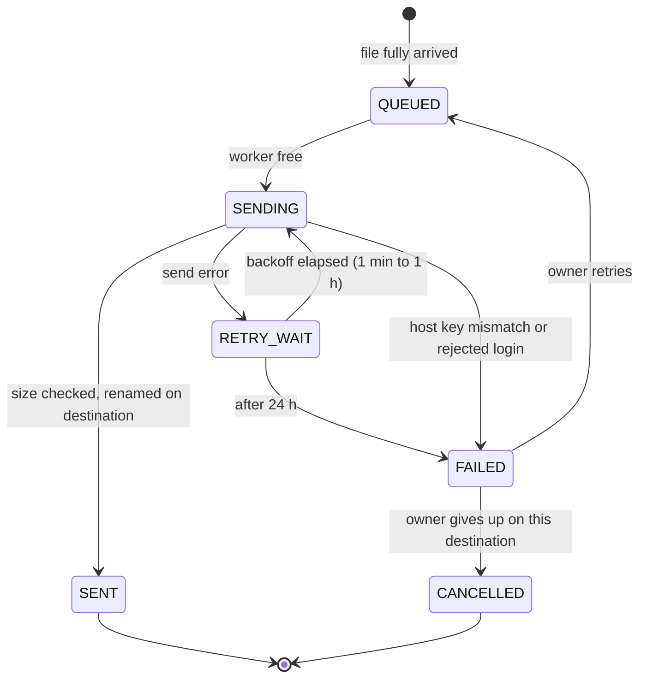

# Folders

[fdrop specification](../SPEC.md)

Besides their private area, standard users create two kinds of managed folder: **shared folders**, where logged-on members exchange files, and **forward folders**, where every file that lands is relayed by fdrop to another SFTP server. Both are created in the web UI or API, never by `mkdir` over SFTP, because they carry settings.

## What a user sees

The same virtual tree appears in the browser and as the SFTP root:

| Path | Contents | Who sees it |
| --- | --- | --- |
| `/home/…` | Private files and ordinary sub-folders | The user only |
| `/shared/<name>/…` | A shared folder's files and sub-folders | Owner and members |
| `/forward/<name>/` | Files waiting for or recently forwarded | Owner and members |

- `/`, `/shared` and `/forward` are read-only listings; creating files or folders directly in them is refused.
- Folder names are unique across fdrop (case-insensitive, 1–100 characters, no `/`), so every member sees the same path.
- In storage, homes live at `users//` and managed folders at `folders/<folderId>/`; renaming a folder changes only its metadata row, never the stored keys.
- Authorisation is checked on every request against this tree: own `/home`, plus the folders where the user is owner or member. Nothing else is reachable, admins included.

## Shared folders

- Shared folders are members-only (decided): users who are not the owner or a member cannot see, list or open them. The creator becomes the **owner** and adds members by username (`GET /api/v1/users?search=` lists matching users with the standard role and application accounts). Application accounts are members on the same terms as people; see Application accounts.
- Each member is **read-write** (upload, create sub-folders, rename, delete) or **read-only** (list and download).
- The owner can rename the folder, change members, transfer ownership to a member, set a default and a maximum expiry for its files (see File expiry), and delete the folder with its contents.
- A member can leave a folder; the owner cannot leave without transferring ownership first.
- Removing a member takes effect on their next request, including open SFTP sessions.
- Uploads into a shared folder count against the **owner's** quota.

## Forward folders

A forward folder pairs a drop location in fdrop with **one or more destination SFTP servers**. When a file finishes arriving — a resumable upload reaches `COMPLETED`, a simple `PUT` completes, or an SFTP write handle is closed — fdrop queues one forward job for it per destination, so every destination receives its own copy.

Users never type a host, path or credential. **Admins define forward destinations** (a server plus a directory) in the admin UI and **assign** each one to users; a user creating a forward folder picks one or more of their assigned destinations from a multi-select drop-down.

**Forward destinations** (admin only):

| Setting | Notes |
| --- | --- |
| Name, description | What users see in the drop-down, e.g. "Partner A – inbound invoices" |
| Host, port | Must also match `forward.allowedHosts`, a server-wide guard against probing internal hosts |
| Remote directory | Fixed per destination; created on first send if missing. Two directories on one server are two destinations |
| Username | The account fdrop logs in as on the destination |
| Server authentication | Pinned host key (SHA-256 fingerprint confirmed from a test connection), or a trusted host CA public key, so any host certificate that CA signs for this hostname is accepted |
| Client authentication | fdrop's own key pair for this destination (Ed25519 by default, generated by fdrop, public key shown for installation on the destination), optionally with an SSH user certificate the destination's CA has signed for it. Passwords are not supported |
| Overwrite existing files | Off by default; when off, a name clash fails the job with a conflict |
| Enabled | Disabling pauses every job to this destination without deleting anything |
| Assigned users | The users who see this destination in their drop-down |

## Mutual authentication

Every forward connection is authenticated in both directions, the SSH equivalent of mutual TLS:

- **fdrop checks the server:** the presented host key must match the pinned fingerprint, or be a valid OpenSSH host certificate signed by the configured CA, unexpired and issued for this hostname. Anything else fails the job immediately, without retry, and never re-pins silently.
- **The server checks fdrop:** fdrop authenticates with the destination's private key (plus its user certificate when one is set). Password and keyboard-interactive authentication are disabled on forward connections.
- MINA SSHD supports OpenSSH certificates on both sides, so no extra library is needed.
- Rotating a client key: the admin generates a new key while the old one stays active, installs the new public key on the destination, runs a test connection, then retires the old key.

## Assignments and the drop-down

- `GET /api/v1/forward-destinations` returns only the enabled destinations assigned to the caller, with name and description; hosts, directories and keys are never shown to standard users.
- A user with no assigned destinations sees the forward folder option disabled, with a hint to ask an admin.
- A forward folder records its chosen destinations. The owner can add and remove destinations later, from their assigned ones; see Several destinations.
- Ownership of a forward folder can only be transferred to a member who is also assigned every one of its destinations. Application accounts can be members of forward folders but never owners, and are never assigned destinations.
- If an admin removes an assignment, that user's forward folders using the destination stop accepting uploads and their queued jobs to that destination pause, until the destination is reassigned or the owner removes it from the folder. Jobs to the folder's other destinations carry on.
- A destination used by any forward folder cannot be deleted, only disabled; the admin UI lists the folders using it.

## Several destinations

A forward folder replicates each file to every destination it lists, for example the same invoices to a partner's production and disaster-recovery servers, or one report to three regional offices.

- **How many.** One to `forward.maxDestinationsPerFolder` destinations (default 5), all different. Each must be enabled and assigned to the owner when it is added.
- **One job per destination.** Each file gets a forward job for each destination. Jobs are independent: each has its own state, attempts, backoff and error, a slow or unreachable destination never holds up the others, and a host key mismatch on one fails only that job.
- **When a file counts as sent.** The file stays in fdrop until every one of its jobs has reached `SENT` (or the owner gave up on a job, below). Only then does "After sending" apply: the file is deleted, or its keep period of N days starts from the last `SENT`. The `upload_record` status becomes `SENT` at the same moment. If the owner gave up on every destination, nothing was sent, so the file stays in fdrop with status `CANCELLED` (shown as Stopped) until the owner deletes it.
- **A file's overall status** is worked out from its jobs, the worst first: Failed if any job failed, then Paused, then Sending (also while a job waits to retry), then Queued; Sent only when every job is sent. The UI adds the count while it is incomplete ("Sending · 2 of 3 sent") and lists each destination with its own state and last error.
- **Giving up on a destination.** A `FAILED` job can be retried, or cancelled by the owner ("Stop sending to Partner B"). A cancelled job counts as finished for the file, so a destination that is gone for good cannot keep files in fdrop forever. Cancelling is audited with the owner and the reason they type.
- **Adding a destination** applies to files that arrive afterwards. Files already in the folder are not sent to it, unless the owner ticks "Also send the N files still in this folder", which queues jobs for files not yet deleted from fdrop.
- **Removing a destination** stops new files from going to it. Jobs already queued to it keep running (as before, a pending job keeps its destination); the owner can cancel any that fail. A folder always keeps at least one destination. Deleting the folder cancels every job not yet sent, since its files are gone.
- **Deleting a destination** is refused while any folder lists it or any job to it is still unsent; disable it instead.
- **Order.** Within a folder, each destination receives files in arrival order, up to `forward.perDestinationConcurrency` at a time; destinations do not wait for one another.

## Per-folder settings

The forward folder's owner chooses:

| Setting | Notes |
| --- | --- |
| Destinations | Multi-select of the destinations assigned to the owner: at least one, at most `forward.maxDestinationsPerFolder` |
| After sending | Delete from fdrop (default) or keep for N days (default 7), once every destination has the file. Keeping is carried out as an expiry of N days from the last send; per-file expiries are not accepted in forward folders (see File expiry) |

## Sending

- A forward worker pool (default 4 threads, `forward.workers`) uses the MINA SSHD SFTP client, streaming from `StorageBackend.openRead` without a local copy.
- Each file is written as `.<name>.fdrop-part` on the destination, its size checked, then renamed to `<name>`, so the receiver never sees a partial file. An existing destination file is overwritten only if the destination allows it (off by default; otherwise the job fails with a conflict).
- Each file has one job per destination of its folder. Jobs run in arrival order per folder and destination, up to 2 at a time per destination (`forward.perDestinationConcurrency`).
- Failures retry with backoff (1 min doubling to 1 h) for up to 24 h, then the job is `FAILED` and the owner sees it in the UI with the error and its destination; a manual retry puts it back in the queue, and cancelling it gives up on that destination for that file.
- Members can upload and see each file's forward status; only the owner can change settings or retry.
- Forwarding is recorded in the audit log (file, size, destination, outcome) and in metrics (jobs by state, bytes forwarded, send latency).

A job only reaches `SENT` after its destination holds the complete file under its final name. The file stays in fdrop until every one of its jobs is `SENT` or `CANCELLED`.

## Forwarding security

- Destination private keys are encrypted at rest with AES-256-GCM using a key from `forward.encryptionKey` (env var or secret file). The API returns only the public key and certificate details, never the private key.
- Only admins can create or change destinations, so standard users cannot point fdrop at arbitrary hosts. `forward.allowedHosts` is a second, server-wide limit that also binds admins; an empty list disables forwarding.
- Every destination change, assignment change and key rotation is written to the audit log with the acting admin.

## Metadata

- `folder(id, type SHARED|FORWARD, name, owner_sub, created_at, default_expiry, max_expiry)`
- `folder_member(folder_id, user_sub, permission READ|WRITE)`
- `folder_forward(folder_id, keep_days)`
- `folder_destination(folder_id, destination_id, added_at, added_by)`, primary key `(folder_id, destination_id)`: a forward folder's one or more destinations
- `forward_destination(id, name, description, host, port, remote_dir, username, server_auth HOST_KEY|HOST_CA, host_key_sha256, host_ca_pubkey, overwrite, enabled, created_by, updated_at)`
- `forward_client_key(id, destination_id, public_key, private_key_enc, user_cert, state ACTIVE|PENDING|RETIRED, created_at)`
- `destination_assignment(destination_id, user_sub)`
- `forward_job(id, folder_id, destination_id, upload_record_id, path, size, state QUEUED|SENDING|RETRY_WAIT|PAUSED|SENT|FAILED|CANCELLED, attempts, last_error, next_attempt_at, created_at, sent_at, cancelled_by, cancel_reason)`, unique on `(upload_record_id, destination_id)`: one job per file and destination
- `upload_record(id, user_sub, file_name, size, went_to HOME|SHARED|FORWARD, folder_id, path_at_upload, current_path, status STORED|MOVED|DELETED|FORWARDED|EXPIRED, via HTTP|SFTP, client_ip, start_ip, completed_at, expires_at)`, indexed on `(user_sub, completed_at)` and `(user_sub, client_ip)`
- Expiry columns and tables are listed under File expiry.
