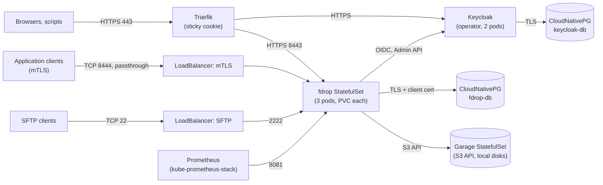

# Kubernetes deployment (fdrop-kubernetes)

[fdrop specification](../SPEC.md)

`fdrop-kubernetes` is a module holding a reference Kubernetes deployment of fdrop with everything it needs: fdrop itself, an S3 object store on the nodes' local disks, PostgreSQL, Keycloak, certificates, ingress, monitoring and network policies. It is written as Terraform-language (HCL) configuration and applied with **OpenTofu**, whose state and plan encryption keeps the secrets it generates safe at rest. It is a working example to copy and adapt, tested on a local `kind` cluster, not a hosted product: the operators of a real cluster own their DNS, load balancers, backups and upgrades.

## Terraform language, OpenTofu runner, secrets

- **One configuration, applied with `tofu`.**
  - The modules are plain HCL using providers from the public registry, so they read like any Terraform configuration.
  - They are applied with OpenTofu (`tofu`, 1.10 or later, pinned in `.opentofu-version`) and not with `terraform`. The root modules use OpenTofu's `encryption` block, which Terraform does not understand.
  - Provider versions are pinned in `versions.tf`, and the lock file (`.terraform.lock.hcl`) is committed.
- **Secrets are generated, not written down.** OpenTofu generates every secret fdrop's deployment needs, with the `random` provider:
  - the Keycloak bootstrap admin password, and the `fdrop-web` and `fdrop-sftp` client secrets
  - the Keycloak database password
  - `forward.encryptionKey`
  - the local storage KEK (when no cloud KMS is used)
  - the management `metricsToken`
  - the object store's RPC secret and admin token, and fdrop's S3 access key id and secret key

  Each is written only to a Kubernetes `Secret` that the workload mounts as a file or reads as an environment variable. No secret is ever in a `.tfvars` file, in Git, in a plan printed to the terminal (all are `sensitive`), or in an output except through `tofu output -raw` on purpose.
- **State and plans are encrypted.** The generated values necessarily live in OpenTofu's state, so every root module turns on state and plan encryption with `method "aes_gcm"` and `enforced = true`, so an unencrypted state or plan is refused. The key provider is chosen per environment:

  | Environment | Key provider | Where the key comes from |
  | --- | --- | --- |
  | `kind` (local demo) | `pbkdf2` | A passphrase in `TF_VAR_state_passphrase`, never stored |
  | `production-example` | `aws_kms` (or `gcp_kms`, or `openbao` transit, by variable) | A KMS key the deployer's role can use; the key never leaves the KMS |

  Production state goes to a remote backend with locking (S3 with a DynamoDB-free lock file in the example). The bucket is still versioned and private, but even read access to it reveals no secret without the KMS key. Rotating the encryption key uses OpenTofu's `fallback` block for one apply, then removes it.
- **Certificates are cert-manager's, not OpenTofu's.** TLS keys are created and renewed inside the cluster by cert-manager, so they never pass through state:
  - fdrop's and Keycloak's public certificates (ACME in production, a local CA on `kind`); fdrop serves its own on its HTTPS and mTLS ports, and Traefik checks it by name when it connects to fdrop
  - the PostgreSQL CA (kept by cert-manager in its namespace, behind a `ClusterIssuer`), and the server and client certificates it issues

  OpenTofu only declares the `Issuer` and `Certificate` resources.
- **Rotating a generated secret:** `tofu apply -replace=module.secrets.random_password.<name>` writes a new value. The changed Secret's checksum is an annotation on the pod template, so the workloads that use it roll. Keycloak's client secrets are the exception: a realm import only creates a realm and never changes one that exists, so after replacing `web_client` or `sftp_client` the same value is set on the client in Keycloak (admin console or `kcadm.sh`). The module README lists each secret's rotation, including the storage KEK, which must be rotated by adding a key and re-encrypting, never by replacing it.

## Layout

```
fdrop-kubernetes/
  pom.xml                      # runs check.sh in the Maven build; e2e/kind-test.sh under -Pkind
  check.sh                     # tofu fmt -check, validate and test, for the build and by hand
  .opentofu-version
  modules/
    platform/                  # cert-manager, CloudNativePG, Keycloak operator, Traefik, optionally kube-prometheus-stack
    secrets/                   # random_* values, written to Kubernetes Secrets
    postgres/                  # CloudNativePG clusters for fdrop and Keycloak, certificates, pg_hba
    keycloak/                  # Keycloak operator CR, realm import, database wiring
    objectstore/               # Garage: the S3 object store on local disks, its layout, bucket and key
    fdrop/                     # fdrop StatefulSet, services, Traefik route, config, policies, monitoring
  environments/
    kind/                      # local demo: one fdrop replica, one Garage node, self-signed CA, dev users
    production-example/        # three fdrop replicas, three Garage nodes, ACME, KMS state encryption, remote backend
  e2e/kind-test.sh             # the end-to-end test on a real kind cluster
```

Each module and the `kind` environment has a `tests/` folder of `tofu test` files with mocked providers.

Each environment is a root module that calls the six modules with its own settings. The modules take everything as variables with checked values (`validation` blocks), so a new environment is one more small root module.

## What runs in the cluster



### Platform (`modules/platform`)

Installed with the `helm` and `kubernetes` providers at pinned chart versions, each in its own namespace, each switchable off for clusters that already have it:
- cert-manager
- the CloudNativePG operator
- the Keycloak operator (its release manifests, vendored into the module and applied with `kubernetes_manifest`)
- Traefik, as the ingress controller, configured with its own `IngressRoute` and `ServersTransport` resources. ingress-nginx is not used: the Kubernetes project retired it in March 2026, and it no longer gets fixes.
- optionally kube-prometheus-stack, for clusters without their own Prometheus Operator

### PostgreSQL (`modules/postgres`)

- **Two CloudNativePG clusters:**
  - `fdrop-db` (three instances in production, one on `kind`) for fdrop
  - `keycloak-db` for Keycloak

  Keeping them apart means neither application's role can reach the other's data, and each can be backed up, upgraded and restored on its own.
- **fdrop's connection is the one Metadata DB connection describes.**
  - cert-manager runs a dedicated `fdrop-db-ca` and issues three certificates from it:
    - the cluster's server certificate (SAN: the `fdrop-db-rw` service names)
    - the CA CloudNativePG uses to check client certificates (`clientCASecret`)
    - fdrop's client certificate, with `CN=fdrop` and a PKCS#8 key (`privateKey.encoding: PKCS8`), renewed 30 days before expiry
  - The cluster's `pg_hba` allows fdrop's role only as `hostssl fdrop fdrop all cert`.
  - fdrop mounts the CA, certificate and key and sets `db.tls.mode: verify-full`. It re-reads them for new connections, so renewals need no restart.
- **Keycloak's connection** uses a generated password over TLS with `sslmode=verify-full` against the same CA, since Keycloak's own database support has no client-certificate login.
- **Backups:** continuous WAL archiving and a daily base backup to an object store bucket (`backup` variable; off on `kind`), using CloudNativePG's backup support. The target must be outside the cluster: a bucket in the in-cluster Garage would sit on the same nodes as the database it backs up, so the module refuses Garage's own endpoint as a backup target. The production example's restore runbook is a `README.md` in its folder.

### Object storage (`modules/objectstore`)

fdrop's files are stored through its S3 backend in an S3-compatible object store that runs in the cluster and keeps its data on the nodes' local disks. No cloud object storage is needed.

- **Garage.** The store is [Garage](https://garagehq.deuxfleurs.fr/): a single small binary built for self-hosted S3 on local disks, with replication across nodes and zones. MinIO is not used because it no longer publishes container images. Garage is AGPL-3.0, and runs here unmodified as its own service that fdrop only talks to over the S3 API, so fdrop's licence is unaffected. The image is pinned by digest.
- **On local disk.**
  - A StatefulSet with two `ReadWriteOnce` volumes per pod, `data` and `meta` (Garage keeps its metadata database apart, preferably on faster disk).
  - The volumes come from a storage class for node-local disks, chosen by variable:
    - `local-path` on `kind` (its built-in provisioner)
    - in production, a local-volume class such as static local PersistentVolumes, OpenEBS LocalPV or TopoLVM
  - A local volume ties each Garage pod to its node; Garage's replication, not the volume, survives losing one.
- **Replication.**
  - Production runs three Garage pods on three different nodes (required anti-affinity), with `replication_factor = 3`. In the layout each node is its own zone (named after its pod), so Garage puts the three copies of every object on three different nodes; the required anti-affinity has already put those pods on different hosts.
  - `kind` runs one with `replication_factor = 1`.
  - The module refuses any other combination: replication greater than the number of pods, or 2.
- **Setup.** A Job runs the Garage CLI against its admin API after each apply, and does only what is missing, so running it again changes nothing:
  - assign every pod its capacity and zone, and apply the layout
  - create the `fdrop` bucket
  - import fdrop's access key with the id and secret OpenTofu generated (`garage key import`), so the key comes from OpenTofu's encrypted state like every other secret
  - allow that key to read and write the bucket, and nothing else
- **fdrop's configuration:**
  - `storage.type: s3`
  - `storage.s3.endpointOverride: https://garage.fdrop-objectstore.svc:3443`
  - `storage.s3.trustedCas`: the internal CA (below)
  - `storage.s3.region: garage`
  - path-style addressing
  - bucket `fdrop`
  - the key from its Secret

  fdrop uses S3's native multipart upload for chunks, `CopyObject` for moves, and `DeleteObjects`, all of which Garage supports. fdrop's S3 backend is tested against Garage (see Tests).
- **HTTPS in front of Garage.** Garage's S3 and admin APIs speak only plain HTTP, so each Garage pod binds them to `127.0.0.1` (3900 and 3903) and runs two [ghostunnel](https://github.com/ghostunnel/ghostunnel) sidecars (distroless image, pinned by digest) that terminate TLS for them: S3 on 3443, admin on 3943. Nothing reaches Garage's HTTP ports from outside the pod. The certificate comes from the cluster's internal CA (`fdrop-internal-ca`, a cert-manager `ClusterIssuer` the platform module creates from a CA OpenTofu generates, so its certificate can go into fdrop's `storage.s3.trustedCas`; the key stays in the encrypted state and cert-manager's namespace, and a new CA is made by the first apply in its last year) and is renewed by cert-manager; the sidecars reload it hourly. Their status ports (3444, 3944, also HTTPS) answer 503 while Garage behind them is down, and are Garage's readiness and liveness probes. A network policy admits only fdrop's pods to 3443, and only the setup Job and Prometheus to 3943; the setup Job checks the certificate against the internal CA. Object contents are already encrypted by fdrop before they leave it (Encryption at rest), so Garage only ever stores ciphertext. Garage's RPC port (3901) between its own pods is not HTTP: Garage encrypts and authenticates it itself with the generated RPC secret.
- **Capacity and monitoring.**
  - A `ServiceMonitor` scrapes Garage's metrics.
  - A `PrometheusRule` adds two alerts:
    - `FdropObjectStoreDiskFull`: a Garage data or metadata volume over 80% full, from the kubelet's volume statistics; warning, critical at 90%.
    - `FdropObjectStoreNodeDown`: a node missing from Garage's cluster health for 10 minutes; critical, because with replication 3 one more loss stops writes.
  - The capacity each node announces in the layout comes from its volume size, so a node with a bigger disk takes a bigger share.
- **Growing.** Raise the `objectstore_replicas` variable, or the volume size where the storage class allows expansion. The setup Job adds the new nodes or capacities to the layout, and Garage rebalances in the background.

### Keycloak (`modules/keycloak`)

- **The server:** a `Keycloak` resource for the Keycloak operator, two instances in production, at `auth.<domain>` through Traefik. Keycloak serves HTTPS only (`http.tlsSecret`, `httpEnabled: false`) with a certificate from the internal CA, and Traefik re-encrypts to it, checking that certificate (a `ServersTransport` trusting the internal CA), so the hop inside the cluster is HTTPS too; a network policy admits only Traefik. It uses `keycloak-db`, and its bootstrap admin comes from the generated Secret.
- **The realm:** a `KeycloakRealmImport` with the `fdrop` realm, rendered from the same source as the dev realm (`.devcontainer/keycloak/fdrop-realm.json`) with its users and secrets taken out. It brings the roles, the `fdrop-applications` group, the three clients, the two-factor browser flow and the `fdrop-sftp` service-account roles. The client secrets come from the generated Secrets through the import's `placeholders`, so they are never in the rendered JSON. On `kind` the import also brings the dev users (`admin`, `jugash`, `app-demo`), for trying it.
- **The first real admin** is created by a person in the Keycloak admin console after the first apply, and is asked to set up two factors at first sign-in. The module prints the steps as an output; it does not create people.

### fdrop (`modules/fdrop`)

- **A StatefulSet, not a Deployment.** Each node keeps its own Lucene search index and audit index on local disk (`search.indexDir`, `audit.indexDir`), so each pod gets its own `ReadWriteOnce` volume (`volumeClaimTemplates`). Its stable name (`fdrop-0`, `fdrop-1`, …) is `audit.node`, so each audit chain stays with its pod across restarts. Pods start one at a time (`OrderedReady`), so Flyway migrations run once, on the first.
- **Storage.** fdrop always uses its S3 backend against the in-cluster Garage store (see Object storage), on every environment, so every replica sees the same files. The pod's own volume holds only the per-node indexes and spool, never stored files.
- **Configuration.** `fdrop.yaml` is a ConfigMap rendered from the module's variables, carrying no secrets. Secrets are mounted files (DB certificate and key, storage KEK, forward key, SFTP host key) or environment variables (`FDROP_AUTH_OIDC_WEBCLIENTSECRET`, …) from the Secrets above. A checksum of both on the pod template rolls the pods when either changes.
- **The SFTP host key** must be the same on every pod, or clients see a different host key each time they connect to a different node. It is generated once (`tls_private_key`, Ed25519) and kept in a Secret; it is the one key that lives in OpenTofu's encrypted state.
- **Traffic.**
  - **HTTPS (browser and API):** Traefik terminates the public certificate and connects to fdrop's HTTPS port, checking fdrop's certificate by its public name (a `ServersTransport` with `serverName`; on `kind` also with the local CA as its root). Browser sessions stay in memory per pod (decided for now; moving them to a shared store is not planned), so Traefik pins each browser to one pod with a secure, HTTP-only cookie (`sticky.cookie` on the route). A pod that restarts or is rescheduled, for example during a rolling update, signs out the browsers pinned to it; they sign in again through Keycloak, whose own SSO session usually makes that a redirect without a password. Scripts with bearer tokens, application accounts and SFTP are not affected. The ingress pods' range is fdrop's `http.trustedProxies`, so client IPs in the audit log are the real ones.
  - **Application mTLS (8444):** a `LoadBalancer` Service passing TCP straight through, because fdrop must see the client certificate itself.
  - **SFTP (port 22, to fdrop's 2222):** a `LoadBalancer` Service with `externalTrafficPolicy: Local` (for real client IPs) and `sessionAffinity: ClientIP`.
  - **Management (8081):** cluster-internal only, and HTTPS like every fdrop port. Probes use `/healthz` (liveness) and `/readyz` (readiness) with `scheme: HTTPS`, and Prometheus scrapes `/metrics` over HTTPS (`scheme: https`, checking fdrop's certificate against its issuer's CA) with the generated token.
- **Monitoring.**
  - A `ServiceMonitor` scraping fdrop's management port over HTTPS.
  - A `PrometheusRule` built from `deploy/prometheus/alerts.yml` itself (the file's `groups` are the rule's `spec.groups`), so Kubernetes and Podman deployments alert on the same rules.
  - The Grafana dashboard `deploy/grafana/fdrop-dashboard.json` as a ConfigMap labelled for Grafana's sidecar.
- **Hardening.**
  - Namespaces labelled for Pod Security `restricted`, except `keycloak`, which enforces `baseline` and warns and audits at `restricted`: the Keycloak operator's own Deployment, and the pods it creates for Keycloak and the realm import, set no restricted security context, and they are the operator's to change.
  - Service links off (`enableServiceLinks: false`): Kubernetes would otherwise put variables such as `FDROP_SFTP_PORT=tcp://…` into fdrop's environment, and fdrop reads every `FDROP_*` variable as a configuration override.
  - Every container runs as non-root, with a read-only root file system (writable `emptyDir` for `/tmp` and the SFTP spool), `seccompProfile: RuntimeDefault`, and all capabilities dropped.
  - Resource requests and limits size the JVM and the forked Tika extractor together (`search.extract.workers` × `forkHeap` plus the server heap).
  - A `PodDisruptionBudget` (`minAvailable: 2` with three replicas) and topology spread across nodes and zones.
- **Network policies.** Default deny in each namespace, then only:
  - Traefik → fdrop 8443 and Keycloak 8443, both HTTPS
  - load balancers → fdrop 8444 and 2222
  - monitoring → fdrop 8081
  - fdrop → `fdrop-db` 5432
  - fdrop → Keycloak
  - fdrop → Garage 3443 (HTTPS)
  - Garage → Garage 3901 (its own replication), the setup Job → Garage 3943 (HTTPS), monitoring → Garage 3943
  - fdrop → port 22 of the CIDRs given for forward destinations (matching `forward.allowedHosts`)
  - Keycloak → `keycloak-db`
  - the CloudNativePG operator → its clusters
- **The image** is fdrop's Jib-built OCI image, referred to by digest (`fdrop_image = "ghcr.io/…/fdrop@sha256:…"`), never by a moving tag.

## Environments

| | `kind` | `production-example` |
| --- | --- | --- |
| Cluster | Created by the `tehcyx/kind` provider (Docker or Podman), with host ports 8443 (HTTPS), 8444 (mTLS) and 2222 (SFTP) mapped to NodePorts, so it runs without root | Existing cluster, from the deployer's kubeconfig |
| fdrop | 1 replica | 3 replicas |
| Object storage | 1 Garage node, replication 1, on `local-path` volumes | 3 Garage nodes on 3 nodes, replication 3, on a local-volume storage class |
| PostgreSQL | 1 instance each, no backups | 3 instances for fdrop, 2 for Keycloak, WAL archiving and daily backups |
| Certificates | A local CA from cert-manager for public names, trusted by fdrop for Keycloak (`auth.oidc.trustedCas`), Traefik and Prometheus; its certificate is an output, to trust in the browser and CLI. The internal CA as in production | Let's Encrypt with DNS-01 on Route 53 for public names; the PostgreSQL CA as on `kind` |
| Public names inside the cluster | `*.localtest.me` resolve to 127.0.0.1 everywhere, so fdrop's pods get `hostAliases` pointing them at Traefik's service, which also listens on 8443 | Public DNS; the load balancer |
| Storage KEK | Generated, in a Secret | AWS KMS key (`storage.encryption.keyProvider: aws-kms`) |
| State | Local file, encrypted with a passphrase | Remote S3 backend, encrypted with KMS |
| Users | The dev realm's users | None; first admin by hand |

`environments/kind/README.md` walks through it:

```bash
export TF_VAR_state_passphrase=…   # any long passphrase; keep it to apply again
tofu init
tofu apply -target=kind_cluster.this                     # the cluster first
kind load image-archive ../../../fdrop-server/target/jib-image.tar --name fdrop
tofu apply
```

fdrop's image is built with `jib:buildTar -Dimage.name=localhost/fdrop` and loaded into the cluster, so nothing is pushed to a registry. The walk-through then covers trusting the CA output, signing in at `https://fdrop.localtest.me:8443`, `curl -u app-demo:app-demo`, `sftp -P 2222`, and finally `tofu destroy`. Keycloak's back-channel logout to fdrop does not work on `kind` (Keycloak does not trust the local CA), so signing out in Keycloak does not end fdrop sessions there.

## Tests

- **Static checks in the Maven build.** `fdrop-kubernetes` is a module of the reactor with `pom` packaging; `exec-maven-plugin` runs `check.sh`, which runs `tofu fmt -check -recursive` and `tofu validate` for both environments in `validate`, and `tofu test` in `test`. Providers are cached in `~/.cache/opentofu/plugins`. `-Dtofu.skip` skips the module on machines without OpenTofu.
- **`tofu test` with mocked providers** (`mock_provider`), so no cluster is needed, in a `tests/` folder beside each module. They check that:
  - fdrop's pod runs as non-root with a read-only root file system, no capabilities, and no service account token
  - fdrop is a StatefulSet with a `ReadWriteOnce` volume per pod, and the pod name is its audit node
  - fdrop stores files in S3 at Garage's in-cluster endpoint, encrypted, and reaches the database with `verify-full`; any other S3 endpoint is refused
  - no generated secret is in fdrop's ConfigMap
  - Traefik routes to fdrop over HTTPS with a secure sticky cookie, and the mTLS service goes straight to fdrop's mTLS port
  - default-deny network policies are in place, and forward destination CIDRs are open on port 22 only
  - the `PrometheusRule` holds every alert in `deploy/prometheus/alerts.yml`
  - an image by tag is refused; a local CA is trusted only when asked
  - Garage keeps three copies on three separate hosts on the local storage class, or one copy with one node; two copies, or more copies than nodes, are refused; only fdrop's namespace reaches its S3 port; the setup Job imports the generated key from its Secret
  - `pg_hba` admits fdrop only with `cert` and nothing without TLS; fdrop's certificate is `CN=fdrop` with a PKCS#8 key, issued into fdrop's namespace; backups to an in-cluster endpoint are refused and others are configured with a daily base backup
  - the realm brings no people and no client secret outside `kind`, points `fdrop-web` at fdrop's URL, and Keycloak checks its database's certificate
  - the whole `kind` environment plans with every module wired together, and a short state passphrase is refused
- **Encryption of state** is checked by the end-to-end test on a real state file (the mocked tests write no state).
- **End to end on kind** (`-Pkind` runs `e2e/kind-test.sh`; in CI nightly and before releases, on a runner with Docker; not inside the dev container). The test:
  1. builds fdrop's image with `jib:buildTar`, creates the cluster with OpenTofu, loads the image, and applies `environments/kind`
  2. checks Keycloak's OIDC discovery through Traefik, that fdrop refuses an anonymous request, and that `app-demo` signs in with its password
  3. uploads 20 MiB as `app-demo` with the chunked upload protocol (at least three chunks), downloads it and compares it byte for byte
  4. uploads over SFTP on the mapped port with a password, and reads the file back over HTTPS
  5. checks with the Garage CLI, inside its pod, that the `fdrop` bucket holds the objects
  6. checks that the state file is encrypted and does not hold the Keycloak admin password in clear
  7. destroys everything (`KEEP_CLUSTER=1` keeps it for a look)

  Registering a client certificate for the mTLS port needs an admin API call with a bearer token carrying the `fdrop-api` audience, which the dev realm's password grant does not issue, so the mTLS path is left to the CLI's integration tests.

## Dev container

- **OpenTofu:** installed from its signed release packages at the version in `.opentofu-version`, so `./mvnw verify` runs the static checks and mocked tests.
- **kind:** not installed in the dev container, since running a cluster inside a rootless container under Podman is not supported here; the end-to-end test runs on the host or in CI.
