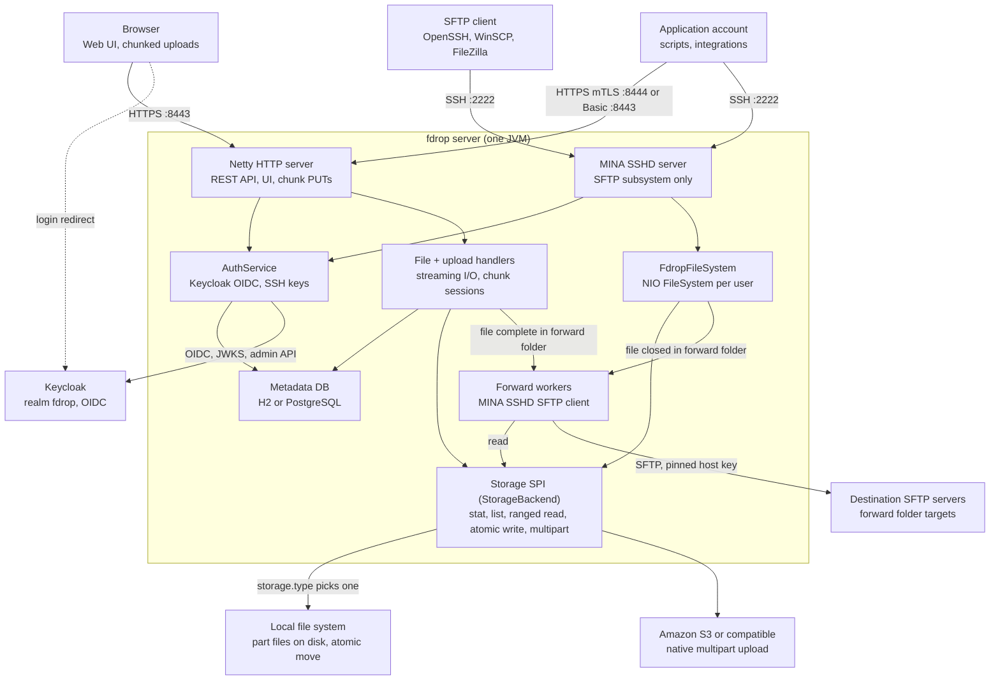

# Overview and architecture

[fdrop specification](../SPEC.md)

## Overview

fdrop is a single JVM service that lets users upload and download files through a browser (HTTP) or an SFTP client, with every file stored in a pluggable backend: the local file system or Amazon S3 (and S3-compatible stores). Browser uploads are split into chunks so a dropped connection resumes from the last acknowledged chunk instead of restarting. Any file can be given an expiry (`6 days`, `2weeks`), after which fdrop deletes it, and users can search the names and contents of every file they can see. Users keep private files, collaborate in shared folders, and drop files into forward folders that fdrop relays to another SFTP server; admins create and delete users, create application accounts that let other systems exchange files over mTLS or a password (with `fdrop`, a Java command line client, for unattended uploads), and define the forwarding destinations each user may use.

### Goals

- One storage abstraction (the Storage SPI) shared by HTTP and SFTP, so a file uploaded one way is downloadable the other.
- Two backends at launch: `local` and `s3`, selected by configuration, no code change.
- Browser uploads of multi-GB files that survive network drops, tab reloads and server restarts.
- SFTP access via Apache MINA SSHD; HTTP via Netty, with streaming I/O and bounded memory regardless of file size.
- Per-user isolation: each user sees only their own files plus the shared and forward folders they belong to.
- Every stored file encrypted at rest with streaming, per-file envelope encryption, on both backends.
- Full-text search over names and contents with Lucene, never returning anything from a file the user cannot open.
- A complete, tamper-evident audit log that admins can read and search in the web app, with its own Lucene index.

### Non-goals (v1)

- File versioning, sync clients, or desktop apps.
- Public anonymous upload links (candidate for v2).
- FTP/FTPS, WebDAV, or SCP (MINA supports SCP; left disabled in v1).
- Hiding file and folder names in storage (contents are encrypted at rest; see Encryption at rest).
- Clustering with shared in-memory state; multiple nodes are supported only via shared storage and a shared metadata DB.

## Architecture

fdrop runs as one process with two protocol front ends, Netty for HTTP and Apache MINA SSHD for SFTP, sitting on shared services: AuthService, the metadata DB and the Storage SPI. Neither front end touches disk or S3 directly.

Browser uploads go through the upload handlers, which track chunk sessions in the metadata DB; SFTP goes through a per-user NIO file system. Both end at the same `StorageBackend`, so files are interchangeable between protocols. Forward workers pick up jobs queued in the metadata DB, read the file through the Storage SPI and send it to the folder's destination SFTP server. The browser signs in at Keycloak (dashed arrow), and AuthService talks to Keycloak for tokens, SFTP passwords and admin user management.

- **Threading:** Netty event loops and MINA NIO threads only parse protocol frames. All storage calls run on a virtual-thread executor, and results are handed back to the channel, so a slow S3 call never blocks a network thread.
- **Backpressure:** HTTP uploads pause `autoRead` while a write is pending; SFTP relies on MINA's window size (default 2 MiB) so a client cannot outrun the backend.
- **Audit log:** every audit event goes to the log file as before and, in batches, to an append-only, hash-chained `audit_event` table; each node also keeps a separate Lucene audit index built from that table, used only by the admin Audit log page (see Audit log).
- **Search:** an embedded Lucene index on each node, fed from a change feed in the metadata DB, with text extracted once per file by Tika in a separate short-lived JVM (see Search). It lives in the `fdrop-search` module behind a `SearchService` interface in `fdrop-core`, so a build without it simply has no search.
- **Encryption:** the backend is always wrapped in `EncryptingStorage`, so every byte written through the Storage SPI is encrypted and every byte read is decrypted and authenticated, whichever front end or worker made the call (see Encryption at rest).
- **Lifecycle:** `fdrop-server` main loads config, runs DB migrations, initialises the chosen backend and its encryption keys, starts HTTP and SFTP, and on SIGTERM stops accepting connections, waits up to 30 s for in-flight transfers, then closes.
