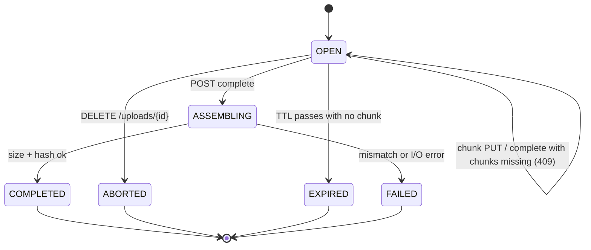

# Resumable chunked uploads

[fdrop specification](../SPEC.md)

A browser upload is a server-side upload session: the client cuts the file into fixed-size chunks, sends each with its own `PUT`, and the server records every acknowledged chunk durably. After a drop, the client asks which chunks the server holds and sends only the missing ones; `complete` then concatenates them in order into the final file.

## Protocol

1. **Create.** `POST /api/v1/uploads` with `{ "path": "/docs/big.iso", "size": 4294967296, "lastModified": 1761130000000, "sha256": "<optional whole-file hash>", "overwrite": false, "expiresIn": "6 days" }` (`expiresIn` optional; see File expiry). Server checks quota, permissions, the expiry against the folder's limits and that the target does not exist (unless `overwrite`), then returns `201 { "id": "upl_01J…", "chunkSize": 8388608, "chunkCount": 512, "expiresAt": "…", "fileExpiresIn": "6 days" }`, where `expiresAt` is when the unfinished session would be abandoned and `fileExpiresIn` the expiry the file will get. Chunk size is chosen by the server: 8 MiB default, raised so `chunkCount` ≤ 10,000 (S3's part limit), never below 5 MiB.
2. **Upload chunks.** `PUT /api/v1/uploads/{id}/chunks/{index}` with `Content-Length` = chunk length (exactly `chunkSize`, except the last chunk) and `X-Chunk-SHA256`. The server streams the body to `MultipartUpload.putPart`, verifying length and hash as it goes. On success it commits the chunk record and returns `204` with `ETag`. Re-sending an already-stored chunk with the same hash is a no-op `204` (idempotent); a different hash returns `409`.
3. **Resume.** After any network error the client calls `GET /api/v1/uploads/{id}` → `{ "state": "OPEN", "received": [[0, 211], [214, 214]], "bytesReceived": … }` (ranges of chunk indexes) and re-queues the gaps. A chunk interrupted mid-body is discarded by the server and simply sent again.
4. **Complete.** `POST /api/v1/uploads/{id}/complete`. The server verifies every index `0..chunkCount-1` is present, calls `MultipartUpload.complete` (local: stream-concatenate into a temp file then atomic move; S3: `CompleteMultipartUpload`), verifies total size and the optional whole-file SHA-256, writes file metadata and the file's expiry, and returns `200` with the file entry (including `expiresAt`). Large local assemblies return `202` and the client polls status until `COMPLETED`.
5. **Abort.** `DELETE /api/v1/uploads/{id}` deletes parts and the session.

## Session states

Only `COMPLETED` writes the target file; every other end state deletes the stored parts, so partial uploads are never visible to downloads or SFTP listings.

## Server-side storage of sessions

- Session and chunk records live in the metadata DB (embedded H2 by default, PostgreSQL for multi-node): `upload_session(id, user_id, target_path, size, chunk_size, chunk_count, sha256, state, backend_upload_id, created_at, updated_at, expires_at, expires_in)` (`expires_at` is the session's own TTL; `expires_in` the file expiry to apply at completion) and `upload_chunk(session_id, idx, size, sha256, etag, received_at)`.
- A chunk row is inserted only after its bytes are durable in the backend (local: `fsync`; S3: `UploadPart` returned), so the DB never claims a chunk that is not stored. A restart loses at most in-flight chunks.
- Chunk data never touches the JVM heap beyond Netty's pooled buffers; the handler pauses `autoRead` while the backend write catches up.
- Two concurrent `PUT`s of the same index: a per-session, per-index lock admits one; the other gets `409` and the client re-checks status.

## Expiry and cleanup

- Sessions expire `upload.ttl` (default 24 h) after their last chunk; any successful chunk extends `expiresAt`.
- A janitor runs every 15 min: marks expired `OPEN` sessions `EXPIRED`, calls `abort()` (deletes local part files or issues `AbortMultipartUpload`), and removes their rows.
- On S3, operators should also set a bucket lifecycle rule `AbortIncompleteMultipartUpload` after 7 days as a backstop.
- Bytes held in open sessions count toward the user's quota so abandoned uploads cannot exhaust disk.

## Client behaviour

- Retry each chunk with exponential backoff (1 s doubling to 60 s, jitter); go to a paused-offline state on `navigator.onLine === false` and resume on the `online` event.
- After a reload, match a re-selected file to its IndexedDB record by name, size and `lastModified`, then resume via status; if the session is gone (`404`), start a new one.
- Hash each chunk with `crypto.subtle.digest('SHA-256')` in the worker; the optional whole-file hash is computed incrementally only when the file is under `upload.clientHashMax` (default 2 GiB) to bound CPU time.
